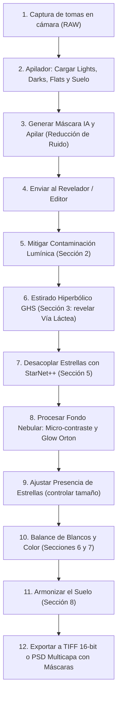

# 📖 Manual de Usuario de AstroLoom

Bienvenido a la guía oficial de **AstroLoom**, una suite integral diseñada específicamente para la captura, apilado y revelado de astrofotografía de paisaje (Nightscapes), cielo profundo de campo amplio y eventos astronómicos.

Este manual ha sido redactado pensando en fotógrafos y aficionados: **sin fórmulas matemáticas complejas ni jerga técnica innecesaria**, explicando qué hace cada botón, para qué sirve cada control deslizante y cuál es el flujo de trabajo paso a paso más eficiente para lograr resultados espectaculares.

---

## 🗺️ Índice General

1. [Filosofía y Módulos de la Aplicación](#1-filosofía-y-módulos-de-la-aplicación)
2. [Flujo de Trabajo Recomendado (Paso a Paso)](#2-flujo-de-trabajo-recomendado-paso-a-paso)
3. [Módulo 1: Apilador (Stacker)](#3-módulo-1-apilador-stacker)
4. [Módulo 2: Revelador / Editor (Guía Detallada de Parámetros)](#4-módulo-2-revelador--editor-guía-detallada)
   - [Sección 1: Presets y Estilos de Revelado](#sección-1-presets-y-estilos-de-revelado)
   - [Sección 2: Contaminación Lumínica y Gradientes](#sección-2-contaminación-lumínica-y-gradientes)
   - [Sección 3: Estirado No Lineal (MTF vs GHS)](#sección-3-estirado-no-lineal-mtf-vs-ghs)
   - [Sección 4: Curvas Tonales (Contraste S-Curve)](#sección-4-curvas-tonales)
   - [Sección 5: StarNet++ y Fondo Nebular (Claridad, Ondículas y Glow Orton)](#sección-5-starnet-y-fondo-nebular)
   - [Sección 5b: Deconvolución Óptica y Enfoque (Richardson-Lucy)](#sección-5b-deconvolución-óptica-y-enfoque-richardson-lucy)
   - [Sección 6: Balance de Blancos y Calibración](#sección-6-balance-de-blancos-y-calibración)
   - [Sección 7: Color, Saturación e Intensidad de Nebulosa](#sección-7-color-saturación-e-intensidad-de-nebulosa)
   - [Sección 8: Tono y Exposición del Suelo](#sección-8-tono-y-exposición-del-suelo)
   - [Sección 9: Gestor de Capas, Máscaras IA y Exportación PSD](#sección-9-gestor-de-capas-máscaras-ia-y-exportación-psd)
   - [Sección 10: Guardado y Gestión de Proyectos (.devloom)](#sección-10-guardado-y-gestión-de-proyectos-devloom)
5. [Módulo 3 y 4: Eclipses (HDR y Collage)](#5-módulos-3-y-4-eclipses-hdr-y-collage)
6. [Módulo 5: Trazas de Estrellas (Startrails)](#6-módulo-5-trazas-de-estrellas-startrails)
7. [Módulo 6: Panorámicas (Mosaicos)](#7-módulo-6-panorámicas-mosaicos)
8. [Atajos de Teclado y Consejos de Productividad](#8-atajos-de-teclado-y-consejos-de-productividad)

---

## 1. Filosofía y Módulos de la Aplicación

AstroLoom opera internamente en **precisión de coma flotante de 32 bits** sin pérdidas de rango dinámico. En la barra superior encontrarás las pestañas de sus diferentes módulos:

| Módulo | Función Principal |
| :--- | :--- |
| **1. Apilador (Stacker)** | Alinea decenas de tomas del cielo para reducir ruido digital y fusiona el paisaje terrestre con máscara de horizonte. |
| **2. Revelador / Editor** | Motor no destructivo de procesado astronómico: estirado hiperbólico (GHS), desacoplo de estrellas con IA, resplandor cósmico Orton y capas. |
| **3. Eclipses (HDR)** | Fusión de tomas con diferentes tiempos de exposición para revelar desde la luna hasta los filamentos tenues de la corona solar. |
| **4. Eclipses (Collage)** | Monta la evolución cronológica del eclipse a lo largo de una trayectoria estética sobre el paisaje. |
| **5. Startrails** | Genera trazas circulares continuas o con efecto cometa eliminando aviones y satélites. |
| **6. Panorámicas** | Une mosaicos multi-panel horizontal y vertical con compensación de estrellas y terreno. |
| **7. Configuración** | Preferencias de aceleración por GPU, rutas de StarNet++ e idioma. |

---

## 2. Flujo de Trabajo Recomendado (Paso a Paso)

Para obtener el máximo partido de tus fotografías nocturnas, sigue este orden recomendado:

---

## 3. Módulo 1: Apilador (Stacker)

El apilador combina múltiples tomas cortas para emular una única exposición ultra-limpia sin ruido y sin que las estrellas salgan movidas por la rotación de la Tierra.

### Pestañas de Archivos
* **⭐ Lights (Tomas de luz):** Las fotos principales de tu cielo nocturno.
* **🌑 Darks (Tomas oscuras):** Fotos tomadas con la tapa del objetivo puesta a la misma temperatura e ISO. Sirven para eliminar píxeles calientes (*hot pixels*) y ruido térmico.
* **💡 Flats (Tomas planas):** Fotos a una superficie blanca uniforme con el mismo enfoque y apertura. Eliminan el viñeteo de las esquinas y las manchas de polvo del sensor.
* **⚡ Bias (Tomas de lectura):** Fotos ultrarrápidas con tapa puesta (mínima velocidad de obturación). Eliminan el ruido de lectura electrónico del sensor.
* **🏞️ Suelo (Foreground):** Una o varias tomas fijas enfocadas y expuestas especialmente para el paisaje terrestre.

### Opciones Clave del Apilador
* **Tipo de Salida:**
  * **📷 Imagen Fija (Compuesto único):** Apila todas las tomas del lote en un archivo final TIFF de 32 bits de rango dinámico superior, ideal para fotografía fija y posterior revelado.
  * **🎬 Vídeo Time-Lapse (Sub-stacking / Ventana Deslizante):** Genera un vídeo continuo `.mp4` en alta definición (1080p, 4K) donde cada fotograma es el resultado de apilar una ventana móvil de tomas consecutivas ($W$). Logra un time-lapse nocturno con la nitidez y limpieza de ruido de una toma de estudio, manteniendo la rotación fluida y natural del cielo estrellado.
* **Parámetros de Vídeo Time-Lapse (Sub-stacking):**
  * *Ventana Deslizante ($W$):* De 3 a 15 tomas (por defecto: 5 tomas). Muestra en directo la ganancia de señal/ruido ($+2.2\times$ SNR, $+1.2\text{ EV}$).
  * *Paso ($Stride$):* Paso 1 (vídeo completo y fluido a 24/30 FPS) o Paso $W$ (bloques discretos acelerados).
  * *Ponderación Temporal:* Gaussiana (máxima nitidez temporal y fidelidad a fenómenos efímeros), Uniforme (máxima reducción de ruido térmico) o Triangular.
  * *Suelo en Vídeo:* Suelo Limpio Apilado (para trípode fijo, erradica el ruido en sombras terrestres) o Suelo de Toma Central (para paneos y sliders motorizados).
  * *Exportación:* Generación directa en contenedor MP4 y casilla para exportar la secuencia completa de imágenes individuales JPEG.
* **Método de Alineación y Registro Estelar:**
  * Detección automática de patrones estelares (ORB/AKAZE) y refinamiento subpíxel por flujo óptico (*Lucas-Kanade*).
  * En modo vídeo, precomputa la cadena de homografías adyacentes en tiempo lineal $O(N)$ con consumo acotado de memoria RAM $O(W)$.
* **Rechazo de Artefactos (Sigma-Clipping / MAD):**
  * Elimina automáticamente las rayas dejadas por satélites (Starlink), estrellas fugaces y aviones que crucen por el encuadre.
* **Detección de Horizonte por IA y Creación/Edición de Máscaras:**
  * **Auto-Detectar Suelo (IA 1-Click):** Segmenta automáticamente cielo y tierra con inferencia neuronal y refinamiento subpíxel por Filtro Guiado, incluyendo recuperación fotométrica adaptativa de ramas finas y follaje a resolución nativa.
  * **Pintar en Máscara:** Aplica al instante los trazos verde (cielo) o rojo (suelo) directamente sobre la máscara activa con centro sólido y borde suavizado local, ideal para retoques manuales inmediatos sin esperar ningún cálculo.
  * **Refinar con GrabCut:** Algoritmo de refinado matemático asistido por trazos. Permite aportar trazos de ambos colores o, si ya cuentas con una máscara base (ej. generada por IA), introducir únicamente trazos verdes o rojos para corregir zonas locales concretas.
  * **Expandir Suelo (+2px) / Contraer (-2px):** Dilatación y contracción morfológica perimétrica en un solo clic para asegurar que ramas finas queden cubiertas o para recortar transiciones no deseadas.
  * **Fusión Anti-Ghosting Continua (SDF):** Emplea campos de distancia con signo (*Signed Distance Function*) para generar una transición óptica suave de 2.5 px de radio (5 px en total) sin bandas translúcidas difusas. Protege de forma prioritaria las estructuras oscuras del suelo contra el cielo estrellado en movimiento, erradicando ramas fantasma y sangrado estelar en árboles y horizontes complejos.
* **Botón "Revelar en Editor ➔":** Una vez terminado el apilado estático, transfiere la imagen de 32 bits directamente a la mesa de revelado.

---

## 4. Módulo 2: Revelador / Editor (Guía Detallada)

El Revelador es el corazón creativo de AstroLoom. Trabaja en tiempo real y permite deshacer/rehacer cualquier acción con `Ctrl+Z` / `Ctrl+Y`.

A continuación se detalla qué hace cada sección y cada uno de sus parámetros de forma intuitiva:

---

### Sección 1: Presets y Estilos de Revelado
Permite aplicar recetas rápidas o guardar tus ajustes favoritos para usarlos en futuras sesiones.
* **Presets Predefinidos:**
  * *Vía Láctea Profunda:* Potencia el contraste del canal central y satura el polvo cálido.
  * *Dorado Sagitario:* Realza las tonalidades ocres y doradas del centro galáctico.
  * *Frío Nórdico:* Estilo limpio y azulado para cielos puros de alta montaña.
  * *H-Alfa Intenso:* Resalta la emisión rojiza/magenta de nebulosas de hidrógeno.
  * *Suave Natural:* Revelado fiel y orgánico para principiantes.
* **Guardar Preset:** Almacena todos los valores actuales de los deslizadores con un nombre personalizado.

---

### Sección 2: Contaminación Lumínica y Gradientes
La atmósfera y las ciudades lejanas crean cúpulas de luz brillante en el horizonte que apagan el brillo de la Vía Láctea. Esta sección elimina esa luz parásita mediante dos enfoques complementarios:

#### A. Extracción Analítica de Gradiente (Modelo Polinómico)
* **Qué hace:** Modela la superficie matemática del fondo del cielo nocturno y la sustrae para dejar el fondo plano y homogéneo.
* **Modelo Polinómico:**
  * **Cuadrático (Grado 2) (Recomendado):** Ajusta una superficie parabólica suave capaz de corregir domos luminosos y viñeteo residual simultáneamente.
  * **Lineal (Grado 1):** Ajusta un plano inclinado bidimensional ideal para gradientes simples en una dirección fija.
* **Aislamiento del Suelo:** Al pulsar **"Extraer Fondo"**, el algoritmo utiliza automáticamente la máscara de cielo actual para muestrear exclusivamente las zonas celestes, garantizando que siluetas oscuras de árboles o montañas no falseen el cálculo ni originen halos negros en el horizonte.
* **Velocidad:** Cálculo nativo e instantáneo en milisegundos sin necesidad de binarios externos ni archivos temporales.

#### B. Reducción Paramétrica y Domo 2D
* **Atenuar Cúpula de Luz (Gradiente 1D):**
  * *Qué hace:* Aplica una atenuación vertical suave que oscurece el resplandor del horizonte devolviendo el contraste a la parte baja del cielo.
* **Reducción Paramétrica 2D (Domo Elíptico):**
  * *Qué hace:* Modela con exactitud la cúpula de luz real de una ciudad, permitiendo descentrarla y darle forma.
  * **Intensidad (%):** Cuánta luz de la cúpula queremos retirar (un 30-60% suele ser ideal).
  * **Posición Centro X / Y:** Dónde está situada la ciudad en la foto.
    * *Consejo:* Usa el botón **"🎯 Marcar en Canvas"** y haz clic directamente sobre el punto más brillante del horizonte en tu imagen.
  * **Anchura (W) y Altura (H):** Ajusta si la contaminación es un domo ancho y bajo o alto y concentrado.
  * **Tinte de Contaminación:** Elige el color de las farolas (Sodio Cálido / Ámbar, Mercurio Frío, LED Blanco Neutro o Personalizado).
  * **Fuerza del Tinte (%):** Permite descontaminar el color amarillento sin dejar zonas grises artificiales.
  * **Modo (Atenuar vs Sustraer):** *Atenuar* reduce la intensidad preservando las estrellas; *Sustraer* resta el fondo como un filtro astronómico de polución.

---

### Sección 3: Estirado No Lineal (MTF vs GHS)
Las imágenes astronómicas apiladas salen casi negras porque la luz del espacio es muy débil. El "estirado" (stretch) amplifica esa luz tenue sin quemar las estrellas brillantes.

Puedes alternar entre dos motores:

#### Modo A: MTF Clásico (Curvas Tradicionales)
* **Medios Tonos (Midtones):** Ilumina progresivamente todo el cielo nocturno sacando la Vía Láctea de la oscuridad.
* **Sombras / Punto Negro (Shadows):** Ajusta el nivel de negro del espacio profundo para que no se vea lavado ni grisáceo.
* **Luces (Highlights):** Controla el punto blanco para evitar que las estrellas más brillantes se saturen.
* **Auto-Estirado MTF:** Analiza el histograma y calcula automáticamente un estirado equilibrado.

#### Modo B: GHS Hiperbólico (Generalized Hyperbolic Stretch)
Es el algoritmo más avanzado de la astrofotografía moderna. A diferencia de las curvas clásicas que inflan las estrellas, GHS enfoca todo el estirado exclusivamente en el polvo cósmico.

* **Factor de Estirado (D):** La fuerza con la que se expande la imagen (entre 5.0 y 20.0 para empezar).
* **Punto de Simetría (SP):** **El parámetro más importante de GHS.** Determina exactamente qué brillo recibirá el máximo contraste.
  * *Consejo:* Pulsa el botón **"🎯 Cuentagotas SP"** y haz clic sobre una nube de polvo o gas de la Vía Láctea que quieras hacer estallar de detalle.
* **Protección de Luces Altas (HP):** Cuanto más alto sea este valor, más protegerá los núcleos de las estrellas para que sigan siendo pequeños puntos afilados.
* **Desplazamiento de Negros (BP):** Ancla el fondo del cielo oscuro para que el estirado no levante ruido de fondo.
* **Modo de Color (Luminancia vs RGB):**
  * *Luminancia (Recomendado):* Estira la luz sin alterar la saturación ni cambiar los tonos originales de las estrellas.
  * *RGB Enlazado:* Estira los tres canales juntos, aumentando la saturación al mismo tiempo.
* **Auto-GHS:** Configura automáticamente D, SP y BP tras una lectura estadística del cielo.

---

### Sección 4: Curvas Tonales
* **Contraste Curva S:** Aumenta la pegada de la imagen oscureciendo sutilmente los tonos medios-bajos e iluminando los medios-altos.
* **Medios Tonos:** Desplaza suavemente el centro de brillo global sin tocar los extremos de negro y blanco.

---

### Sección 5: StarNet++ y Fondo Nebular
Esta sección permite separar la fotografía en dos realidades independientes: el **Fondo Nebular (sin estrellas)** y las **Estrellas**.

* **Botón "Desacoplar Estrellas (StarNet++)":**
  * Ejecuta una red neuronal de inteligencia artificial que borra limpiamente todas las estrellas de la imagen dejando únicamente el polvo galáctico, las nebulosas y el cielo.
  * Se crean automáticamente dos capas independientes en el Gestor de Capas.
* **Presencia de Estrellas (%):**
  * Al mover este control al 50-70%, reduces el tamaño y densidad de las estrellas para que el polvo de la Vía Láctea sea el protagonista sin verse tapado por un millón de puntos blancos.
* **Bloqueo Inteligente de Controles Globales (Coherencia y Rendimiento):**
  * Una vez separadas las capas, los paneles de la izquierda de **Balance de Blancos**, **Color / Saturación** y **Estirado Tonal (MTF/GHS)** se bloquean automáticamente con insignias (`🔒 Integrado`, `🔒 En capas`, `🔒 Base fijada`). Esto previene desincronizaciones cromáticas entre el cielo y las estrellas y ahorra cálculos redundantes en cada redibujado.
  * **La Contaminación Lumínica permanece 100% libre:** Puedes seguir ajustando la cúpula de polución del horizonte en cualquier momento; el motor utiliza una caché lineal intermedia para responder en milisegundos sin recalcular el balance de color.
* **Protección Espectral en la Capa de Estrellas:**
  * En la *"⭐ Capa de Estrellas"*, los deslizadores de Temperatura y Tinte se ocultan para proteger la física cromática natural de las estrellas (índice B-V). La saturación, intensidad y filtro difusor permanecen totalmente configurables.

#### 🚀 Estirado Adaptativo RGB (Starless)
* **Botón "Estirado Adaptativo RGB":** Ubicado directamente bajo la selección de vista del panel StarNet y accesible también desde los controles de la tarjeta de capa *Fondo Nebular (Starless)*.
* **Propósito:** Aplica un estirado no lineal analítico MTF calibrado específicamente para el fondo galáctico sin estrellas. Aísla de forma matemática el cielo mediante la máscara de horizonte, evitando que las sombras oscuras del terreno o el horizonte alteren la mediana y el rango dinámico de las nebulosas.
* **Parámetros configurables en la tarjeta de capa:**
  * **Fondo Objetivo (Target BG):** Nivel de brillo medio asignado al fondo cósmico tras el estirado (por defecto 18%).
  * **Recorte Sombras (σ):** Nivel de corte de punto negro en unidades de dispersión estadística MAD (por defecto 3.0σ), maximizando el contraste sin empastar estructuras débiles.
  * **Realce Saturación:** Multiplicador del canal de saturación HSV (por defecto +50% / 1.5x) para exaltar la crominancia del polvo interestelar y nebulosas de emisión.
  * **Difuminado Horizonte:** Radio gaussiano en píxeles para una transición imperceptible entre el cielo estirado y el suelo base.
  * **Desvincular Canales (Unlinked):** Calcula de forma independiente las curvas de los canales R, G y B, eliminando dominantes frías o verdes del sensor y destacando la calidez dorada del núcleo galáctico.
* **Totalmente No Destructivo:** Compatible con `Ctrl+Z` / `Ctrl+Y`, preservando la base lineal intacta en memoria para reajustes ilimitados.

#### Controles de Textura de Polvo Galáctico
* **Claridad Nebular:** Realza el micro-contraste local en los bordes de los filamentos oscuros de polvo.
* **Dehaze (Anti-Niebla):** Retira la bruma atmosférica aumentando la profundidad visual.
* **Ondículas (Estructura):** Aumenta el relieve y la tridimensionalidad de las nubes moleculares galácticas.
* **Ondículas (Fondo):** Suaviza el grano y el ruido de alta frecuencia del fondo del cielo.
* **Contraste Nebular:** Otorga mayor fuerza y dinamismo a las nubes de gas.
* **Reducción de Ruido (Astro Denoise Multietapa):** Limpia el ruido preservando el detalle mediante filtrado bilateral en luminancia y suavizado de crominancia en espacio YCrCb. Mediante el icono de engranaje (⚙️), permite acceder a:
  * **Ruido Color (Croma):** Filtra manchas térmicas y ruido de color del sensor sin lavar los colores estelares ni los filamentos tenues.
  * **Máscara Bordes/Sombras:** Pondera la doble máscara inteligente (luminancia invertida para actuar en fondos oscuros de bajo SNR y gradiente Sobel para blindar estrellas y filamentos de contraste).
* **Reducción de Ruido por IA (NAFNet / ONNX Runtime):**
  * Motor neuronal convolucional especializado (*Nonlinear Activation Free Network*) ejecutado localmente sin dependencias en la nube.
  * Diseñado para suprimir el grano profundo en fondos estelares y paisajes nocturnos de alta sensibilidad ISO, blindando el filo de las estrellas y el micro-contraste estructural de las nebulosas.

#### ✨ Efecto Orton y Glow Específico para Polvo Galáctico
Crea un halo de luz celestial suave y etéreo alrededor de las partes más luminosas de la galaxia, emulando la técnica analógica inventada por Michael Orton.
* **Intensidad Glow (%):** La cantidad de resplandor que aplicas a la imagen.
* **Radio (Difusión):** El alcance del resplandor en píxeles. Un radio bajo (20-40 px) da un resplandor concentrado; un radio alto (80-120 px) produce una atmósfera cósmica envolvente.
* **Umbral Polvo:** Qué zonas tienen derecho a emitir resplandor.
  * Un valor bajo (0.05) hace que todo el polvo y nebulosas brillen.
  * Un valor más alto (0.20) reserva el efecto únicamente para el brillante centro galáctico.
  * *Importante:* El fondo oscuro del espacio queda protegido para que no se lave ni pierda negros.
* **Tinte Cromático:**
  * *Dorado Vía Láctea:* Calidez natural para el núcleo de Sagitario y Rho Ophiuchi.
  * *Azul Reflexión:* Tinte fresco para nebulosas de reflexión y cúmulos jóvenes.
  * *Rubí H-Alfa:* Tonalidad magenta-rojiza para regiones de hidrógeno ionizado.
  * *Neutro:* Sin alteración de color (monocromático).
* **Modo de Fusión:**
  * *Luz Suave (Recomendado):* Brillo aterciopelado con excelente contraste en medios tonos; **las estrellas no se oscurecen jamás**.
  * *Trama (Screen):* Velo luminoso, transparente y etéreo.
  * *Aditivo:* Resplandor directo de gran energía para efectos dramáticos.

#### 🌟 Filtro Difusor Digital y Realce de Constelaciones (Star Mist Filter)
Emula los prestigiosos filtros físicos de difusión estelar (como *Kenko Pro1D Pro Softon-A*, *Kase Star Diffusion* o *Lee Soft Mist*) y la función *Enhance Star Light* de Sequator de forma matemática y no destructiva:
* **Intensidad Difusor (%):** Cantidad de difusión estelar aplicada. Al 0% permanece desactivado.
* **Radio (Halo):** Diámetro óptico del halo difuso que envuelve a las estrellas (5 a 60 px).
* **Umbral de Magnitud:** Controla qué estrellas reciben el halo difusor:
  * *Valores altos (0.60 - 0.80):* El halo se restringe exclusivamente a las estrellas más brillantes de las constelaciones (Orión, Casiopea, Escorpio, Osa Mayor), haciéndolas destacar como en una carta celeste.
  * *Valores medios (0.35 - 0.50):* Añade un resplandor elegante tanto a las estrellas principales como a las de brillo intermedio.
  * *Protección de estrellas débiles:* Los millones de estrellas diminutas del fondo cósmico quedan protegidas para que permanezcan nítidas y puntuales sin formar niebla.
* **Color Espectral (%):** Recupera el color intrínseco de la estrella a partir de la periferia de su disco de Airy (tipo espectral estelar) y lo propaga por todo el halo (ej. el naranja cálido de Betelgeuse o Antares, el azul eléctrico de Rigel o Vega).
* **Modo de Fusión:**
  * *Trama (Screen - Recomendado):* Velo estelar etéreo y luminoso, libre de quemaduras o saturaciones agresivas.
  * *Luz Suave (Soft Light):* Resplandor aterciopelado con cero oscurecimiento.
  * *Aditivo (Additive):* Energía lumínica directa para una atmósfera nocturna brillante y romántica.
* *Nota:* Disponible de forma contextual al seleccionar la capa **⭐ Estrellas** en el Gestor de Capas o en el revelado general. Protege el horizonte y suelo terrestre mediante la máscara de cielo para no generar halos en luces terrestres ni relieve.

---

### Sección 5b: Deconvolución Óptica y Enfoque (Richardson-Lucy)
Restaura la resolución óptica y nitidez perdida debido a la difracción de la lente, desenfoque atmosférico (*seeing*) o aberraciones de coma/guiado, aflojando los discos estelares y recuperando micro-contraste en filamentos de polvo y nebulosa.

* **🎯 Estimar PSF Automática de Estrellas:** Analiza automáticamente las estrellas aisladas y no saturadas de la imagen para inferir el perfil empírico de la función de dispersión de punto (PSF), determinando con precisión subpíxel el diámetro FWHM y la relación de aspecto/elipticidad.
* **Iteraciones (R-L):** Número de ciclos del algoritmo iterativo de Richardson-Lucy (0 = Desactivado, 1 a 40). Valores entre 10 y 25 proporcionan la máxima nitidez sin introducir grano.
* **FWHM (px):** Ancho a media altura de la PSF modelada (1.0 a 8.0 px). Si se calculó automáticamente con el botón de estimación, se ajusta al valor óptico exacto de tus estrellas.
* **⚙️ Opciones Avanzadas:**
  * **Antianillos (Halos):** Factor de deringing local que calcula un suelo de protección en el entorno de las estrellas más brillantes, eliminando completamente los halos oscuros de Gibbs ("donuts").
  * **Amortiguación Ruido:** Regularización bayesiana basada en la dispersión MAD (*Median Absolute Deviation*) de las altas frecuencias del sensor. Amortigua las iteraciones en áreas suaves de cielo oscuro para que el ruido de fondo no explote.
  * **Aspecto (Elipticidad) y Ángulo (°):** Modela estrellas elongadas por coma en bordes del encuadre o deriva de seguimiento/trípode fijo.
  * **Perfil PSF:** Permite alternar entre el modelo astrofísico **Moffat 2D** ($\beta=4.5$, recomendado para estrellas reales) y el perfil clásico **Gaussiano 2D**.
  * **Ámbito:** Permite enfocar *Toda la Imagen*, *Solo Estrellas* o *Solo Fondo / Nebulosa*.
  * **Solo Luminancia (Preservar color):** Aplica la deconvolución en el canal de luminancia perceptual (ITU-R BT.709) y recompone los canales de color multiplicativamente, garantizando cero aberración cromática o alteración de tonos en las estrellas.

---

### Sección 6: Balance de Blancos y Calibración
* **Temperatura (Azul ↔ Ámbar):** Corrige si la noche se ve demasiado anaranjada o excesivamente gélida.
* **Tinte (Verde ↔ Magenta):** Corrige dominantes verdosas del sensor o del *airglow* atmosférico.
* **🎯 Cuentagotas Gris Neutro:** Haz clic en una zona del cielo donde no haya estrellas ni Vía Láctea (un parche de cielo oscuro libre de nebulosas) para neutralizar la dominante de color al instante.

---

### Sección 7: Color, Saturación e Intensidad de Nebulosa
* **Saturación Global:** Intensifica todos los colores por igual.
* **Intensidad (Vibrance):** Satura primero los tonos apagados y débiles del polvo protegiendo los colores que ya están vivos.
* **Realce de Nebulosa:** Enfatiza selectivamente las longitudes de onda del hidrógeno cósmico (rojos intensos y magentas) y los marrones cálidos del polvo interestelar.

---

### Sección 8: Tono y Exposición del Suelo
Cuando realizamos una fotografía de paisaje nocturno, el suelo terrestre suele quedar demasiado oscuro o con una temperatura de color incompatible con el cielo.
* **Exposición Suelo (EV):** Sube o baja la luz del suelo de forma independiente respecto al cielo (rango de -3.0 EV a +3.0 EV).
* **Tono / Temperatura Suelo:** Permite darle un matiz más frío o cálido al paisaje terrestre sin contaminar el cielo estrellado.
* **Memoria de Suelo:** Si capturaste una toma durante la hora azul o con larga exposición para el suelo, AstroLoom la recuerda y mantiene sus valores de exposición calibrados.

---

### Sección 9: Gestor de Capas, Máscaras IA y Exportación PSD
El compositor multicapa de AstroLoom funciona de manera análoga a Adobe Photoshop o PixInsight, pero automatizado para astrofotografía.

* **Control y Visualización Rápida de Máscara:**
  * **Botón `👁️ Ver Máscara` en la Barra Superior:** Ubicado directamente junto a `🧠 Máscara IA` y `🖌️ Máscara Suelo (M)`. Permite activar u ocultar la superposición en cualquier momento con un solo clic, sin necesidad de desplegar menús ni sub-barras.
  * **Indicador Visual Dinámico:** Cambia a **Verde Brillante (`👁️ Máscara Visible`)** cuando la superposición está proyectándose en pantalla, y a tono oscuro cuando está oculta. Sincronizado en tiempo real con la barra secundaria de trazado.
  * **Generación Limpia por Trazos:** Al calcular la máscara desde trazos (`✨ Generar`), los trazos gruesos de semillas se ocultan automáticamente, dejando visible la máscara refinada calculada.

* **Máscaras con Inteligencia Artificial:**
  * Pulsa **"Generar Máscara IA"**: el modelo neuronal detecta árboles, montañas, personas y arquitectura, creando un recorte limpio sin halos ni bordes blancos entre el cielo y la tierra.

* **Pila de Capas con Miniaturas Visuales Dinámicas (S / M / L):**
  - **Previsualización Fotorrealista en Vivo:** Cada fila de la lista muestra una miniatura nítida con el contenido real de la capa: las estrellas aisladas sobre fondo oscuro en la capa de estrellas, el gas y polvo galáctico a todo color en la capa *Starless*, la silueta del paisaje en la capa de suelo, y máscaras monocromáticas en capas de pincel, luminancia o color.
  - **Selector de Tamaños `[S]`, `[M]`, `[L]`:**
    - **S (Compacto):** Fila de 42 px, ideal para pantallas pequeñas o proyectos con muchas capas.
    - **M (Equilibrado):** Fila de 56 px, tamaño estándar para trabajo cómodo.
    - **L (Amplitud XL):** Fila de 74 px con miniatura de alta resolución (44×66 px en retrato / 75×50 px en apaisado) para inspeccionar núcleos estelares, bordes y detalles finos de un vistazo.
  - **Detección Automática de Orientación:** Si tu fotografía nocturna fue tomada en vertical (retrato) o en horizontal (paisaje), las miniaturas se adaptan automáticamente a la relación de aspecto real de la imagen sin recortar ni deformar la toma.

* **Ajuste de Altura Adaptativo y Tirador de Arrastre Libre:**
  - **Altura Automática Óptima:** La lista de capas calcula por defecto la altura exacta para que se vean todas tus capas sin necesidad de barras de desplazamiento internas molestas.
  - **Tirador Central de Redimensión:** Situado justo debajo de los botones de ordenar capas. Arrastra la barra con el ratón hacia abajo para expandir la lista libremente (hasta 850 px).
  - **Doble Clic para Restaurar:** Haz doble clic sobre el tirador central para volver instantáneamente a la altura automática calculada.
  - **Anti-Colapso al Cambiar de Capa:** Al seleccionar una capa con numerosos controles (como *Fondo Nebular / Starless* con sus paneles de Claridad, Efecto Orton y Glow de polvo), la lista mantiene su altura intacta sin comprimirse nunca a una sola línea.

* **Curvas Tonales Dedicadas por Capa:**
  - Despliega la **"📈 Curva Tonal de Capa"** dentro de cualquier capa (Estrellas, Starless, Suelo, Base o Ajuste local).
  - Permite modelar el contraste, realzar sombras o comprimir altas luces de forma no destructiva e independiente para ese componente específico de la imagen.
  - **Histograma Armonizado en Vivo:** El fondo de la curva muestra la distribución fotométrica real de los píxeles de esa capa concreta (después de su estirado y filtrada por su máscara espacial), lo que te permite colocar los nodos de control exactamente donde reside la información que deseas modular.

* **Máscaras de Rango de Color (HSV) con Pipeta Muestreadora:**
  - **🎯 Muestrear Color en Imagen:** En las capas de tipo Color, activa la pipeta interactiva y pincha directamente sobre el lienzo (nebulosas de emisión H-Alfa, OIII, cúpulas de sodio o airglow).
  - El sistema calcula de forma instantánea el Matiz (Hue de 0° a 360°) y el umbral de saturación mínima a partir de la muestra en pantalla, activando automáticamente la previsualización de la máscara en rojo rubí.
  - También dispones de presets astronómicos rápidos: 🔴 H-Alfa (0°), 🔵 OIII (190°), 🟠 Sodio (38°) y 🟢 Airglow (115°).

* **Herramientas de Pincel:**
  - Pinta manualmente en pantalla para añadir o quitar zonas de ajuste local con control de tamaño y suavizado de borde (*feather*).
* **Capas Nativas:**
  - **🌌 Fondo Nebular:** Ajusta selectivamente el polvo de la Vía Láctea e integra los controles de Estirado Adaptativo RGB, Claridad, Dehaze, Ondículas y Reducción de Ruido multietapa.
  - **⭐ Estrellas:** Ajusta el brillo, nitidez o saturación de las estrellas y los efectos de difusión estelar.
  - **🏞️ Suelo:** Ajusta el paisaje terrestre (exposición, balance de blancos, contraste y curvas tonales locales).
* **Capas de Ajuste Personalizadas:** Crea capas locales para iluminar un árbol, apagar una farola o dar volumen a una nube.
* **Exportación Profesional:**
  - **TIFF 16-bit:** Para impresión o archivo maestro de máxima calidad.
  - **PSD Multicapa (Photoshop):** Exporta el proyecto completo conservando cada capa separada (Cielo, Suelo, Estrellas, Fondo Nebular) y **con sus máscaras de capa reales y editables**, listas para continuar trabajando en Photoshop sin perder nada.

---

### Sección 10: Guardado y Gestión de Proyectos (.devloom)
AstroLoom permite congelar y reanudar todo tu flujo de trabajo en cualquier momento sin perder precisión ni calidad fotométrica.

* **¿Qué es un archivo `.devloom`?**
  * Es un contenedor comprimido (ZIP estándar) autocontenido que almacena el archivo `project.json` con todos los parámetros de revelado (deslizadores de exposición, contraste, GHS, balances, MTF, curvas tonales splines) y las máscaras espaciales de ajuste local en formato **PNG de 16 bits sin pérdida** (`uint16`).
* **Empaquetado de Capas StarNet:**
  * Si desacoplaste las estrellas con StarNet++, AstroLoom guarda dentro del `.devloom` las capas de *Fondo Nebular* y *Estrellas* en formato **TIFF comprimido de 16 bits** (`uint16`). Al reabrir el proyecto, tus capas separadas estarán listas inmediatamente sin necesidad de volver a ejecutar la red neuronal.
* **Flujo de Trabajo y Atajos:**
  * **Guardar Proyecto (`Ctrl + S`):** Si el proyecto ya fue guardado previamente, sobrescribe los cambios de forma instantánea. Si es la primera vez, abre el diálogo para elegir ubicación y nombre.
  * **Guardar Como... (`Ctrl + Shift + S`):** Guarda una copia independiente del proyecto con otro nombre o en otra carpeta.
  * **Abrir Proyecto (`Ctrl + O`):** Permite seleccionar tanto archivos `.devloom` como imágenes astronómicas individuales (TIFF, FITS, PNG, JPG).
  * **Arrastrar y Soltar (Drag & Drop):** Puedes soltar cualquier archivo `.devloom` directamente sobre el lienzo del Revelador para cargarlo de inmediato.
* **Barra de Progreso y Reporte Paso a Paso:**
  * Las operaciones de guardado y apertura muestran un diálogo de progreso modal interactivo (`QProgressDialog`) y notifican cada etapa en el Registro de Actividad (empaquetado de capas, compresión de máscaras de 16 bits, verificación de integridad).
* **Protección contra Pérdida de Trabajo:**
  * Cuando realizas cambios en los controles o capas, el título de la ventana muestra un asterisco (`*`) indicando cambios pendientes. Si intentas abrir otro archivo sin guardar, AstroLoom te preguntará si deseas guardar los cambios antes de continuar.
* **Asistente de Re-vinculación de Imágenes Base:**
  * Si la imagen base original fue movida a otra carpeta o disco, AstroLoom detecta la ausencia y te muestra un diálogo con el **nombre exacto del archivo que busca**, permitiéndote localizarlo con un solo clic y continuar trabajando sin inconvenientes.
* **Historial Limpio:**
  * Al abrir un proyecto `.devloom`, el historial de Deshacer / Rehacer (`Ctrl+Z` / `Ctrl+Y`) se reinicia tomando el estado del proyecto como punto de partida base, evitando saltar accidentalmente a imágenes de sesiones anteriores.

---

## 5. Módulos 3 y 4: Eclipses (HDR y Collage)

* **Selector de Modo Solar / Lunar Ergonómico:** En la cabecera del módulo dispones de un selector por sub-pestañas integradas con iconografía visual específica (☀️ **Eclipse Solar** con corona dorada y 🌙 **Eclipse Lunar** con tinte cyan), lo que permite alternar instantáneamente entre los flujos de trabajo de corona solar y fases de sombra umbral.

### Módulo 3: Eclipses (HDR)
Durante un eclipse total de sol o de luna, el rango dinámico excede la capacidad de cualquier sensor:
* Carga la serie de exposiciones (desde $1/4000\text{ s}$ para las protuberancias solares hasta $2\text{ s}$ para la corona lejana).
* El algoritmo alinea el disco solar/lunar automáticamente mediante detección circular.
* Produce una imagen compuesta de 32 bits donde se aprecian simultáneamente la superficie lunar, las perlas de Baily y los filamentos coronales.

### Módulo 4: Eclipses (Collage)
* Selecciona las fotos clave de las distintas fases (inicio parcial, totalidad, final parcial).
* Elige una trayectoria de composición: *Línea recta diagonal, Arco parabólico o Diamante concéntrico*.
* AstroLoom monta las fases en orden cronológico sobre tu foto de paisaje con espaciado regular y fusión transparente.

---

## 6. Módulo 5: Trazas de Estrellas (Startrails)

Especializado en transformar cientos de fotos fijas en espectaculares círculos de movimiento celeste.

* **Modos de Apilado:**
  * *Máximo (Lighten):* El modo clásico que mantiene los trazos continuos sin oscurecer.
  * *Efecto Cometa:* Añade una cola decreciente a cada estrella para emular una lluvia de meteoros.
  * *Relleno de Huecos (Gap Filling):* Si la cámara tardó 1 segundo entre foto y foto, este filtro rellena las micro-interrupciones para que las trazas sean líneas continuas perfectas.
* **Eliminación de Tráfico Aéreo:**
  * Detecta y suprime automáticamente las luces intermitentes rojas y verdes de los aviones para que no estropeen las trazas.
* **Suelo Estático:**
  * Fusiona una toma limpia del terreno para que los árboles o rocas se vean nítidos y libres de ruido.

---

## 7. Módulo 6: Panorámicas (Mosaicos)

Permite ensamblar mosaicos gigantes del cielo nocturno (por ejemplo, el arco completo de la Vía Láctea de horizonte a horizonte de 180° o 360°).

* **Proyección:**
  * *Cilíndrica:* Recomendada para arcos amplios con horizonte plano.
  * *Esférica:* Recomendada para grandes campos con distorsión angular acentuada.
* **Alineación Híbrida Cielo-Tierra:**
  * Evita que el suelo se deforme mientras resuelve la orientación relativa de las constelaciones.
* **Blending Multibanda:**
  * Iguala el brillo y el balance de blancos entre teselas adyacentes para que no se noten cortes ni cambios de iluminación en el cielo.

---

## 8. Atajos de Teclado y Consejos de Productividad

| Atajo | Acción |
| :--- | :--- |
| `Ctrl + S` | Guardar proyecto actual del Revelador (`.devloom`). |
| `Ctrl + Shift + S` | Guardar proyecto como... con nuevo nombre (`.devloom`). |
| `Ctrl + O` | Abrir proyecto `.devloom` o imagen base en el Revelador. |
| `Ctrl + Z` | Deshacer el último cambio de parámetros o pincel. |
| `Ctrl + Y` / `Ctrl + Shift + Z` | Rehacer la acción deshecha. |
| `J` | Alternar advertencia de recorte (Clipping: sombras azules, luces rojas). |
| `Y` | Activar / Desactivar el comparador Antes / Después (Split-View). |
| `Shift + Y` | Conmutar orientación del comparador Antes / Después (Vertical ↔ Horizontal). |
| `W` | Activar pipeta interactiva de Balance de Blancos en el lienzo. |
| `Z` | Activar / Desactivar lupa de inspección flotante con zoom dinámico. |
| `M` | Conmutar modo de máscara y trazado de suelo. |
| `Espacio + Arrastre` | Moverse por la imagen (*pan*) en cualquier nivel de zoom. |
| `Rueda del Ratón` | Zoom continuo interactivo centrado en el cursor. |
| `Doble Clic en Etiqueta` | Resetea cualquier control deslizante a su valor por defecto. |
| `Doble Clic en Tirador de Capas` | Restaura la altura óptima automática de la lista de capas. |
| `Clic Derecho en Canvas` | Muestra el menú contextual de selección de herramientas. |
| `[ / ]` | Disminuir / Aumentar el tamaño del pincel de máscara. |
| `Shift + Pincel` | Conmuta temporalmente al modo goma de borrar de la máscara. |

---

> [!TIP]
> **Consejo de Oro para Revelado:** No intentes estirar la imagen al máximo en un solo paso. Realiza primero un estirado moderado con GHS (Sección 3), mitiga la luz del horizonte (Sección 2), desacopla las estrellas con StarNet++ (Sección 5), y luego dale el volumen final al polvo galáctico mediante el Glow Orton y la Claridad.

¡Disfruta capturando y revelando el cosmos con **AstroLoom**! 🌌🔭
