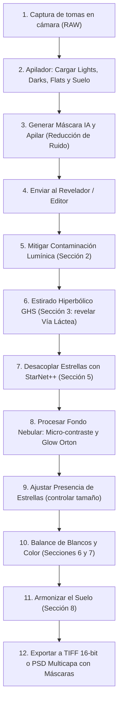

# 📖 Manual de Usuario de AstroLoom

Bienvenido a la guía oficial de **AstroLoom**, una suite integral diseñada específicamente para la captura, apilado y revelado de astrofotografía de paisaje (Nightscapes), cielo profundo de campo amplio y eventos astronómicos.

Este manual ha sido redactado pensando en fotógrafos y aficionados: **sin fórmulas matemáticas complejas ni jerga técnica innecesaria**, explicando qué hace cada botón, para qué sirve cada control deslizante y cuál es el flujo de trabajo paso a paso más eficiente para lograr resultados espectaculares.

---

## 🗺️ Índice General

1. [Filosofía y Módulos de la Aplicación](#1-filosofía-y-módulos-de-la-aplicación)
2. [Flujo de Trabajo Recomendado (Paso a Paso)](#2-flujo-de-trabajo-recomendado-paso-a-paso)
3. [Módulo 1: Apilador (Stacker)](#3-módulo-1-apilador-stacker)
4. [Módulo 2: Revelador / Editor (Guía Detallada de Parámetros)](#4-módulo-2-revelador--editor-guía-detallada)
   - [Sección 1: Presets y Estilos de Revelado](#sección-1-presets-y-estilos-de-revelado)
   - [Sección 2: Contaminación Lumínica y Gradientes](#sección-2-contaminación-lumínica-y-gradientes)
   - [Sección 3: Estirado No Lineal (MTF vs GHS)](#sección-3-estirado-no-lineal-mtf-vs-ghs)
   - [Sección 4: Curvas Tonales (Contraste S-Curve)](#sección-4-curvas-tonales)
   - [Sección 5: StarNet++ y Fondo Nebular (Claridad, Ondículas y Glow Orton)](#sección-5-starnet-y-fondo-nebular)
   - [Sección 6: Balance de Blancos y Calibración](#sección-6-balance-de-blancos-y-calibración)
   - [Sección 7: Color, Saturación e Intensidad de Nebulosa](#sección-7-color-saturación-e-intensidad-de-nebulosa)
   - [Sección 8: Tono y Exposición del Suelo](#sección-8-tono-y-exposición-del-suelo)
   - [Sección 9: Gestor de Capas, Máscaras IA y Exportación PSD](#sección-9-gestor-de-capas-máscaras-ia-y-exportación-psd)
5. [Módulo 3 y 4: Eclipses (HDR y Collage)](#5-módulos-3-y-4-eclipses-hdr-y-collage)
6. [Módulo 5: Trazas de Estrellas (Startrails)](#6-módulo-5-trazas-de-estrellas-startrails)
7. [Módulo 6: Panorámicas (Mosaicos)](#7-módulo-6-panorámicas-mosaicos)
8. [Atajos de Teclado y Consejos de Productividad](#8-atajos-de-teclado-y-consejos-de-productividad)

---

## 1. Filosofía y Módulos de la Aplicación

AstroLoom opera internamente en **precisión de coma flotante de 32 bits** sin pérdidas de rango dinámico. En la barra superior encontrarás las pestañas de sus diferentes módulos:

| Módulo | Función Principal |
| :--- | :--- |
| **1. Apilador (Stacker)** | Alinea decenas de tomas del cielo para reducir ruido digital y fusiona el paisaje terrestre con máscara de horizonte. |
| **2. Revelador / Editor** | Motor no destructivo de procesado astronómico: estirado hiperbólico (GHS), desacoplo de estrellas con IA, resplandor cósmico Orton y capas. |
| **3. Eclipses (HDR)** | Fusión de tomas con diferentes tiempos de exposición para revelar desde la luna hasta los filamentos tenues de la corona solar. |
| **4. Eclipses (Collage)** | Monta la evolución cronológica del eclipse a lo largo de una trayectoria estética sobre el paisaje. |
| **5. Startrails** | Genera trazas circulares continuas o con efecto cometa eliminando aviones y satélites. |
| **6. Panorámicas** | Une mosaicos multi-panel horizontal y vertical con compensación de estrellas y terreno. |
| **7. Configuración** | Preferencias de aceleración por GPU, rutas de StarNet++ e idioma. |

---

## 2. Flujo de Trabajo Recomendado (Paso a Paso)

Para obtener el máximo partido de tus fotografías nocturnas, sigue este orden recomendado:

---

## 3. Módulo 1: Apilador (Stacker)

El apilador combina múltiples tomas cortas para emular una única exposición ultra-limpia sin ruido y sin que las estrellas salgan movidas por la rotación de la Tierra.

### Pestañas de Archivos
* **⭐ Lights (Tomas de luz):** Las fotos principales de tu cielo nocturno.
* **🌑 Darks (Tomas oscuras):** Fotos tomadas con la tapa del objetivo puesta a la misma temperatura e ISO. Sirven para eliminar píxeles calientes (*hot pixels*) y ruido térmico.
* **💡 Flats (Tomas planas):** Fotos a una superficie blanca uniforme con el mismo enfoque y apertura. Eliminan el viñeteo de las esquinas y las manchas de polvo del sensor.
* **⚡ Bias (Tomas de lectura):** Fotos ultrarrápidas con tapa puesta (mínima velocidad de obturación). Eliminan el ruido de lectura electrónico del sensor.
* **🏞️ Suelo (Foreground):** Una o varias tomas fijas enfocadas y expuestas especialmente para el paisaje terrestre.

### Opciones Clave del Apilador
* **Método de Alineación:**
  * *Triángulos / K-NN (Recomendado):* Detecta patrones estelares y rota/alinea cada fotograma con precisión subpíxel.
  * *Transformación Afín / Homografía:* Corrige distorsiones ópticas ligeras entre fotogramas.
* **Rechazo de Artefactos (Sigma-Clipping):**
  * Elimina automáticamente las rayas dejadas por satélites (Starlink), estrellas fugaces y aviones que crucen por el encuadre.
* **Detección de Horizonte por IA:**
  * Pulsa **"Generar Máscara IA"**: el sistema aísla el cielo del suelo automáticamente para que el suelo no se emborrone mientras se alinean las estrellas del cielo.
* **Botón "Revelar en Editor ➔":** Una vez terminado el apilado, transfiere la imagen de 32 bits directamente a la mesa de revelado.

---

## 4. Módulo 2: Revelador / Editor (Guía Detallada)

El Revelador es el corazón creativo de AstroLoom. Trabaja en tiempo real y permite deshacer/rehacer cualquier acción con `Ctrl+Z` / `Ctrl+Y`.

A continuación se detalla qué hace cada sección y cada uno de sus parámetros de forma intuitiva:

---

### Sección 1: Presets y Estilos de Revelado
Permite aplicar recetas rápidas o guardar tus ajustes favoritos para usarlos en futuras sesiones.
* **Presets Predefinidos:**
  * *Vía Láctea Profunda:* Potencia el contraste del canal central y satura el polvo cálido.
  * *Dorado Sagitario:* Realza las tonalidades ocres y doradas del centro galáctico.
  * *Frío Nórdico:* Estilo limpio y azulado para cielos puros de alta montaña.
  * *H-Alfa Intenso:* Resalta la emisión rojiza/magenta de nebulosas de hidrógeno.
  * *Suave Natural:* Revelado fiel y orgánico para principiantes.
* **Guardar Preset:** Almacena todos los valores actuales de los deslizadores con un nombre personalizado.

---

### Sección 2: Contaminación Lumínica y Gradientes
La atmósfera y las ciudades lejanas crean cúpulas de luz brillante en el horizonte que apagan el brillo de la Vía Láctea. Esta sección elimina esa luz parásita.

* **Atenuar Cúpula de Luz (Gradiente 1D):**
  * *Qué hace:* Aplica una atenuación vertical suave que oscurece el resplandor del horizonte devolviendo el contraste a la parte baja del cielo.
* **Reducción Paramétrica 2D (Domo Elíptico):**
  * *Qué hace:* Modela con exactitud la cúpula de luz real de una ciudad, permitiendo descentrarla y darle forma.
  * **Intensidad (%):** Cuánta luz de la cúpula queremos retirar (un 30-60% suele ser ideal).
  * **Posición Centro X / Y:** Dónde está situada la ciudad en la foto.
    * *Consejo:* Usa el botón **"🎯 Marcar en Canvas"** y haz clic directamente sobre el punto más brillante del horizonte en tu imagen.
  * **Anchura (W) y Altura (H):** Ajusta si la contaminación es un domo ancho y bajo o alto y concentrado.
  * **Tinte de Contaminación:** Elige el color de las farolas (Sodio Cálido / Ámbar, Mercurio Frío, LED Blanco Neutro o Personalizado).
  * **Fuerza del Tinte (%):** Permite descontaminar el color amarillento sin dejar zonas grises artificiales.
  * **Modo (Atenuar vs Sustraer):** *Atenuar* reduce la intensidad preservando las estrellas; *Sustraer* resta el fondo como un filtro astronómico de polución.

---

### Sección 3: Estirado No Lineal (MTF vs GHS)
Las imágenes astronómicas apiladas salen casi negras porque la luz del espacio es muy débil. El "estirado" (stretch) amplifica esa luz tenue sin quemar las estrellas brillantes.

Puedes alternar entre dos motores:

#### Modo A: MTF Clásico (Curvas Tradicionales)
* **Medios Tonos (Midtones):** Ilumina progresivamente todo el cielo nocturno sacando la Vía Láctea de la oscuridad.
* **Sombras / Punto Negro (Shadows):** Ajusta el nivel de negro del espacio profundo para que no se vea lavado ni grisáceo.
* **Luces (Highlights):** Controla el punto blanco para evitar que las estrellas más brillantes se saturen.
* **Auto-Estirado MTF:** Analiza el histograma y calcula automáticamente un estirado equilibrado.

#### Modo B: GHS Hiperbólico (Generalized Hyperbolic Stretch)
Es el algoritmo más avanzado de la astrofotografía moderna. A diferencia de las curvas clásicas que inflan las estrellas, GHS enfoca todo el estirado exclusivamente en el polvo cósmico.

* **Factor de Estirado (D):** La fuerza con la que se expande la imagen (entre 5.0 y 20.0 para empezar).
* **Punto de Simetría (SP):** **El parámetro más importante de GHS.** Determina exactamente qué brillo recibirá el máximo contraste.
  * *Consejo:* Pulsa el botón **"🎯 Cuentagotas SP"** y haz clic sobre una nube de polvo o gas de la Vía Láctea que quieras hacer estallar de detalle.
* **Protección de Luces Altas (HP):** Cuanto más alto sea este valor, más protegerá los núcleos de las estrellas para que sigan siendo pequeños puntos afilados.
* **Desplazamiento de Negros (BP):** Ancla el fondo del cielo oscuro para que el estirado no levante ruido de fondo.
* **Modo de Color (Luminancia vs RGB):**
  * *Luminancia (Recomendado):* Estira la luz sin alterar la saturación ni cambiar los tonos originales de las estrellas.
  * *RGB Enlazado:* Estira los tres canales juntos, aumentando la saturación al mismo tiempo.
* **Auto-GHS:** Configura automáticamente D, SP y BP tras una lectura estadística del cielo.

---

### Sección 4: Curvas Tonales
* **Contraste Curva S:** Aumenta la pegada de la imagen oscureciendo sutilmente los tonos medios-bajos e iluminando los medios-altos.
* **Medios Tonos:** Desplaza suavemente el centro de brillo global sin tocar los extremos de negro y blanco.

---

### Sección 5: StarNet++ y Fondo Nebular
Esta sección permite separar la fotografía en dos realidades independientes: el **Fondo Nebular (sin estrellas)** y las **Estrellas**.

* **Botón "Desacoplar Estrellas (StarNet++)":**
  * Ejecuta una red neuronal de inteligencia artificial que borra limpiamente todas las estrellas de la imagen dejando únicamente el polvo galáctico, las nebulosas y el cielo.
  * Se crean automáticamente dos capas independientes en el Gestor de Capas.
* **Presencia de Estrellas (%):**
  * Al mover este control al 50-70%, reduces el tamaño y densidad de las estrellas para que el polvo de la Vía Láctea sea el protagonista sin verse tapado por un millón de puntos blancos.

#### Controles de Textura de Polvo Galáctico
* **Claridad Nebular:** Realza el micro-contraste local en los bordes de los filamentos oscuros de polvo.
* **Dehaze (Anti-Niebla):** Retira la bruma atmosférica aumentando la profundidad visual.
* **Ondículas (Estructura):** Aumenta el relieve y la tridimensionalidad de las nubes moleculares galácticas.
* **Ondículas (Fondo):** Suaviza el grano y el ruido de alta frecuencia del fondo del cielo.
* **Contraste Nebular:** Otorga mayor fuerza y dinamismo a las nubes de gas.
* **Reducción de Ruido:** Limpia el ruido cromático y de luminancia del fondo estelar.

#### ✨ Efecto Orton y Glow Específico para Polvo Galáctico
Crea un halo de luz celestial suave y etéreo alrededor de las partes más luminosas de la galaxia, emulando la técnica analógica inventada por Michael Orton.
* **Intensidad Glow (%):** La cantidad de resplandor que aplicas a la imagen.
* **Radio (Difusión):** El alcance del resplandor en píxeles. Un radio bajo (20-40 px) da un resplandor concentrado; un radio alto (80-120 px) produce una atmósfera cósmica envolvente.
* **Umbral Polvo:** Qué zonas tienen derecho a emitir resplandor.
  * Un valor bajo (0.05) hace que todo el polvo y nebulosas brillen.
  * Un valor más alto (0.20) reserva el efecto únicamente para el brillante centro galáctico.
  * *Importante:* El fondo oscuro del espacio queda protegido para que no se lave ni pierda negros.
* **Tinte Cromático:**
  * *Dorado Vía Láctea:* Calidez natural para el núcleo de Sagitario y Rho Ophiuchi.
  * *Azul Reflexión:* Tinte fresco para nebulosas de reflexión y cúmulos jóvenes.
  * *Rubí H-Alfa:* Tonalidad magenta-rojiza para regiones de hidrógeno ionizado.
  * *Neutro:* Sin alteración de color (monocromático).
* **Modo de Fusión:**
  * *Luz Suave (Recomendado):* Brillo aterciopelado con excelente contraste en medios tonos; **las estrellas no se oscurecen jamás**.
  * *Trama (Screen):* Velo luminoso, transparente y etéreo.
  * *Aditivo:* Resplandor directo de gran energía para efectos dramáticos.

#### 🌟 Filtro Difusor Digital y Realce de Constelaciones (Star Mist Filter)
Emula los prestigiosos filtros físicos de difusión estelar (como *Kenko Pro1D Pro Softon-A*, *Kase Star Diffusion* o *Lee Soft Mist*) y la función *Enhance Star Light* de Sequator de forma matemática y no destructiva:
* **Intensidad Difusor (%):** Cantidad de difusión estelar aplicada. Al 0% permanece desactivado.
* **Radio (Halo):** Diámetro óptico del halo difuso que envuelve a las estrellas (5 a 60 px).
* **Umbral de Magnitud:** Controla qué estrellas reciben el halo difusor:
  * *Valores altos (0.60 - 0.80):* El halo se restringe exclusivamente a las estrellas más brillantes de las constelaciones (Orión, Casiopea, Escorpio, Osa Mayor), haciéndolas destacar como en una carta celeste.
  * *Valores medios (0.35 - 0.50):* Añade un resplandor elegante tanto a las estrellas principales como a las de brillo intermedio.
  * *Protección de estrellas débiles:* Los millones de estrellas diminutas del fondo cósmico quedan protegidas para que permanezcan nítidas y puntuales sin formar niebla.
* **Color Espectral (%):** Recupera el color intrínseco de la estrella a partir de la periferia de su disco de Airy (tipo espectral estelar) y lo propaga por todo el halo (ej. el naranja cálido de Betelgeuse o Antares, el azul eléctrico de Rigel o Vega).
* **Modo de Fusión:**
  * *Trama (Screen - Recomendado):* Velo estelar etéreo y luminoso, libre de quemaduras o saturaciones agresivas.
  * *Luz Suave (Soft Light):* Resplandor aterciopelado con cero oscurecimiento.
  * *Aditivo (Additive):* Energía lumínica directa para una atmósfera nocturna brillante y romántica.
* *Nota:* Disponible de forma contextual al seleccionar la capa **⭐ Estrellas** en el Gestor de Capas o en el revelado general. Protege el horizonte y suelo terrestre mediante la máscara de cielo para no generar halos en luces terrestres ni relieve.

---

### Sección 6: Balance de Blancos y Calibración
* **Temperatura (Azul ↔ Ámbar):** Corrige si la noche se ve demasiado anaranjada o excesivamente gélida.
* **Tinte (Verde ↔ Magenta):** Corrige dominantes verdosas del sensor o del *airglow* atmosférico.
* **🎯 Cuentagotas Gris Neutro:** Haz clic en una zona del cielo donde no haya estrellas ni Vía Láctea (un parche de cielo oscuro libre de nebulosas) para neutralizar la dominante de color al instante.

---

### Sección 7: Color, Saturación e Intensidad de Nebulosa
* **Saturación Global:** Intensifica todos los colores por igual.
* **Intensidad (Vibrance):** Satura primero los tonos apagados y débiles del polvo protegiendo los colores que ya están vivos.
* **Realce de Nebulosa:** Enfatiza selectivamente las longitudes de onda del hidrógeno cósmico (rojos intensos y magentas) y los marrones cálidos del polvo interestelar.

---

### Sección 8: Tono y Exposición del Suelo
Cuando realizamos una fotografía de paisaje nocturno, el suelo terrestre suele quedar demasiado oscuro o con una temperatura de color incompatible con el cielo.
* **Exposición Suelo (EV):** Sube o baja la luz del suelo de forma independiente respecto al cielo (rango de -3.0 EV a +3.0 EV).
* **Tono / Temperatura Suelo:** Permite darle un matiz más frío o cálido al paisaje terrestre sin contaminar el cielo estrellado.
* **Memoria de Suelo:** Si capturaste una toma durante la hora azul o con larga exposición para el suelo, AstroLoom la recuerda y mantiene sus valores de exposición calibrados.

---

### Sección 9: Gestor de Capas, Máscaras IA y Exportación PSD
El compositor multicapa de AstroLoom funciona de manera análoga a Adobe Photoshop o PixInsight, pero automatizado para astrofotografía.

* **Máscaras con Inteligencia Artificial:**
  * Pulsa **"Generar Máscara IA"**: el modelo neuronal detecta árboles, montañas, personas y arquitectura, creando un recorte limpio sin halos ni bordes blancos entre el cielo y la tierra.
* **Herramientas de Pincel:**
  * Pinta manualmente en pantalla para añadir o quitar zonas de ajuste local con control de tamaño y suavizado de borde (*feather*).
* **Capas Nativas:**
  * **🌌 Fondo Nebular:** Ajusta selectivamente el polvo de la Vía Láctea.
  * **⭐ Estrellas:** Ajusta el brillo, nitidez o saturación de las estrellas.
  * **🏞️ Suelo:** Ajusta el paisaje terrestre.
* **Capas de Ajuste Personalizadas:** Crea capas locales para iluminar un árbol, apagar una farola o dar volumen a una nube.
* **Exportación Profesional:**
  * **TIFF 16-bit:** Para impresión o archivo maestro de máxima calidad.
  * **PSD Multicapa (Photoshop):** Exporta el proyecto completo conservando cada capa separada (Cielo, Suelo, Estrellas, Fondo Nebular) y **con sus máscaras de capa reales y editables**, listas para continuar trabajando en Photoshop sin perder nada.

---

## 5. Módulos 3 y 4: Eclipses (HDR y Collage)

### Módulo 3: Eclipses (HDR)
Durante un eclipse total de sol o de luna, el rango dinámico excede la capacidad de cualquier sensor:
* Carga la serie de exposiciones (desde $1/4000\text{ s}$ para las protuberancias solares hasta $2\text{ s}$ para la corona lejana).
* El algoritmo alinea el disco solar/lunar automáticamente mediante detección circular.
* Produce una imagen compuesta de 32 bits donde se aprecian simultáneamente la superficie lunar, las perlas de Baily y los filamentos coronales.

### Módulo 4: Eclipses (Collage)
* Selecciona las fotos clave de las distintas fases (inicio parcial, totalidad, final parcial).
* Elige una trayectoria de composición: *Línea recta diagonal, Arco parabólico o Diamante concéntrico*.
* AstroLoom monta las fases en orden cronológico sobre tu foto de paisaje con espaciado regular y fusión transparente.

---

## 6. Módulo 5: Trazas de Estrellas (Startrails)

Especializado en transformar cientos de fotos fijas en espectaculares círculos de movimiento celeste.

* **Modos de Apilado:**
  * *Máximo (Lighten):* El modo clásico que mantiene los trazos continuos sin oscurecer.
  * *Efecto Cometa:* Añade una cola decreciente a cada estrella para emular una lluvia de meteoros.
  * *Relleno de Huecos (Gap Filling):* Si la cámara tardó 1 segundo entre foto y foto, este filtro rellena las micro-interrupciones para que las trazas sean líneas continuas perfectas.
* **Eliminación de Tráfico Aéreo:**
  * Detecta y suprime automáticamente las luces intermitentes rojas y verdes de los aviones para que no estropeen las trazas.
* **Suelo Estático:**
  * Fusiona una toma limpia del terreno para que los árboles o rocas se vean nítidos y libres de ruido.

---

## 7. Módulo 6: Panorámicas (Mosaicos)

Permite ensamblar mosaicos gigantes del cielo nocturno (por ejemplo, el arco completo de la Vía Láctea de horizonte a horizonte de 180° o 360°).

* **Proyección:**
  * *Cilíndrica:* Recomendada para arcos amplios con horizonte plano.
  * *Esférica:* Recomendada para grandes campos con distorsión angular acentuada.
* **Alineación Híbrida Cielo-Tierra:**
  * Evita que el suelo se deforme mientras resuelve la orientación relativa de las constelaciones.
* **Blending Multibanda:**
  * Iguala el brillo y el balance de blancos entre teselas adyacentes para que no se noten cortes ni cambios de iluminación en el cielo.

---

## 8. Atajos de Teclado y Consejos de Productividad

| Atajo | Acción |
| :--- | :--- |
| `Ctrl + Z` | Deshacer el último cambio de parámetros o pincel. |
| `Ctrl + Y` | Rehacer la acción deshecha. |
| `Espacio + Arrastre` | Moverse por la imagen (*pan*) en cualquier nivel de zoom. |
| `Rueda del Ratón` | Zoom continuo interactivo centrado en el cursor. |
| `Doble Clic en Etiqueta` | Resetea cualquier control deslizante a su valor por defecto. |
| `Clic Derecho en Canvas` | Muestra el menú contextual de selección de herramientas. |
| `[ / ]` | Disminuir / Aumentar el tamaño del pincel de máscara. |
| `Shift + Pincel` | Conmuta temporalmente al modo goma de borrar de la máscara. |

---

> [!TIP]
> **Consejo de Oro para Revelado:** No intentes estirar la imagen al máximo en un solo paso. Realiza primero un estirado moderado con GHS (Sección 3), mitiga la luz del horizonte (Sección 2), desacopla las estrellas con StarNet++ (Sección 5), y luego dale el volumen final al polvo galáctico mediante el Glow Orton y la Claridad.

¡Disfruta capturando y revelando el cosmos con **AstroLoom**! 🌌🔭
