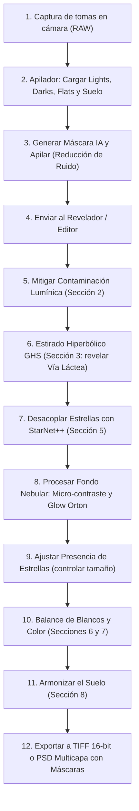
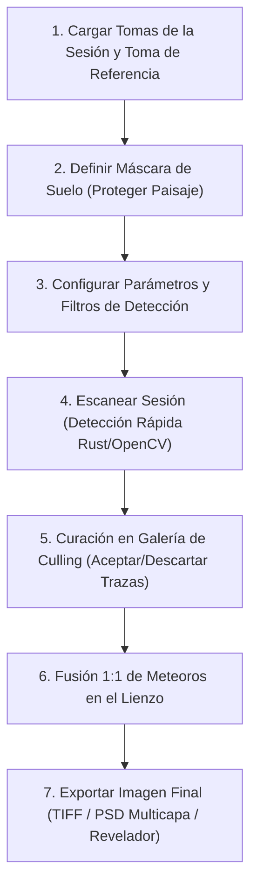

# 📖 Manual de Usuario de AstroLoom

Bienvenido a la guía oficial de **AstroLoom**, una suite integral diseñada específicamente para la captura, apilado y revelado de astrofotografía de paisaje (Nightscapes), cielo profundo de campo amplio y eventos astronómicos.

Este manual ha sido redactado pensando en fotógrafos y aficionados: **sin fórmulas matemáticas complejas ni jerga técnica innecesaria**, explicando qué hace cada botón, para qué sirve cada control deslizante y cuál es el flujo de trabajo paso a paso más eficiente para lograr resultados espectaculares.

---

## 🗺️ Índice General

1. [Filosofía y Módulos de la Aplicación](#1-filosofía-y-módulos-de-la-aplicación)
   - [Arranque Rápido en Windows (astroloom.bat)](#-arranque-rápido-en-windows-astroloombat)
   - [Diagnóstico y Depuración en Windows (astroloom_debug.bat)](#-diagnóstico-y-depuración-en-windows-astroloom_debugbat)
2. [Flujo de Trabajo Recomendado (Paso a Paso)](#2-flujo-de-trabajo-recomendado-paso-a-paso)
3. [Módulo 1: Apilador (Stacker)](#3-módulo-1-apilador-stacker)
4. [Módulo 2: Revelador / Editor (Guía Detallada de Parámetros)](#4-módulo-2-revelador--editor-guía-detallada)
   - [Sección 1: Presets y Estilos de Revelado](#sección-1-presets-y-estilos-de-revelado)
   - [Sección 2: Contaminación Lumínica y Gradientes](#sección-2-contaminación-lumínica-y-gradientes)
   - [Sección 3: Estirado No Lineal (MTF vs GHS)](#sección-3-estirado-no-lineal-mtf-vs-ghs)
   - [Sección 4: Curvas Tonales (Contraste S-Curve)](#sección-4-curvas-tonales)
   - [Sección 5: StarNet++ y Fondo Nebular (Claridad, Ondículas, Denoise y Banding CMOS)](#sección-5-starnet-y-fondo-nebular)
   - [Sección 5b: Deconvolución Óptica y Enfoque (Richardson-Lucy)](#sección-5b-deconvolución-óptica-y-enfoque-richardson-lucy)
   - [Sección 5c: Máscara de Enfoque, Nitidez y Ondículas Multiescala (USM / Wavelets)](#sección-5c-máscara-de-enfoque-nitidez-y-ondículas-multiescala-usm--wavelets-novedades-v0160--v0170)
   - [Sección 6: Balance de Blancos, Calibración Fotométrica (PCC) y Filtros Dual-Band](#sección-6-balance-de-blancos-y-calibración)
   - [Sección 7: Color, Saturación e Intensidad de Nebulosa](#sección-7-color-saturación-e-intensidad-de-nebulosa)
   - [Sección 8: Tono y Exposición del Suelo](#sección-8-tono-y-exposición-del-suelo)
   - [Sección 9: Gestor de Capas, Máscaras IA y Exportación PSD](#sección-9-gestor-de-capas-máscaras-ia-y-exportación-psd)
   - [Sección 10: Guardado y Gestión de Proyectos (.devloom)](#sección-10-guardado-y-gestión-de-proyectos-devloom)
5. [Módulo 3 y 4: Eclipses (HDR y Collage)](#5-módulos-3-y-4-eclipses-hdr-y-collage)
6. [Módulo 5: Trazas de Estrellas (Startrails)](#6-módulo-5-trazas-de-estrellas-startrails)
7. [Módulo 6: Lluvias de Meteoros](#7-módulo-6-lluvias-de-meteoros)
   - [7.1 Filosofía y Arquitectura Híbrida](#71-filosofía-y-arquitectura-híbrida)
   - [7.2 Flujo de Trabajo Paso a Paso](#72-flujo-de-trabajo-paso-a-paso)
8. [Módulo 7: Panorámicas (Mosaicos)](#8-módulo-7-panorámicas-mosaicos)
9. [Visor de Inspección Rápida y Descarte (Blink Viewer)](#9-visor-de-inspección-rápida-y-descarte-blink-viewer)
10. [Atajos de Teclado y Consejos de Productividad](#10-atajos-de-teclado-y-consejos-de-productividad)

---

## 1. Filosofía y Módulos de la Aplicación

### 🚀 Arranque Rápido en Windows (`astroloom.bat`)
Para iniciar AstroLoom en Windows de la manera más cómoda y sin ventanas negras de consola en segundo plano, haz **doble clic sobre el archivo `astroloom.bat`** en la carpeta principal de la aplicación:
* El lanzador detecta automáticamente si existe un entorno virtual local (`.venv` o `venv`) y arranca la interfaz usando `pythonw.exe`.
* Si no hay entorno virtual, recurre automáticamente a la instalación de Python del sistema.
* En entornos Linux/macOS o desde la terminal, puedes iniciar la suite ejecutando `./astroloom.sh` (o directamente `python run_app.py`).

### 🐞 Modo Diagnóstico y Depuración en Windows (`astroloom_debug.bat`, Novedad v0.18.0)
Si experimentas problemas técnicos, deseas reportar una incidencia o necesitas inspeccionar la traza completa de consola:
* Haz **doble clic sobre `astroloom_debug.bat`** en la carpeta principal del proyecto.
* Lanza AstroLoom manteniendo una ventana de consola secundaria activa donde se muestran en tiempo real las trazas completas (*stack traces*), eventos de inicialización de GPU DirectML y registros de `LogHub`.
* En caso de cierre o excepción inesperada, la ventana no se cerrará automáticamente, permitiéndote copiar el diagnóstico o capturar la pantalla.

### ⚡ Motor de Cómputo Nativo en Rust (`astroloom_rs` en v0.19.1)
A partir de las versiones **v0.14.0** a **v0.19.1**, AstroLoom incorpora un motor de cálculo numérico y renderizado de ultra-alta velocidad programado en Rust (`astroloom_rs` vía `PyO3`, `rust-numpy`, `rayon`, `nalgebra` y compresión paralela), totalmente integrado entre bastidores con la interfaz gráfica:
* **Motor de Teselas 512×512 y Kernels Espaciales en Rust para Zoom 1:1 (v0.19.1):** Rejilla fija asíncrona con caché LRU por tesela, prefetch concéntrico en segundo plano con cancelación instantánea, scrubbing fluido a 0.5× al arrastrar deslizadores con refinado atómico 1:1 al soltar y aceleración nativa en Rust para ondículas à-trous, claridad, dehaze, contraste enmascarado, filtro autoguiado, estirado MTF y reducción de ruido astronómica.
* **Plate Solving Offline y Anotaciones Astronómicas (v0.19.0):** Resolución astrométrica sin conexión en Rust (catálogos estándar y profundos), ajuste radial conjunto con nivelación SO(3) en panorámicas y capa de anotaciones con constelaciones IAU, estrellas nombradas y objetos Messier/NGC.
* **Fluidez Total a 60-160+ FPS:** El renderizado del lienzo (`MaskCanvas`) vuelca directamente a búferes de memoria continua `BGRA8888` compatibles de forma nativa con `QImage(Format_RGB32)`. Las alertas de clipping (`J`) y el comparador Antes/Después con cortina (`Y`) se procesan en microsegundos sin crear copias intermedias en NumPy ni capas secundarias de `QPixmap`.
* **Arrastrar y Soltar Global y Clasificación Inteligente (v0.18.0):** Soporte de *Drag & Drop* universal sobre la ventana principal: los proyectos `.devloom` se abren directamente en el Revelador y las imágenes se enrutan a la pestaña activa. El algoritmo `classify_astro_files` cataloga automáticamente lotes de archivos en tomas de *Darks*, *Flats*, *Bias*, *Suelo* y *Lights*.
* **Resiliencia ante Agotamiento de Memoria (OOM) en IA (v0.18.0):** Interceptación guiada de fallos de memoria RAM o GPU DirectML (`MemoryError` / `bad_alloc`) en StarNet++ v2 y NAFNet Denoise (cielo y suelo), liberando memoria de inmediato con `gc.collect()` y mostrando al usuario recomendaciones directas de optimización (aumento de Stride, recorte previo o caché en disco).
* **Diagnóstico de Modelos Neuronales en Ajustes (v0.18.0):** Panel de supervisión en tiempo real del estado de los pesos ONNX de StarNet v2, NAFNet y SkySeg Horizon, reportando tamaño en disco, GPU DirectML y verificación manual en un clic.
* **Cierre Seguro y Purga Automática de Temporales (v0.18.0):** Comprobación interactiva de cambios pendientes en proyectos del Revelador al cerrar la suite, junto con la eliminación automática garantizada de archivos y carpetas temporales huérfanas en `%TEMP%` (`starnet_run_*`, `astroloom_pano_burst_*`).
* **Exportación Web y Redes Sociales Integrada (v0.18.0):** Motor de re-escalado de alta fidelidad con espacio de color sRGB estandarizado, re-enfoque adaptativo USM, firmas/marcas de agua en 9 cuadrantes y plantillas dedicadas para Instagram, Twitter/X, Stories y AstroBin.
* **Viñeteo, Ganancia In-Place y Curvatura de Arco Zero-Mesh en Rust (v0.17.2):** Corrección analítica continua de caída perimétrica de luz y deformación geométrica vertical del arco panorámico en Rust multihilo con Rayon, evaluada *in-place* en memoria contigua sin copias intermedias.
* **Fusión Robusta y Previsualización Rápida Borrador en Panorámicas (v0.17.2):** Generación ultrarrápida del mosaico previo a escala 25% (*Draft*) para validación ágil de teselas antes del cosido final, y margen de seguridad de 8192 niveles en `MultiBandBlender` contra desbordamiento en zonas hiperluminosas.
* **Filtros Coronales NAFE y WOW Nativos en Rust (v0.17.1):** Evaluación de ecualización difusa adaptativa NAFE con convolución FFT 2D en memoria nativa (`realfft`) y paralelización Rayon multinivel, junto al blanqueamiento de ondículas WOW con suavizado recursivo IIR acelerado al 100% en CPU.
* **Pipeline de Exportación Zero-Copy e In-Place en Rust (v0.17.0 / v0.17.1):** El grafo de capas se evalúa y fusiona en registros de CPU en un único bucle paralelo multihilo de Rayon en Rust, eliminando arrays temporales de NumPy y volcando a enteros `uint16` in-place, lo que acelera entre un 40% y 60% la exportación de proyectos `.devloom` y archivos PSD multicapa.
* **Purga Inteligente Anti-Satélites por Transformada de Hough (v0.17.0):** Escaneo geométrico de trazas lineales a escala 50% con evaluación monocanal de alta velocidad en circumpolares (`Startrails`), suprimiendo satélites artificiales y aviones mientras se preservan con fidelidad las estrellas y trazas circulares.
* **Barra de Progreso Unificada en Lienzo (`CanvasFooterBar`, v0.17.0 / v0.17.2):** Integración homogénea de barras de progreso contextuales directamente sobre la base del lienzo en todos los visores y módulos (Revelador, Circumpolares, Meteoros, Panorámicas, Eclipses y Apilador), con cancelación reactiva instantánea y dimensiones ampliadas de alto contraste (290x16 px).
* **Purga Integral de Numba y Mapeo LUT 16 a 8 Bits en Rust (v0.16.0):** Eliminación total de dependencias LLVM/Numba, reduciendo 2.36 s en el arranque en frío. El estirado interactivo MTF, GHS y curvas tonales se evalúa en Rust Rayon (`apply_display_lut16_rs`, `apply_display_lut16_dual_rs`) a más de 4.000 FPS (0.24 ms por frame de 2 MP), con cálculo de histograma multihilo en OpenCV C++ AVX2/SSE.
* **Aceleración Nativa para Eclipses Solares (v0.16.0):** Centrado solar automático de sub-milisegundo por momentos (`center_solar_disc_rs`), estirado Asinh Luma preservando el color (`asinh_stretch_luma_rs`) y fusión coronal HDR adaptativa multiescala (`coronal_hdr_fusion_rs`) ejecutados en registros paralelos de CPU.
* **Caché LRU de Búferes con Presupuesto de RAM (v0.16.0):** Gestor inteligente de memoria para hitos del pipeline con cuota máxima configurable en MB/GB, purgando búferes antiguos y manteniendo el consumo de memoria acotado incluso en proyectos de alta densidad.
* **Resiliencia de Hardware y Fallback GPU a CPU en IA (v0.16.0):** StarNet++ v2 y AI Denoise detectan automáticamente desbordamientos de memoria de GPU (VRAM OOM) y conmutan en caliente a inferencia CPU sin bloquear el proceso ni perder el trabajo, alertando al usuario mediante una píldora visual en la barra superior.
* **Pincel Acelerado en Rust y Refresco por Dirty-Rects (v0.15.1):** Estampado continuo de trazos de pincel (`stamp_brush_stroke_rs`) con interpolación polinómica Hermite, cálculo analítico de región de interés (ROI) y actualización directa *in-place* sobre búferes compartidos sin reasignación de memoria de pantalla, permitiendo pintar máscaras a 60–144 FPS estables sin tirones ni latencia.
* **Curvas Selectivas Hue/Luma Fusionadas en Registros (v0.15.1):** Bucle paralelo compilado en Rust (`apply_hue_luma_curves_fused_rs`) que procesa simultáneamente las curvas de Tono vs Saturación y Luminancia vs Saturación, eliminando las conversiones intermedias de espacio de color RGB $\leftrightarrow$ HSV y multiplicando por más de 10 la tasa de refresco.
* **Pirámides de Mipmaps para Pincel y Gestión Ligera de Historial (v0.15.1):** Caché de máscaras de pincel multinivel (`brush_mask_preview` ≤1600 px y `brush_mask_draft` ≤800 px) e instantáneas ultraligeras de capas (`shallow_snapshot`) que excluyen arrays pesados de la pila de deshacer/rehacer, reduciendo drásticamente el consumo de memoria RAM.
* **Máscaras Vectoriales y Gradientes Analíticos en Rust (v0.15.0):** Kernels Rayon paralelos (`compute_linear_gradient_rs`, `compute_radial_gradient_rs`) para evaluar degradados analíticos continuos (Hermite smoothstep, lineal, exponencial, reflejado) a más de 120 FPS sin consumo dinámico en el heap.
* **Kernels Fused de Ajustes de Capa y Modos de Fusión (v0.15.0):** Evaluación conjunta en un solo ciclo multihilo (`apply_layer_adjustments_fused` y `apply_blend_mode_rs`) para exposición, contraste, altas luces, sombras, saturación, temperatura, tinte y curvas LUT con modos Normal, Screen, Luminosidad, Soft Light, Overlay y Multiply.
* **Máscaras de Rango de Color y Luminancia Compiladas (v0.15.0):** Segmentación instantánea por tono angular y luminancia (`generate_luminance_range_mask_rs`, `generate_color_range_mask_rs`) acelerada en Rust.
* **Filtrado Coronal Multihilo Científico (Eclipses):** Kernels dedicados en Rust con Rayon para segundas derivadas orientables por tensor de estructura (`steerable_g2_rs`), convolución rotacional de Keys ($a = -0.5$, `compute_larson_sekanina_rs`), mediana circular polar (`polar_circular_median_filter_rs`), pasos à-trous B3 guiados (`paired_b3_step_rs`), máscaras de protuberancias (`compute_red_excess_mask_rs`) y mapeo anular concéntrico (`display_detail_rings_rs`).
* **Ahorro Masivo de Memoria RAM:** La calibración de tomas RAW (Darks, Bias, Flats) opera *in-place* sobre la matriz nativa de fotodiodos sin copias en coma flotante (0 bytes de RAM adicional), y la extracción de gradientes RBF ahorra más de 1.3 GB de memoria en imágenes de 24 a 60 MP.
* **Poda Integral de Dependencias Externas:** Eliminadas las dependencias pesadas de `pytoshop`, `astropy` y `psutil`. AstroLoom ahora incluye lectores/escritores nativos en Rust para FITS (`fits_io`), PSD multicapa de 16 bits (`psd_writer`) y monitoreo de memoria del sistema operativo (`system_info`).
* **Ingesta Concurrente de Lotes:** Escaneo multihilo en paralelo de metadatos EXIF, dimensiones y niveles negros de cientos de archivos RAW en décimas de segundo al arrastrar carpetas al Apilador o Startrails.
* **Tiling ONNX y Filtro Guiado O(1):** Pre y post-procesado acelerado para StarNet++ v2 y NAFNet con ventanas 2D de Hann continuas, y refinado de bordes de horizonte con imágenes integrales (SAT) en ~21 ms.
* **Resiliencia Automática (*Drop-in Fallback*):** Si en algún entorno el módulo binario no estuviera presente, AstroLoom conmuta de forma transparente y automática a su motor de reserva en Python/NumPy sin que el usuario experimente errores.

### 🖥️ Cabecera de Telemetría Superior y Espacio Útil (v0.16.0 / v0.19.1)
Para maximizar el área de trabajo vertical dedicada al lienzo de revelado y apilado, se ha suprimido la barra de estado inferior (*status bar*), reubicando toda la información de diagnóstico y monitorización en la esquina superior derecha de la barra de pestañas:
* **Insignia del Motor:** Identifica en todo momento la versión activa de la suite (`● AstroLoom Engine v0.19.1`).
* **Píldora de Alerta Fallback GPU $\rightarrow$ CPU:** Si tu tarjeta gráfica se satura de memoria (VRAM) durante la ejecución de StarNet++ o AI Denoise, se enciende una píldora ámbar (`⚠️ Fallback CPU (VRAM)`) indicando que el proceso continuó en CPU de forma segura. Puedes pinchar en ella para ocultarla.
* **Monitor de RAM en Tiempo Real:** Muestra el porcentaje y los gigabytes de memoria en uso del sistema operativo (`RAM: XX% (used / total GB)`), actualizado mediante telemetría cada 2.5 segundos.
* **Botón de Registro de Actividad:** Abre una ventana flotante con el histórico cronológico de operaciones, advertencias, tiempos de ejecución y telemetría de depuración.

---

AstroLoom opera internamente en **precisión de coma flotante de 32 bits** sin pérdidas de rango dinámico. En la barra superior encontrarás las pestañas de sus diferentes módulos:

| Módulo | Función Principal |
| :--- | :--- |
| **1. Apilador (Stacker)** | Alinea decenas de tomas del cielo para reducir ruido digital y fusiona el paisaje terrestre con máscara de horizonte. |
| **2. Revelador / Editor** | Motor no destructivo de procesado astronómico: estirado hiperbólico (GHS), desacoplo de estrellas con IA, resplandor cósmico Orton y capas. |
| **3. Eclipses (HDR)** | Fusión de tomas con diferentes tiempos de exposición para revelar desde la luna hasta los filamentos tenues de la corona solar. |
| **4. Eclipses (Collage)** | Monta la evolución cronológica del eclipse a lo largo de una trayectoria estética sobre el paisaje. |
| **5. Startrails** | Genera trazas circulares continuas o con efecto cometa eliminando aviones y satélites. |
| **6. Lluvias de Meteoros** | Detecta bólidos en cientos de tomas, los reproyecta al radiante celeste compensando la rotación terrestre y los compone con flujo neto. |
| **7. Panorámicas** | Une mosaicos multi-panel horizontal y vertical con compensación de estrellas y terreno. |
| **8. Configuración** | Preferencias de aceleración por GPU, rutas de StarNet++ e idioma. |

---

## 2. Flujo de Trabajo Recomendado (Paso a Paso)

Para obtener el máximo partido de tus fotografías nocturnas, sigue este orden recomendado:

---

## 3. Módulo 1: Apilador (Stacker)

El apilador combina múltiples tomas cortas para emular una única exposición ultra-limpia sin ruido y sin que las estrellas salgan movidas por la rotación de la Tierra.

### Pestañas de Archivos
* **Botones Superiores de Ingesta:** En la cabecera superior, justo encima del selector de pestañas, los botones **«Añadir Tomas...»** y **«Limpiar Pestaña»** permanecen siempre visibles y a mano sin importar la longitud de tu lista de archivos.
* **⭐ Lights (Tomas de luz):** Las fotos principales de tu cielo nocturno.
* **🌑 Darks (Tomas oscuras):** Fotos tomadas con la tapa del objetivo puesta a la misma temperatura e ISO. Sirven para eliminar píxeles calientes (*hot pixels*) y ruido térmico.
* **💡 Flats (Tomas planas):** Fotos a una superficie blanca uniforme con el mismo enfoque y apertura. Eliminan el viñeteo de las esquinas y las manchas de polvo del sensor.
* **⚡ Bias (Tomas de lectura):** Fotos ultrarrápidas con tapa puesta (mínima velocidad de obturación). Eliminan el ruido de lectura electrónico del sensor.
* **🏞️ Suelo (Foreground):** Una o varias tomas fijas enfocadas y expuestas especialmente para el paisaje terrestre.
* **Calibración Matemática en Espacio Puro CFA (Pre-Debayer In-Place en Rust):** Al cargar tomas maestras de calibración (Darks, Flats, Bias), AstroLoom sustrae el exceso térmico y corrige el viñeteo directamente sobre los fotodiodos de la matriz Bayer mediante el módulo nativo en Rust (`streaming_io.rs`) antes de la interpolación de color, operando *in-place* con 0 bytes de RAM adicional, garantizando máxima fidelidad cromática y cero artefactos de esquina.

### Opciones Clave del Apilador
* **Tipo de Salida:**
  * **📷 Imagen Fija (Compuesto único):** Apila todas las tomas del lote en un archivo final TIFF de 32 bits de rango dinámico superior, ideal para fotografía fija y posterior revelado.
  * **🎬 Vídeo Time-Lapse (Sub-stacking / Ventana Deslizante):** Genera un vídeo continuo `.mp4` en alta definición (1080p, 4K) donde cada fotograma es el resultado de apilar una ventana móvil de tomas consecutivas ($W$). Logra un time-lapse nocturno con la nitidez y limpieza de ruido de una toma de estudio, manteniendo la rotación fluida y natural del cielo estrellado.
* **Parámetros de Vídeo Time-Lapse (Sub-stacking):**
  * *Ventana Deslizante ($W$):* De 3 a 15 tomas (por defecto: 5 tomas). Muestra en directo la ganancia de señal/ruido ($+2.2\times$ SNR, $+1.2\text{ EV}$).
  * *Paso ($Stride$):* Paso 1 (vídeo completo y fluido a 24/30 FPS) o Paso $W$ (bloques discretos acelerados).
  * *Ponderación Temporal:* Gaussiana (máxima nitidez temporal y fidelidad a fenómenos efímeros), Uniforme (máxima reducción de ruido térmico) o Triangular.
  * *Suelo en Vídeo:* Suelo Limpio Apilado (para trípode fijo, erradica el ruido en sombras terrestres) o Suelo de Toma Central (para paneos y sliders motorizados).
  * *Exportación:* Generación directa en contenedor MP4 y casilla para exportar la secuencia completa de imágenes individuales JPEG.
* **Método de Alineación y Registro Estelar:**
  * Detección automática de patrones estelares (ORB/AKAZE) y refinamiento subpíxel por flujo óptico (*Lucas-Kanade*).
  * **Alineación Elástica No Rígida por Thin Plate Splines (TPS):** En tomas de cielo profundo o con montura de seguimiento (*tracker*), genera una malla elástica de deformación subpíxel con interpolación `cv2.INTER_LANCZOS4`, erradicando la distorsión periférica diferencial en las esquinas por rotación de campo en objetivos gran angular.
  * En modo vídeo, precomputa la cadena de homografías adyacentes en tiempo lineal $O(N)$ con consumo acotado de memoria RAM $O(W)$.
* **Auto-Selección Inteligente de Toma de Referencia:**
  * Al evaluar el cribado de tomas o iniciar el proceso, AstroLoom analiza las métricas de calidad óptica (menor FWHM, mayor censo estelar y contraste) y selecciona de forma automática la toma óptima como referencia maestra geométrica y fotométrica.
* **Diagnóstico Óptico 3x3 y Detección de Curvatura de Campo / Sensor Tilt:**
  * Al pulsar **«Analizar Calidad»**, la suite evalúa el FWHM y la excentricidad estelar en 9 zonas del sensor ($3\times 3$).
  * En la lista de tomas, el tooltip de calidad desglosa las medidas y clasifica anomalías individuales.
  * Además, al finalizar el análisis, el registro del sistema ofrece un informe global determinando si la sesión sufre de **Curvatura de Campo** (necesidad de corregir backfocus con el aplanador) o de **Inclinación de Sensor / Tilt Mecánico** (holguras en el enfocador o anillo adaptador).
* **Normalización Fotométrica Previa (Linear Fit):**
  * Ajuste lineal por canal ($I'_k = a_k \cdot I_k + b_k$) antes del rechazo Kappa-Sigma. Iguala la dispersión y el pedestal del fondo de cada toma respecto a la referencia, neutralizando gradientes dinámicos, nubes tenues pasajeras o cambios en la transparencia atmosférica.
* **Integración Kappa-Sigma Adaptativa Ponderada (Motor Rust en Caché L1):**
  * Ponderación matemática ejecutada en paralelo sobre la memoria caché L1/L2 de la CPU mediante kernels nativos en Rust (`kappa_sigma_kernel` con Quickselect $O(N)$), donde cada toma aporta al apilado en proporción inversa a su FWHM ($1 / \text{FWHM}^2$), maximizando la nitidez estelar y la relación señal/ruido (SNR) final sin degradar zonas afectadas por viento o peor seeing.
* **Modos de Integración de Suelo Terrestre:**
  * **Toma de Referencia:** Conserva el paisaje estático nítido de la toma maestra seleccionada.
  * **Min-Stack (Anti-ghosting / Vegetación):** Fusión por percentil mínimo ($P_{10}$) diseñada para eliminar ramas batientes, hierba mecida por el viento, vehículos o personas en movimiento en el horizonte.
  * **Mediana:** Fusión estadística para reducción uniforme de ruido térmico en paisajes terrestres completamente inmóviles.
* **Rechazo de Artefactos (Sigma-Clipping / MAD):**
  * Elimina automáticamente las rayas dejadas por satélites (Starlink), estrellas fugaces y aviones que crucen por el encuadre.
* **Detección de Horizonte por IA y Creación/Edición de Máscaras:**
  * **Auto-Detectar Suelo (IA 1-Click):** Segmenta automáticamente cielo y tierra con inferencia neuronal y refinamiento subpíxel por Filtro Guiado, incluyendo recuperación fotométrica adaptativa de ramas finas y follaje a resolución nativa.
  * **Pintar en Máscara:** Aplica al instante los trazos verde (cielo) o rojo (suelo) directamente sobre la máscara activa con centro sólido y borde suavizado local, ideal para retoques manuales inmediatos sin esperar ningún cálculo.
  * **Refinar con GrabCut:** Algoritmo de refinado matemático asistido por trazos. Permite aportar trazos de ambos colores o, si ya cuentas con una máscara base (ej. generada por IA), introducir únicamente trazos verdes o rojos para corregir zonas locales concretas.
  * **Expandir Suelo (+2px) / Contraer (-2px):** Dilatación y contracción morfológica perimétrica en un solo clic para asegurar que ramas finas queden cubiertas o para recortar transiciones no deseadas.
  * **Fusión Anti-Ghosting Continua (SDF):** Emplea campos de distancia con signo (*Signed Distance Function*) para generar una transición óptica suave de 2.5 px de radio (5 px en total) sin bandas translúcidas difusas. Protege de forma prioritaria las estructuras oscuras del suelo contra el cielo estrellado en movimiento, erradicando ramas fantasma y sangrado estelar en árboles y horizontes complejos.
* **Botón "Revelar en Editor ➔":** Una vez terminado el apilado estático, transfiere la imagen de 32 bits directamente a la mesa de revelado.

---

## 4. Módulo 2: Revelador / Editor (Guía Detallada)

El Revelador es el corazón creativo de AstroLoom. Trabaja en tiempo real y permite deshacer/rehacer cualquier acción con `Ctrl+Z` / `Ctrl+Y`.

A continuación se detalla qué hace cada sección y cada uno de sus parámetros de forma intuitiva:

---

### Sección 1: Presets y Estilos de Revelado
Permite aplicar recetas rápidas, explorar la galería gráfica o guardar tus ajustes favoritos para usarlos en futuras sesiones.
* **Galería Visual de Tarjetas (*Cards*, Novedad v0.16.0):** Al pulsar sobre la galería de presets se abre un diálogo interactivo estilizado con tarjetas visuales, miniaturas y descripción de cada receta fotométrica (*Vía Láctea Profunda*, *Dorado Sagitario*, *Frío Nórdico*, *H-Alfa Intenso*, *Suave Natural*).
* **Modulación de Intensidad (0% a 150%):** Permite atenuar o potenciar la fuerza del preset sobre la imagen de forma continua mediante interpolación segura.
* **Guardado Seguro sin Colisión de Máscaras (v0.16.0):** Al guardar un preset personalizado, AstroLoom excluye deliberadamente las máscaras vectoriales o de pincel locales para garantizar que aplicar el preset en otra fotografía no sobreescriba ni altere las máscaras específicas del nuevo encuadre.

---

### Sección 2: Contaminación Lumínica y Gradientes
La atmósfera, la luna y los núcleos urbanos generan gradientes y cúpulas de luz brillante en el horizonte que apagan el contraste de las nebulosas y la Vía Láctea. Esta sección combina dos motores avanzados:

#### A. Extracción de Gradientes de Fondo (Muestreo RBF 2D y Superficies Polinómicas)
Permite modelar con precisión matemática la superficie del fondo cósmico y sustraerla o dividirla para lograr un cielo homogéneo, plano y libre de dominantes:

* **Modelos Disponibles:**
  * **Muestreo RBF (Puntos 2D) (Recomendado):** Interpolación multiescala bidimensional ejecutada de forma nativa en Rust (`fit_and_eval_rbf_proxy` y `apply_bg_model_fused`), similar a PixInsight DBE o GraXpert. Procesa imágenes Full-Frame de 24 MP en apenas 37 ms ($15.2\times$ más rápido que SciPy) y reduce en más de 1.3 GB el consumo de memoria RAM, modelando gradientes caóticos, asimétricos o con múltiples cúpulas urbanas.
  * **Cuadrático (Grado 2):** Ajusta una superficie parabólica analítica suave para corregir viñeteo residual o resplandores amplios.
  * **Lineal (Grado 1):** Ajusta un plano inclinado bidimensional para rampas luminosas en una dirección fija.
* **Herramientas de Muestreo Interactivo (Modo RBF):**
  * **Botón "Puntos" (Edición en Lienzo):** Activa el modo de edición interactiva directamente en el visor de imagen:
    * *Clic izquierdo:* Añadir una nueva muestra de fondo o hacer clic y arrastrar para reubicar una muestra existente.
    * *Clic derecho:* Eliminar la muestra seleccionada bajo el cursor.
  * **Botón "Rejilla Auto":** Genera automáticamente una distribución inteligente de puntos en el cielo, excluyendo de forma estricta el suelo terrestre y descartando estrellas mediante análisis estadístico por percentil bajo.
  * **Botón "Borrar":** Elimina al instante todos los puntos de muestreo activos en el lienzo.
  * **Caja Muestra (px):** Ajusta el radio de análisis (10 a 60 px) para promediar el cielo en cada ancla sin ser afectado por estrellas tenues.
  * **Modo de Corrección:**
    * *Sustracción:* Para resplandores aditivos de luz (contaminación lumínica, claridad crepuscular o brillo lunar).
    * *División:* Para gradientes ópticos multiplicativos (viñeteo o transmisión óptica desigual).
* **Botón "Auto Gradiente 1-Clic (ABE)" (Novedad v0.17.0):**
  * Inspirado en el módulo ABE (*Automatic Background Extraction*) de Seti Astro.
  * Realiza un muestreo no supervisado instantáneo en el cielo libre de estrellas y suelo, genera una rejilla inteligente de muestras y extrae la superficie de gradiente RBF con un solo clic, sin necesidad de definir puntos manuales.
* **Botón "Eliminar Gradientes":** Aplica la neutralización analítica sobre el fondo del cielo protegiendo el 100% de la silueta del terreno terrestre. La operación se integra por completo en el historial de **Deshacer (`Ctrl+Z`) y Rehacer (`Ctrl+Y`)**.

#### B. Reducción Paramétrica y Cúpula 2D de Contaminación Lumínica
Modela analíticamente cúpulas de luz urbanas situadas en el horizonte mediante superficies super-gaussianas 2D:

* **Atenuar Cúpula (%):** Deslizador principal de reducción de brillo parásito en el cielo.
* **Botón "Cúpula 2D":** Despliega los controles analíticos avanzados:
  * **Centro X / Centro Y:** Ubicación espacial del foco de la ciudad. Puedes usar el botón **"Pinchar Centro"** para hacer clic directamente sobre el punto más brillante del horizonte en el lienzo, o pulsar **"Auto-Detectar"** para análisis automático por luminancia.
  * **Ancho (W) y Alto (H):** Controlan la dispersión horizontal y el ascenso vertical de la cúpula hacia el cenit.
  * **Tinte Cromático:** Selector de fuente lumínica:
    * *Vapor de Sodio (Ámbar):* Tinte clásico de lámparas de sodio a baja/alta presión (589 nm).
    * *LED Urbano Cálido:* Alumbrado público moderno (3000K–3500K).
    * *LED Frío / Mercurio:* Iluminación comercial fría o lámparas de vapor de mercurio.
    * *Atenuación Neutra:* Atenuación pura de luminancia sin desbalance de color.
    * *Personalizado:* Muestreado directamente o elegido manualmente.
  * **Cuadradito de Color (Swatch):** Muestra en tiempo real el color de tinte actualmente activo. Haz clic sobre él para abrir el selector de color del sistema (`QColorDialog`) y ajustar o seleccionar manualmente cualquier color RGB.
  * **Botón "Muestrear Color":** Activa la pipeta interactiva en el lienzo. Al hacer clic sobre cualquier zona con resplandor, analiza el búfer lineal pre-LP y extrae el tinte espectral exacto sin artefactos de estirado.
  * **Neutralización (%):** Porcentaje de corrección cromática selectiva (0% = atenuación neutra, 100% = neutralización cromática completa).
  * **Modo (Atenuación Suave vs Sustracción Física):** *Atenuación* reduce proporcionalmente el brillo; *Sustracción* retira el flujo de fotones aditivo del resplandor de fondo.

#### C. Corrección y Curación de Manchas de Polvo del Sensor (Sensor Dust Healing)
Módulo no destructivo especializado en erradicar motas de polvo del sensor, sombras y anillos (*donuts*) en áreas lisas de cielo o fondo:
* **Sensibilidad:** Deslizador (0 a 100) que regula el umbral de detección. Valores superiores permiten capturar motas tenues o difusas en cielos crepusculares o degradados suaves.
* **Modo de Curación:**
  * *Curar (Tonal Seamless):* (Recomendado) Reconstrucción continua mediante aproximación de Poisson / convolución normalizada que iguala gradiente y tono de fondo preservando el grano.
  * *Inpainting Puro:* Reconstrucción fluida sin necesidad de zona donante mediante inpainting Navier-Stokes/Telea.
  * *Clonar (Directo):* Transferencia directa de píxeles desde el parche donante seleccionado con muestreo bilineal subpíxel.
* **Detección Automática («Auto-Detectar»):** Escanea el cielo libre descartando estrellas y texturas complejas, encontrando las motas y seleccionando de forma automática parches donantes limpios y sin colisiones.
* **Herramienta Manual en Lienzo («🎯 Colocar / Editar Manchas»):**
  * *Clic izquierdo:* Añade una nueva mota bajo el cursor o haz clic y arrastra sobre una existente para reposicionarla.
  * *Clic derecho:* Elimina la mota sobre la que se hace clic.
* **Modo de Diagnóstico («Visualizar Manchas» / Atajo `A`):**
  * Activa una vista de inspección por paso alto donde el cielo se vuelve negro y las motas de polvo brillan en blanco intenso.
  * Pulsa la tecla **`A`** en cualquier momento para alternar rápidamente entre la vista normal y la vista de diagnóstico.
  * Deslizador de umbral de visualización para ajustar la sensibilidad del diagnóstico de inspección.

---

### Sección 3: Estirado No Lineal (MTF vs GHS)
Las imágenes astronómicas apiladas salen casi negras porque la luz del espacio es muy débil. El "estirado" (stretch) amplifica esa luz tenue sin quemar las estrellas brillantes.

Puedes alternar entre dos motores:

#### Modo A: MTF Clásico (Curvas Tradicionales)
* **Medios Tonos (Midtones):** Ilumina progresivamente todo el cielo nocturno sacando la Vía Láctea de la oscuridad.
* **Sombras / Punto Negro (Shadows):** Ajusta el nivel de negro del espacio profundo para que no se vea lavado ni grisáceo.
* **Luces (Highlights):** Controla el punto blanco para evitar que las estrellas más brillantes se saturen.
* **Prot. Estrellas (% / Highlight Protection, Novedad v0.17.0):** Comprime suavemente las altas luces para evitar que los núcleos estelares colapsen a blanco plano saturado, preservando el color fotométrico original en las estrellas más brillantes.
* **Auto-Estirado MTF:** Analiza el histograma y calcula automáticamente un estirado equilibrado.

#### Modo B: GHS Hiperbólico (Generalized Hyperbolic Stretch)
Es el algoritmo más avanzado de la astrofotografía moderna. A diferencia de las curvas clásicas que inflan las estrellas, GHS enfoca todo el estirado exclusivamente en el polvo cósmico. En AstroLoom, la precomputación de la LUT de 16 bits y su proyección en paralelo se ejecutan de forma nativa en Rust (`compute_ghs_lut_rs` y `apply_ghs_stretch_rs`), garantizando previsualización instantánea a más de 60 FPS sin tirones.

* **Factor de Estirado (D):** La fuerza con la que se expande la imagen (entre 5.0 y 20.0 para empezar).
* **Punto de Simetría (SP):** **El parámetro más importante de GHS.** Determina exactamente qué brillo recibirá el máximo contraste.
  * *Consejo:* Pulsa el botón **"🎯 Cuentagotas SP"** y haz clic sobre una nube de polvo o gas de la Vía Láctea que quieras hacer estallar de detalle.
* **Protección de Luces Altas (HP):** Cuanto más alto sea este valor, más protegerá los núcleos de las estrellas para que sigan siendo pequeños puntos afilados.
* **Desplazamiento de Negros (BP):** Ancla el fondo del cielo oscuro para que el estirado no levante ruido de fondo.
* **Modo de Color (Luminancia vs RGB):**
  * *Luminancia (Recomendado):* Estira la luz sin alterar la saturación ni cambiar los tonos originales de las estrellas.
  * *RGB Enlazado:* Estira los tres canales juntos, aumentando la saturación al mismo tiempo.
* **Auto-GHS:** Configura automáticamente D, SP y BP tras una lectura estadística del cielo.

---

### Sección 4: Curvas Tonales
* **Contraste Curva S:** Aumenta la pegada de la imagen oscureciendo sutilmente los tonos medios-bajos e iluminando los medios-altos.
* **Medios Tonos:** Desplaza suavemente el centro de brillo global sin tocar los extremos de negro y blanco.

---

### Sección 5: StarNet++ y Fondo Nebular
Esta sección permite separar la fotografía en dos realidades independientes: el **Fondo Nebular (sin estrellas)** y las **Estrellas**.

* **Botón "Desacoplar Estrellas (StarNet++)":**
  * Ejecuta una red neuronal de inteligencia artificial que borra limpiamente todas las estrellas de la imagen dejando únicamente el polvo galáctico, las nebulosas y el cielo.
  * **Nuevo Motor Nativo ONNX con Aceleración GPU DirectML (v0.11.3):** Ya no necesitas instalar manualmente ni configurar rutas de binarios CLI externos (`starnet2.exe`). AstroLoom ejecuta el modelo `starnet2.onnx` directamente en tu tarjeta gráfica (DirectML) o CPU. Si el archivo de pesos (~131 MB) no está presente, la aplicación ofrece descargarlo e instalarlo de forma automática en un clic con barra de progreso interactiva. Si deseas usar un binario `starnet2.exe` personalizado existente, puedes seguir vinculándolo en la pestaña de Ajustes.
  * Se crean automáticamente dos capas independientes en el Gestor de Capas.
* **Presencia de Estrellas (%):**
  * Al mover este control al 50-70%, reduces el tamaño y densidad de las estrellas para que el polvo de la Vía Láctea sea el protagonista sin verse tapado por un millón de puntos blancos.
* **Bloqueo Inteligente de Controles Globales (Coherencia y Rendimiento):**
  * Una vez separadas las capas, los paneles de la izquierda de **Balance de Blancos**, **Color / Saturación** y **Estirado Tonal (MTF/GHS)** se bloquean automáticamente con insignias (`🔒 Integrado`, `🔒 En capas`, `🔒 Base fijada`). Esto previene desincronizaciones cromáticas entre el cielo y las estrellas y ahorra cálculos redundantes en cada redibujado.
  * **La Contaminación Lumínica permanece 100% libre:** Puedes seguir ajustando la cúpula de polución del horizonte en cualquier momento; el motor utiliza una caché lineal intermedia para responder en milisegundos sin recalcular el balance de color.
* **Protección Espectral en la Capa de Estrellas:**
  * En la *"⭐ Capa de Estrellas"*, los deslizadores de Temperatura y Tinte se ocultan para proteger la física cromática natural de las estrellas (índice B-V). La saturación, intensidad y filtro difusor permanecen totalmente configurables.

#### 🚀 Estirado Adaptativo RGB (Starless)
* **Botón "Estirado Adaptativo RGB":** Ubicado directamente bajo la selección de vista del panel StarNet y accesible también desde los controles de la tarjeta de capa *Fondo Nebular (Starless)*.
* **Propósito:** Aplica un estirado no lineal analítico MTF calibrado específicamente para el fondo galáctico sin estrellas. Aísla de forma matemática el cielo mediante la máscara de horizonte, evitando que las sombras oscuras del terreno o el horizonte alteren la mediana y el rango dinámico de las nebulosas.
* **Parámetros configurables en la tarjeta de capa:**
  * **Fondo Objetivo (Target BG):** Nivel de brillo medio asignado al fondo cósmico tras el estirado (por defecto 18%).
  * **Recorte Sombras (σ):** Nivel de corte de punto negro en unidades de dispersión estadística MAD (por defecto 3.0σ), maximizando el contraste sin empastar estructuras débiles.
  * **Realce Saturación:** Multiplicador del canal de saturación HSV (por defecto +50% / 1.5x) para exaltar la crominancia del polvo interestelar y nebulosas de emisión.
  * **Difuminado Horizonte:** Radio gaussiano en píxeles para una transición imperceptible entre el cielo estirado y el suelo base.
  * **Desvincular Canales (Unlinked):** Calcula de forma independiente las curvas de los canales R, G y B, eliminando dominantes frías o verdes del sensor y destacando la calidez dorada del núcleo galáctico.
* **Totalmente No Destructivo:** Compatible con `Ctrl+Z` / `Ctrl+Y`, preservando la base lineal intacta en memoria para reajustes ilimitados.

#### Controles de Textura de Polvo Galáctico
* **Claridad (Gauss):** Realza el micro-contraste local en los bordes de los filamentos oscuros de polvo mediante filtro de paso alto gaussiano clásico.
* **Claridad Textura (Seti Astro, Novedad v0.17.0):** Realce avanzado de textura y micro-estructuras finas mediante filtro bilateral con preservación de bordes, modulado por una máscara analítica en campana de medios tonos $4L(1-L)$ para no levantar grano en fondos oscuros ni crear halos en altas luces.
* **Dehaze (Anti-Niebla):** Retira la bruma atmosférica aumentando la profundidad visual.
* **Ondículas (Estructura):** Aumenta el relieve y la tridimensionalidad de las nubes moleculares galácticas.
* **Ondículas (Fondo):** Suaviza el grano y el ruido de alta frecuencia del fondo del cielo.
* **Contraste Nebular:** Otorga mayor fuerza y dinamismo a las nubes de gas.
* **Reducción de Ruido (Astro Denoise Multietapa):** Limpia el ruido preservando el detalle mediante filtrado bilateral en luminancia y suavizado de crominancia en espacio YCrCb. Mediante el icono de engranaje (⚙️), permite acceder a:
  * **Ruido Color (Croma):** Filtra manchas térmicas y ruido de color del sensor sin lavar los colores estelares ni los filamentos tenues.
  * **Máscara Bordes/Sombras:** Pondera la doble máscara inteligente (luminancia invertida para actuar en fondos oscuros de bajo SNR y gradiente Sobel para blindar estrellas y filamentos de contraste).
* **Supresión de Banding CMOS de Sensor (Banding Reduction):**
  * Control deslizante de reducción (0% a 100%) y selector de orientación (**Horizontal**, **Vertical** o **Ambos**).
  * Erradica las líneas y bandas fijas producidas por circuitos ADC y raíles de potencia en sensores CMOS a sensibilidades ISO elevadas, aislando el fondo y protegiendo el relieve nebular y estelar mediante separación de frecuencias 1D.
* **Reducción de Ruido por IA (NAFNet / ONNX Runtime):**
  * Motor neuronal convolucional especializado (*Nonlinear Activation Free Network*) ejecutado localmente sin dependencias en la nube.
  * Diseñado para suprimir el grano profundo en fondos estelares y paisajes nocturnos de alta sensibilidad ISO, blindando el filo de las estrellas y el micro-contraste estructural de las nebulosas.

#### ✨ Efecto Orton y Glow Específico para Polvo Galáctico
Crea un halo de luz celestial suave y etéreo alrededor de las partes más luminosas de la galaxia, emulando la técnica analógica inventada por Michael Orton.
* **Intensidad Glow (%):** La cantidad de resplandor que aplicas a la imagen.
* **Radio (Difusión):** El alcance del resplandor en píxeles. Un radio bajo (20-40 px) da un resplandor concentrado; un radio alto (80-120 px) produce una atmósfera cósmica envolvente.
* **Umbral Polvo:** Qué zonas tienen derecho a emitir resplandor.
  * Un valor bajo (0.05) hace que todo el polvo y nebulosas brillen.
  * Un valor más alto (0.20) reserva el efecto únicamente para el brillante centro galáctico.
  * *Importante:* El fondo oscuro del espacio queda protegido para que no se lave ni pierda negros.
* **Tinte Cromático:**
  * *Dorado Vía Láctea:* Calidez natural para el núcleo de Sagitario y Rho Ophiuchi.
  * *Azul Reflexión:* Tinte fresco para nebulosas de reflexión y cúmulos jóvenes.
  * *Rubí H-Alfa:* Tonalidad magenta-rojiza para regiones de hidrógeno ionizado.
  * *Neutro:* Sin alteración de color (monocromático).
* **Modo de Fusión:**
  * *Luz Suave (Recomendado):* Brillo aterciopelado con excelente contraste en medios tonos; **las estrellas no se oscurecen jamás**.
  * *Trama (Screen):* Velo luminoso, transparente y etéreo.
  * *Aditivo:* Resplandor directo de gran energía para efectos dramáticos.

#### 🌟 Filtro Difusor Digital y Realce de Constelaciones (Star Mist Filter)
Emula los prestigiosos filtros físicos de difusión estelar (como *Kenko Pro1D Pro Softon-A*, *Kase Star Diffusion* o *Lee Soft Mist*) y la función *Enhance Star Light* de Sequator de forma matemática y no destructiva:
* **Intensidad Difusor (%):** Cantidad de difusión estelar aplicada. Al 0% permanece desactivado.
* **Radio (Halo):** Diámetro óptico del halo difuso que envuelve a las estrellas (5 a 60 px).
* **Umbral de Magnitud:** Controla qué estrellas reciben el halo difusor:
  * *Valores altos (0.60 - 0.80):* El halo se restringe exclusivamente a las estrellas más brillantes de las constelaciones (Orión, Casiopea, Escorpio, Osa Mayor), haciéndolas destacar como en una carta celeste.
  * *Valores medios (0.35 - 0.50):* Añade un resplandor elegante tanto a las estrellas principales como a las de brillo intermedio.
  * *Protección de estrellas débiles:* Los millones de estrellas diminutas del fondo cósmico quedan protegidas para que permanezcan nítidas y puntuales sin formar niebla.
* **Color Espectral (%):** Recupera el color intrínseco de la estrella a partir de la periferia de su disco de Airy (tipo espectral estelar) y lo propaga por todo el halo (ej. el naranja cálido de Betelgeuse o Antares, el azul eléctrico de Rigel o Vega).
* **Modo de Fusión:**
  * *Trama (Screen - Recomendado):* Velo estelar etéreo y luminoso, libre de quemaduras o saturaciones agresivas.
  * *Luz Suave (Soft Light):* Resplandor aterciopelado con cero oscurecimiento.
  * *Aditivo (Additive):* Energía lumínica directa para una atmósfera nocturna brillante y romántica.
* *Nota:* Disponible de forma contextual al seleccionar la capa **⭐ Estrellas** en el Gestor de Capas o en el revelado general. Protege el horizonte y suelo terrestre mediante la máscara de cielo para no generar halos en luces terrestres ni relieve.

---

### Sección 5b: Deconvolución Óptica y Enfoque (Richardson-Lucy)
Restaura la resolución óptica y nitidez perdida debido a la difracción de la lente, desenfoque atmosférico (*seeing*) o aberraciones de coma/guiado, aflojando los discos estelares y recuperando micro-contraste en filamentos de polvo y nebulosa. El algoritmo iterativo y la convolución reflectiva se computan en Rust nativo (`richardson_lucy_deconv_rs`), procesando iteraciones completas con multihilo y amortiguación Bayesiana sin pausas de recolección de basura (*GC*).

* **🎯 Estimar PSF Automática de Estrellas:** Analiza automáticamente las estrellas aisladas y no saturadas de la imagen para inferir el perfil empírico de la función de dispersión de punto (PSF), determinando con precisión subpíxel el diámetro FWHM y la relación de aspecto/elipticidad.
* **Iteraciones (R-L):** Número de ciclos del algoritmo iterativo de Richardson-Lucy (0 = Desactivado, 1 a 40). Valores entre 10 y 25 proporcionan la máxima nitidez sin introducir grano.
* **FWHM (px):** Ancho a media altura de la PSF modelada (1.0 a 8.0 px). Si se calculó automáticamente con el botón de estimación, se ajusta al valor óptico exacto de tus estrellas.
* **⚙️ Opciones Avanzadas:**
  * **Antianillos (Halos):** Factor de deringing local que calcula un suelo de protección en el entorno de las estrellas más brillantes, eliminando completamente los halos oscuros de Gibbs ("donuts").
  * **Amortiguación Ruido:** Regularización bayesiana basada en la dispersión MAD (*Median Absolute Deviation*) de las altas frecuencias del sensor. Amortigua las iteraciones en áreas suaves de cielo oscuro para que el ruido de fondo no explote.
  * **Aspecto (Elipticidad) y Ángulo (°):** Modela estrellas elongadas por coma en bordes del encuadre o deriva de seguimiento/trípode fijo.
  * **Perfil PSF:** Permite alternar entre el modelo astrofísico **Moffat 2D** ($\beta=4.5$, recomendado para estrellas reales) y el perfil clásico **Gaussiano 2D**.
  * **Ámbito:** Permite enfocar *Toda la Imagen*, *Solo Estrellas* o *Solo Fondo / Nebulosa*.
  * **Solo Luminancia (Preservar color):** Aplica la deconvolución en el canal de luminancia perceptual (ITU-R BT.709) y recompone los canales de color multiplicativamente, garantizando cero aberración cromática o alteración de tonos en las estrellas.

---

### Sección 5c: Máscara de Enfoque, Nitidez y Ondículas Multiescala (USM / Wavelets, Novedades v0.16.0 / v0.17.0)
Diseñada con un flujo de trabajo profesional idéntico al motor de detalle de Lightroom/Camera Raw y complementada con descomposición frecuencial de ondículas (B3-Spline Wavelets), esta sección restituye microcontraste y acentuación espacial en texturas del suelo (rocas, árboles, montañas) y estructuras astronómicas contrastadas:

* **Cantidad (Amount, 0% a 150%):** Determina la fuerza del afilado aplicado sobre las altas frecuencias espaciales. Al `0%` el módulo permanece desactivado (`0 (Off)`).
* **Radio (Radius, 0.5 a 3.0 px):** Controla el grosor en píxeles del halo de acentuación de bordes. Para fotografía de paisaje nocturno se recomiendan valores entre `0.8 px` y `1.2 px` para obtener definición nítida sin engrosar la textura.
* **Detalle (Detail, 0% a 100%):** Regula la cantidad de altas frecuencias enfatizadas. Valores altos realzan texturas finas pero pueden amplificar el grano del sensor; valores bajos suprimen el ruido manteniendo el microcontraste en contornos limpios.
* **Máscara (Masking, 0% a 100%):** Umbralización adaptativa de gradiente de bordes. Al `0%`, el enfoque se aplica uniformemente a toda la superficie; a medida que aumentas el valor hacia `50-80%`, el enfoque se retira de áreas lisas (como el cielo oscuro homogéneo o zonas en sombra) y se concentra exclusivamente en los bordes nítidos y líneas de contraste.
* **👁️ Previsualización Interactiva Monocroma:**
  * Pulsa el botón de ojo junto al deslizador de Máscara para conmutar la visualización del lienzo a **blanco y negro puro**: las zonas blancas reciben enfoque y las zonas negras quedan completamente protegidas del grano.
  * **Atajo Ergonómico `Alt`:** Puedes mantener pulsada la tecla `Alt` mientras arrastras el deslizador de Máscara; el lienzo cambiará automáticamente a la vista de máscara de bordes en tiempo real y regresará al renderizado en color al soltar el ratón.
* **Ámbito (Scope):**
  * `Solo Suelo (Recomendado)`: Utiliza la máscara de horizonte de IA para confinar el afilado exclusivamente al paisaje terrestre, evitando que el cielo o las estrellas sufran incremento de ruido.
  * `Cielo sin Estrellas`: Aplica el enfoque a las nebulosas y polvo interestelar respetando las estrellas.
  * `Todo el Fotograma (Global)`: Aplica el afilado uniformemente a lo largo de todo el encuadre.

#### 🌊 Ondículas Multiescala (B3-Spline Wavelets, Novedad v0.17.0)
Descompone la imagen mediante la transformada de ondículas (*À Trous*) para aislar bandas espaciales de frecuencia y regular su presencia:
* **Estructura (-1.00 a +1.00):** Realza las escalas intermedias de frecuencia correspondientes a bandas de polvo interestelar y filamentos de la Vía Láctea, aportando tridimensionalidad y volumen sin engrosar el diámetro estelar ni amplificar el grano de fondo.
* **Atenuar Fondo (0% a 100%):** Regula la capa residual de frecuencia ultra-baja (pedestal y gradiente homogéneo), profundizando los negros del cielo y mejorando el contraste general del campo estelar.

---

### Sección 6: Balance de Blancos, Calibración Fotométrica (PCC) y Filtros Dual-Band
* **Temperatura (Azul ↔ Ámbar):** Corrige si la noche se ve demasiado anaranjada o excesivamente gélida.
* **Tinte (Verde ↔ Magenta):** Corrige dominantes verdosas del sensor o del *airglow* atmosférico.
* **🎯 Cuentagotas Gris Neutro:** Haz clic en una zona del cielo donde no haya estrellas ni Vía Láctea (un parche de cielo oscuro libre de nebulosas) para neutralizar la dominante de color al instante.
* **⭐ Calibración Fotométrica del Color (PCC Real contra Gaia DR3 / Locus Estelar G2V):**
  * Pulsa **«Calibración PCC (Gaia)»** para calcular la fotometría de apertura circular sobre las estrellas y ajustar las pendientes de ganancia fotométrica ($k_r, k_b$) mediante regresión robusta Theil-Sen $O(N^2)$ ejecutada en microsegundos en Rust (`fit_theil_sen_pcc_rs`), anclada al estándar solar G2V ($(BP - RP) = 0.82$), devolviendo el color físico astrofísico real de las estrellas sin alterar el fondo cósmico ni lavar nebulosas.
  * Pulsa **«Restablecer»** para regresar a ganancias unitarias neutras.

#### 🌌 Paletas Dual-Band OSC y Corrección Estelar
Diseñado para fotógrafos que disparan con filtros de doble banda estrecha ($H\alpha + [OIII]$ tipo L-eNhance, L-eXtreme, Optolong L-QFilter, Antlia, Askar) en cámaras a color (OSC / DSLR / Mirrorless), procesado en un único pipeline fusionado en Rust (`apply_dualband_pipeline_fused`):
* **Paleta OSC:**
  * *Desactivado (RGB):* Imagen en color natural.
  * *HOO Bicolor:* Mapea $H\alpha$ a rojo y $[OIII]$ a verde y azul.
  * *SHO Hubble Sintético:* Sintetiza una banda de azufre ($SII$) a partir de $H\alpha$ y genera la clásica paleta dorada y azul del telescopio espacial Hubble.
  * *Foraxx Dinámico:* Algoritmo moderno de modulación cromática no lineal entre $H\alpha$ y $[OIII]$ para contraste y dinamismo máximo.
  * *Cannistra Bicolor:* Mezcla adaptativa que realza estructuras tenues de oxígeno ionizado.
* **Boost [OIII] (0.10x - 3.00x):** Multiplica la presencia de las emisiones azul-verdosas de oxígeno $[OIII]$, habitualmente mucho más débiles que el hidrógeno $H\alpha$.
* **Recuperar Núcleos Estelares (Unclip Stars):** Devuelve la saturación y relación cromática a estrellas cuyos centros se han quemado a blanco puro, usando la información espectral de su corona.
* **Atenuar Halos Violetas (Unpurple):** Reduce la aberración cromática púrpura/magenta en torno a estrellas brillantes sin decolorar las nebulosas de emisión rojas.

---

### Sección 7: Color, Saturación e Intensidad de Nebulosa
* **Saturación Global:** Intensifica todos los colores por igual.
* **Intensidad (Vibrance):** Satura primero los tonos apagados y débiles del polvo protegiendo los colores que ya están vivos.
* **Realce de Nebulosa:** Enfatiza selectivamente las longitudes de onda del hidrógeno cósmico (rojos intensos y magentas) y los marrones cálidos del polvo interestelar.

---

### Sección 8: Tono y Exposición del Suelo
Cuando realizamos una fotografía de paisaje nocturno, el suelo terrestre suele quedar demasiado oscuro o con una temperatura de color incompatible con el cielo.
* **Exposición Suelo (EV):** Sube o baja la luz del suelo de forma independiente respecto al cielo (rango de -3.0 EV a +3.0 EV).
* **Tono / Temperatura Suelo:** Permite darle un matiz más frío o cálido al paisaje terrestre sin contaminar el cielo estrellado.
* **Supresión de Halos en Horizonte (Anti-Halo):** Algoritmo de oscurecimiento selectivo guiado por caja delimitadora en la frontera tierra/cielo. Erradica rebordes claros y flecos artificiales en siluetas de montañas, edificios o árboles sin degradar texturas interiores.
* **Desplazamiento Perimétrico de Borde (Edge Shift):** Permite desplazar subpíxelmente el límite de la máscara hacia el cielo o el suelo, ajustando con precisión microscópica la transición óptica en horizontes complejos.
* **Sincronización Pre-Estirado Lineal y Aislamiento de Capa:** Los ajustes de suelo operan en dos niveles rigurosamente desacoplados: ajustes físicos lineales en espacio float32 (EV lineal, sombras, reducción de ruido y supresión de halos) y ajustes tonales de capa post-estirado. Asimismo, la miniatura de la capa en el Gestor de Capas aísla estrictamente el suelo multiplicando por $(1 - \text{sky\_mask})$, eliminando sobreexposiciones parásitas provenientes del cielo.
* **Memoria de Suelo:** Si capturaste una toma durante la hora azul o con larga exposición para el suelo, AstroLoom la recuerda y mantiene sus valores de exposición calibrados.

---

### Sección 9: Gestor de Capas, Máscaras IA y Exportación PSD
El compositor multicapa de AstroLoom funciona de manera análoga a Adobe Photoshop o PixInsight, pero automatizado para astrofotografía.

* **Control y Visualización Rápida de Máscara:**
  * **Botón `👁️ Ver Máscara` en la Barra Superior:** Ubicado directamente junto a `🧠 Máscara IA` y `🖌️ Máscara Suelo (M)`. Permite activar u ocultar la superposición en cualquier momento con un solo clic, sin necesidad de desplegar menús ni sub-barras.
  * **Indicador Visual Dinámico:** Cambia a **Verde Brillante (`👁️ Máscara Visible`)** cuando la superposición está proyectándose en pantalla, y a tono oscuro cuando está oculta. Sincronizado en tiempo real con la barra secundaria de trazado.
  * **Generación Limpia por Trazos:** Al calcular la máscara desde trazos (`✨ Generar`), los trazos gruesos de semillas se ocultan automáticamente, dejando visible la máscara refinada calculada.

* **Máscaras con Inteligencia Artificial:**
  * Pulsa **"Generar Máscara IA"**: el modelo neuronal detecta árboles, montañas, personas y arquitectura, creando un recorte limpio sin halos ni bordes blancos entre el cielo y la tierra.

* **Refinar Bordes por Filtro Guiado Cruzado (Guided Cross):**
  * Casilla **«Refinar Bordes (Guided Cross)»** y deslizador de **Intensidad (0% a 100%)** en la definición de cada capa de máscara.
  * Imanta de forma no destructiva los contornos de la máscara a las aristas y microestructuras reales de la escena (copas de árboles, crestas montañosas, horizontes complejos o arquitectura) utilizando la luminancia logarítmica de la fotografía como guía fotométrica continua.

* **Pila de Capas con Miniaturas Visuales Dinámicas (S / M / L):**
  - **Previsualización Fotorrealista en Vivo:** Cada fila de la lista muestra una miniatura nítida con el contenido real de la capa: las estrellas aisladas sobre fondo oscuro en la capa de estrellas, el gas y polvo galáctico a todo color en la capa *Starless*, la silueta del paisaje en la capa de suelo, y máscaras monocromáticas en capas de pincel, luminancia o color.
  - **Selector de Tamaños `[S]`, `[M]`, `[L]`:**
    - **S (Compacto):** Fila de 42 px, ideal para pantallas pequeñas o proyectos con muchas capas.
    - **M (Equilibrado):** Fila de 56 px, tamaño estándar para trabajo cómodo.
    - **L (Amplitud XL):** Fila de 74 px con miniatura de alta resolución (44×66 px en retrato / 75×50 px en apaisado) para inspeccionar núcleos estelares, bordes y detalles finos de un vistazo.
  - **Detección Automática de Orientación:** Si tu fotografía nocturna fue tomada en vertical (retrato) o en horizontal (paisaje), las miniaturas se adaptan automáticamente a la relación de aspecto real de la imagen sin recortar ni deformar la toma.

* **Ajuste de Altura Adaptativo y Tirador de Arrastre Libre:**
  - **Altura Automática Óptima:** La lista de capas calcula por defecto la altura exacta para que se vean todas tus capas sin necesidad de barras de desplazamiento internas molestas.
  - **Tirador Central de Redimensión:** Situado justo debajo de los botones de ordenar capas. Arrastra la barra con el ratón hacia abajo para expandir la lista libremente (hasta 850 px).
  - **Doble Clic para Restaurar:** Haz doble clic sobre el tirador central para volver instantáneamente a la altura automática calculada.
  - **Anti-Colapso al Cambiar de Capa:** Al seleccionar una capa con numerosos controles (como *Fondo Nebular / Starless* con sus paneles de Claridad, Efecto Orton y Glow de polvo), la lista mantiene su altura intacta sin comprimirse nunca a una sola línea.

* **Curvas Tonales Dedicadas por Capa:**
  - Despliega la **"📈 Curva Tonal de Capa"** dentro de cualquier capa (Estrellas, Starless, Suelo, Base o Ajuste local).
  - Permite modelar el contraste, realzar sombras o comprimir altas luces de forma no destructiva e independiente para ese componente específico de la imagen.
  - **Histograma Armonizado en Vivo:** El fondo de la curva muestra la distribución fotométrica real de los píxeles de esa capa concreta (después de su estirado y filtrada por su máscara espacial), lo que te permite colocar los nodos de control exactamente donde reside la información que deseas modular.

* **Máscaras de Rango de Color (HSV) con Pipeta Muestreadora:**
  - **🎯 Muestrear Color en Imagen:** En las capas de tipo Color, activa la pipeta interactiva y pincha directamente sobre el lienzo (nebulosas de emisión H-Alfa, OIII, cúpulas de sodio o airglow).
  - El sistema calcula de forma instantánea el Matiz (Hue de 0° a 360°) y el umbral de saturación mínima a partir de la muestra en pantalla, activando automáticamente la previsualización de la máscara en rojo rubí.
  - También dispones de presets astronómicos rápidos: 🔴 H-Alfa (0°), 🔵 OIII (190°), 🟠 Sodio (38°) y 🟢 Airglow (115°).

* **Herramientas de Pincel (Acelerado en Rust y Dirty-Rects en v0.15.1):**
  - **Pintado y Borrado Continuo sin Lag:** Pinta manualmente sobre la máscara de capa con respuesta instantánea a 60–144 FPS. El kernel nativo `stamp_brush_stroke_rs` calcula cápsulas continuas interpoladas (polinomio Hermite) entre muestras de ratón, acumulando opacidad por flujo (*flow*) de forma natural.
  - **Actualización Selectiva por Rectángulos Sucios (*Dirty-Rects*):** El lienzo solo repinta el área modificada por la punta del pincel sobre un búfer RGBA persistente, eliminando la creación de imágenes completas en memoria y permitiendo trazos fluidos en imágenes 4K u 8K.
  - **Caché Multinivel de Mipmaps:** Las máscaras de pincel generan representaciones de resolución intermedia (`preview` ≤1600 px y `draft` ≤800 px) de forma perezosa con control de versiones para evitar recalculaciones durante el arrastre de deslizadores.
  - **Atajos Ergonómicos:** Ajusta el radio con `[` y `]`, varía el tamaño con la rueda del ratón manteniendo pulsado, o conmuta temporalmente a modo goma de borrar manteniendo pulsado `Shift`.
* **Máscaras Vectoriales Analíticas en el Lienzo (Novedad v0.15.0):**
  - **Filtro Graduado Lineal (Lineal):** Diseñado para corregir o matizar gradientes de contaminación lumínica, viñeteo asimétrico o brillo crepuscular.
    - Se evalúa de manera continua y analítica mediante kernels Rust Rayon (`compute_linear_gradient_rs`).
    - **Manipulador Directo en Pantalla (Gizmo):** Haz clic y arrastra directamente sobre el lienzo para orientar la línea de inicio y fin, desplazar la posición o ajustar el punto medio de transición.
    - **Perfiles de Degradado:** Permite alternar entre curva suave *Smoothstep (Hermite)*, respuesta *Lineal*, caída *Exponencial* o degradado simétrico *Reflejado*.
  - **Filtro Graduado Radial / Elíptico (Radial):** Diseñado para centrarse en objetos celestes específicos (núcleo de la Vía Láctea, Galaxia de Andrómeda, nebulosas de emisión o cúmulos estelares).
    - Permite definir de forma interactiva el centro, radio horizontal ($R_x$), radio vertical ($R_y$), ángulo de rotación libre y suavizado periférico (*feather*).
    - Evaluado analíticamente en Rust Rayon (`compute_radial_gradient_rs`) con previsualización fluida a 60 FPS sin asignaciones de memoria intermedias.
  - **Restricción Espacial Automática (Edge-Snapping al Suelo/Cielo):**
    - En el panel de propiedades de cualquier máscara vectorial lineal o radial, puedes elegir la restricción espacial:
      - `Sin restricción (Todo)`: Afecta a toda la escena de borde a borde.
      - `Solo Cielo`: La máscara vectorial se intersecta automáticamente con la segmentación de horizonte de IA, afectando exclusivamente a la bóveda celeste sin tocar el terreno.
      - `Solo Suelo`: La máscara vectorial se restringe exclusivamente al paisaje terrestre, evitando desbordarse hacia las estrellas.

* **Transformación Espacial 2D y Capas Ráster Externas (Novedad v0.15.0):**
  - **Importación de Capas Ráster:** Pulsa el botón **«+ Ráster»** para cargar cualquier imagen externa astronómica o procesada (TIFF, FITS, PNG o JPG) directamente como una nueva capa independiente en la pila.
  - **Herramienta de Mover y Transformar (`M`):**
    - Activa el modo de transformación para reposicionar capas ráster directamente en el lienzo.
    - Arrastra con el ratón para desplazar la capa (`offset_x`, `offset_y`).
    - Usa la rueda del ratón sobre la capa para ampliar o reducir su escala en incrementos suaves (`scale_x`, `scale_y`).
    - Ajusta numéricamente la rotación angular libre (-180° a +180°) desde el panel de la capa.
  - **Miniatura Dual Interactiva (Estilo Photoshop):**
    - Las capas ráster presentan dos miniaturas diferenciadas: la miniatura de la **Imagen** (izquierda) y la miniatura de la **Máscara de Capa** (derecha).
    - Haz clic en la miniatura de la imagen para ajustar parámetros tonales, curvas, traslación y escala.
    - Haz clic en la miniatura de la máscara para pintar con el pincel espacial, invertirla o asociarle un degradado vectorial.
  - **Fluidez y Modo Borrador (Draft Mipmaps):**
    - Durante la manipulación y arrastre en el lienzo, AstroLoom conmuta de forma automática a pirámides de mipmaps de alta velocidad (≤1000 px) y activa una caché incremental de subcomposición $O(1)$, garantizando una tasa de refresco constante de 60 a 144 FPS sin congelamientos de la interfaz.

* **Gestor Avanzado de Presets con Modulación de Intensidad (v0.15.0 / Galería de Tarjetas en v0.16.0):**
  - Abre el diálogo interactivo de presets de revelado (`DeveloperPreset v1.1`) desde el botón de la barra superior.
  - **Galería Visual de Tarjetas (*Cards*, v0.16.0):** Visualización interactiva y limpia mediante tarjetas gráficas estilizadas con previsualización para una selección intuitiva.
  - **Guardado Seguro sin Máscaras (v0.16.0):** Los presets guardados omiten automáticamente las máscaras locales de pincel o vectoriales de usuario para no alterar ni sobreescribir las máscaras propias de la fotografía receptora.
  - **Deslizador de Intensidad (0% a 150%):** Permite modular la fuerza del preset de forma continua mediante interpolación lineal segura (*lerp*):
    - Al `100%`: Aplica exactamente la receta fotométrica del preset.
    - Al `50%`: Aplica una versión sutil y atenuada a la mitad del efecto sobre tu imagen actual.
    - Al `150%`: Intensifica el efecto respetando estrictamente los límites físicos de los deslizadores.
  - **Inferencia Automática de Requisitos:** El gestor detecta e indica mediante insignias si un preset requiere separación de estrellas con StarNet++ o máscara de horizonte cielo/suelo.
  - **Filtro de Ámbito:** Selecciona si deseas aplicar la receta completa (`Todo`), únicamente el `Color y Balance de Blancos`, el `Contraste y Curvas` o los `Detalles y Reducción de Ruido`.

* **AI Denoise NAFNet Multiescala y Preservación Lineal (Novedad v0.15.0):**
  - **Reducción de Ruido Cromático Multiescala:** Ejecuta un pipeline desacoplado en dos pasadas (escala nativa 1.0x para luminancia y detalle fino; escala reducida 0.5x en espacio YCrCb para croma), erradicando manchas térmicas y grano de color sin destruir la microtextura estelar.
  - **Estirado Analítico MTF Dinámico Invertible:** Para tomas en espacio lineal, AstroLoom calcula automáticamente una curva MTF óptima para situar la información en la zona de máxima respuesta de la red neuronal NAFNet, y posteriormente invierte analíticamente la curva (`_apply_inv_mtf`) preservando con rigor el 100% de la fotometría astronómica de partida.
  - **Modulación por Máscara de Cielo y Microdetalles:** Ajusta la potencia del filtrado independientemente en cielo y suelo, e incorpora un paso de protección de altas frecuencias ($>2.5\sigma$) para evitar que los núcleos estelares o filamentos de nebulosas pierdan nitidez.
  - **Caché de Sesiones ONNX y Soporte `width64`:** Reutiliza sesiones en memoria entre ejecuciones evitando retardos de carga y añade soporte nativo para pesos NAFNet de 64 canales de ancho.

* **Capas Nativas:**
  - **🌌 Fondo Nebular:** Ajusta selectivamente el polvo de la Vía Láctea e integra los controles de Estirado Adaptativo RGB, Claridad, Dehaze, Ondículas y Reducción de Ruido multietapa.
  - **⭐ Estrellas:** Ajusta el brillo, nitidez o saturación de las estrellas y los efectos de difusión estelar.
  - **🏞️ Suelo:** Ajusta el paisaje terrestre (exposición, balance de blancos, contraste y curvas tonales locales).
  - **🎨 Capa Ráster / Filtros Coronales:** Aloja imágenes y filtros astronómicos procesados de forma independiente (como la pila multicapa de eclipses solares o imágenes externas importadas). Destacadas con temática ámbar (`#ff9800`) en la lista de capas.
    - **Selector de Modo de Fusión (Blend Mode):** Permite elegir entre `Normal`, `Trama (Screen)`, `Luminosidad (Luminosity)`, `Luz Suave (Soft Light)`, `Superponer (Overlay)` y `Multiplicar (Multiply)`, acelerados en paralelo con Rust Rayon.
    - **Máscara de Pincel Espacial Integrada:** Puedes pintar o borrar sobre la capa ráster con el pincel interactivo (`[ / ]` para tamaño, `Shift` para borrar) para aplicar el filtro coronal exclusivamente en las regiones de interés (por ejemplo, protegiendo las protuberancias o aislando los streamers exteriores).
    - **Ajustes y Curvas Dedicadas:** Cada capa ráster cuenta con sus propios controles tonales (EV, contraste, sombras, luces, balance) y su propia curva spline LUT independiente.
* **Capas de Ajuste Personalizadas:** Crea capas locales para iluminar un árbol, apagar una farola o dar volumen a una nube.
* **Exportación Profesional y Redes Sociales (Novedad v0.18.0):**
  - **Botón de Exportación Unificado (`ExportButton`):** Disponible de manera consistente en todos los módulos creativos (Revelador, Eclipses HDR, Eclipses Collage, Startrails, Meteoros y Panorámicas). Al pulsar sobre el icono principal ejecuta la exportación por defecto, y mediante su flecha desplegable permite elegir entre:
    - *Exportación Maestra:* Archivo TIFF de 16 bits sin pérdidas o proyecto Adobe Photoshop PSD multicapa con máscaras reales editables.
    - *Exportar para Web y Redes Sociales...:* Abre el nuevo diálogo optimizador interactivo (`WebExportDialog`).
  - **Diálogo de Exportación Web y Redes Sociales (`WebExportDialog`, Novedad v0.18.0):**
    - **Plantillas Predefinidas de Aspecto y Resolución:** Ajusta al instante la imagen a los estándares de publicación sin deformar el encuadre:
      - *Instagram Cuadrado (1:1):* $1080 \times 1080\text{ px}$.
      - *Instagram Retrato (4:5):* $1080 \times 1350\text{ px}$ (máxima superficie en feed móvil).
      - *Stories / Reels / TikTok (9:16):* $1080 \times 1920\text{ px}$.
      - *Twitter / X Paisaje (16:9):* $1200 \times 675\text{ px}$.
      - *AstroBin Máxima Calidad:* $3840\text{ px}$ en el lado mayor (Ultra HD 4K).
      - *Web General / Portafolio:* $1920\text{ px}$ en el lado mayor (Full HD).
    - **Conversión de Espacio de Color sRGB:** Transforma matemáticamente el espacio lineal de 32 bits al perfil estándar internacional sRGB, evitando que los colores y la saturación se apaguen o distorsionen al subir la foto a plataformas web y aplicaciones móviles.
    - **Máscara de Enfoque Adaptativa (USM Post-Escalado):** Compensa la suavización natural generada por el algoritmo de reducción de resolución mediante un filtro de nitidez adaptativo con controles de *Cantidad* y *Radio*, resaltando estrellas puntuales y detalles nebulares sin producir halos.
    - **Firmas y Marcas de Agua:** Permite estampar texto de copyright o un logotipo PNG transparente con posicionamiento en 9 cuadrantes (esquinas, centros y bordes), control de escala porcentual y deslizador de opacidad (transparencia).
    - **Control Fino de Compresión JPEG / WebP:** Deslizador de calidad porcentual que calcula y muestra en tiempo real una estimación exacta del peso del archivo en disco (KB/MB) antes de guardarlo.
  - **TIFF 16-bit:** Para impresión o archivo maestro de máxima calidad.
  - **PSD Multicapa (Photoshop):** Exporta el proyecto completo conservando cada capa separada (Cielo, Suelo, Estrellas, Fondo Nebular, Capas Ráster con transformaciones afines espaciales 2D y Capas de Ajuste) y **con sus máscaras de capa reales y editables**, listas para continuar trabajando en Photoshop sin perder nada.

---

### Sección 10: Guardado y Gestión de Proyectos (.devloom)
AstroLoom permite congelar y reanudar todo tu flujo de trabajo en cualquier momento sin perder precisión ni calidad fotométrica.

* **¿Qué es un archivo `.devloom`?**
  * Es un contenedor comprimido (ZIP estándar) autocontenido que almacena el archivo `project.json` con todos los parámetros de revelado (deslizadores de exposición, contraste, GHS, balances, MTF, curvas tonales splines), las máscaras espaciales de ajuste local y las capas ráster de filtros coronales en formato **PNG de 16 bits sin pérdida** (`uint16`) dentro de la carpeta `rasters/`.
* **Empaquetado de Capas StarNet:**
  * Si desacoplaste las estrellas con StarNet++, AstroLoom guarda dentro del `.devloom` las capas de *Fondo Nebular* y *Estrellas* en formato **TIFF comprimido de 16 bits** (`uint16`). Al reabrir el proyecto, tus capas separadas estarán listas inmediatamente sin necesidad de volver a ejecutar la red neuronal.
* **Flujo de Trabajo y Atajos:**
  * **Guardar Proyecto (`Ctrl + S`):** Si el proyecto ya fue guardado previamente, sobrescribe los cambios de forma instantánea. Si es la primera vez, abre el diálogo para elegir ubicación y nombre.
  * **Guardar Como... (`Ctrl + Shift + S`):** Guarda una copia independiente del proyecto con otro nombre o en otra carpeta.
  * **Abrir Proyecto (`Ctrl + O`):** Permite seleccionar tanto archivos `.devloom` como imágenes astronómicas individuales (TIFF, FITS, PNG, JPG).
  * **Arrastrar y Soltar (Drag & Drop):** Puedes soltar cualquier archivo `.devloom` directamente sobre el lienzo del Revelador para cargarlo de inmediato.
* **Barra de Progreso y Reporte Paso a Paso:**
  * Las operaciones de guardado y apertura muestran un diálogo de progreso modal interactivo (`QProgressDialog`) y notifican cada etapa en el Registro de Actividad (empaquetado de capas, compresión de máscaras de 16 bits, verificación de integridad).
* **Protección contra Pérdida de Trabajo:**
  * Cuando realizas cambios en los controles o capas, el título de la ventana muestra un asterisco (`*`) indicando cambios pendientes. Si intentas abrir otro archivo sin guardar, AstroLoom te preguntará si deseas guardar los cambios antes de continuar.
* **Asistente de Re-vinculación de Imágenes Base:**
  * Si la imagen base original fue movida a otra carpeta o disco, AstroLoom detecta la ausencia y te muestra un diálogo con el **nombre exacto del archivo que busca**, permitiéndote localizarlo con un solo clic y continuar trabajando sin inconvenientes.
* **Historial Limpio:**
  * Al abrir un proyecto `.devloom`, el historial de Deshacer / Rehacer (`Ctrl+Z` / `Ctrl+Y`) se reinicia tomando el estado del proyecto como punto de partida base, evitando saltar accidentalmente a imágenes de sesiones anteriores.

---

## 5. Módulos 3 y 4: Eclipses (HDR y Collage)

* **Selector de Modo Solar / Lunar Ergonómico:** En la cabecera del módulo dispones de un selector por sub-pestañas integradas con iconografía visual específica (☀️ **Eclipse Solar** con corona dorada y 🌙 **Eclipse Lunar** con tinte cyan), lo que permite alternar instantáneamente entre los flujos de trabajo de corona solar y fases de sombra umbral.

### Módulo 3: Eclipses (HDR)
Durante un eclipse total de sol o de luna, el rango dinámico de la corona y el limbo solar/lunar excede con creces la capacidad lineal de cualquier sensor:

1. **Carga y Alineación Automática con Recorte ROI (Acelerado en Rust en v0.16.0):**
   * Carga la serie de exposiciones (desde tomas ultracortas de $1/4000\text{ s}$ para las protuberancias cromosféricas hasta $2\text{ s}$ o más para los tenues filamentos de la corona lejana).
   * El algoritmo calcula el centro y el radio del limbo mediante el kernel nativo multihilo en Rust `center_solar_disc_rs` con momentos espaciales en menos de 3 ms por toma, y delimita dinámicamente una **Región de Interés (ROI)** optimizada, acelerando el filtrado multiescala ~3x y reduciendo drásticamente el consumo de memoria RAM.

2. **Fusión HDR Adaptativa y Estirado Asinh Luma (Acelerados en Rust en v0.16.0):**
   * Fusión de exposiciones en coma flotante de 32 bits acelerada con Rayon (`coronal_hdr_fusion_rs`) y estirado Asinh no lineal sobre el canal de luminancia (`asinh_stretch_luma_rs`) para proteger el color cromático de las llamaradas cromosféricas.
   * **Casilla "Traspaso gradual de exposición (anti-anillos de grano)":** En fusiones HDR convencionales, el corte brusco de tomas largas en el límite de saturación provoca un salto repentino en la varianza del grano local. Esta opción modula la ponderación suavemente mediante la relación de tiempos $t_i / t_{i-1}$, erradicando por completo los falsos anillos o halos anulares en las isófotas de bracketing al aplicar filtros de microcontraste posteriores.

3. **Arsenal de Filtros Coronales Avanzados (Acelerados en Rust con Rayon):**
   * **Steerable G2 (Freeman & Adelson 1991 / Weickert 1999) [Recomendado 2026]:** Calcula el tensor de estructura local de la corona para orientar analíticamente la respuesta de segunda derivada a lo largo de las líneas magnéticas locales. Sigue lazos cerrados y bucles curvados cerca del limbo con **más del 50% de reducción de ruido aleatorio** frente a filtros tangenciales.
     - *Deslizador Mezcla (Blend):* Regula la proporción de detalle direccional inyectado sobre la corona base.
   * **Gradiente Rotacional de Larson–Sekanina (Larson & Sekanina 1984):** Diferencia angular de segundo orden en coordenadas polares evaluada con interpolación cúbica de Keys ($a = -0.5$) libre de artefactos periódicos.
     - *Ángulo $\Delta\theta$:* Apertura angular de rotación (habitualmente $0.4^\circ$ para texturas ultra-finas o $1.0^\circ$ para chorros anchos).
     - *Casilla "Proteger protuberancias H-alfa (Anti-fantasmas)":* Analiza el exceso cromático $R/G > 1.12 \times \text{mediana}$ en la cromosfera y enmascara las protuberancias solares, impidiendo que generen copias fantasma oscuras a $\pm\Delta\theta$.
   * **Filtro SWAP / Misión PROBA2 de la ESA (Seaton et al. 2023):** Filtrado polar de mediana móvil ($\pm 15^\circ$) y compresión de potencia $I / (F + t_0)^{c_0}$ con reescalado por raíz cuarta en $[0.5, 2.0]$. **Genera una imagen solar autónoma completa**, revelando al mismo tiempo la estructura interna brillante y los filamentos externos tenues sin requerir mezclas adicionales.
     - *Ventana angular:* Sector azimutal de suavizado de fondo (por defecto $15.0^\circ$).
     - *Factor $c_0$:* Grado de compresión radial de la corona (por defecto $0.75$).
   * **WOW Bilateral Guiado Edge-Aware (AEL 1.3.5 / Nativo en Rust en v0.17.1):** Descomposición à-trous con spline B3 normalizado, pares simétricos y pesos de rango calculados a partir de una guía sin bilateral, erradicando la inversión de signo en filamentos tenues y acelerado nativamente en Rust Rayon con filtrado gaussiano recursivo IIR.
     - *Escalas:* Número de niveles de descomposición de ondículas (por defecto 5).
     - *Casilla "Pesos de rango guiados":* Garantiza que el detalle fino mantenga siempre su signo fotométrico positivo y elimina halos en el limbo.
   * **NAFE (Noise Adaptive Fuzzy Equalization - Miloslav Druckmüller 2013 / Nativo en Rust en v0.17.1):** Ecualización difusa con vecindario de 129 px (12 componentes gaussianas), convoluciones FFT 2D nativas con `realfft` y compuerta de ruido adaptativa en el eje de intensidad ($12\times$ el ruido medido en la corona lejana), ejecutada en paralelo con Rust Rayon.
     - *Deslizador Sigma:* Umbral de adaptación de ruido difuso (por defecto $12.0$).
     - *Casilla "Modo de mezcla Overlay":* Combina el microcontraste NAFE en modo Superposición sobre la imagen base o muestra la salida directa.
   * **FNRGF Armónico Libre de Aliasing (Novedad v0.17.1):** Filtro de gradiente radial normalizado con descomposición armónica en frecuencia angular; procesa sectores equidistantes mediante FFT evitando completamente los patrones de muaré y aliasing de rejilla cartesiana en la corona media y exterior.
   * **Realce de Estructuras Oscuras / Cavidades y Canales de Filamentos (Novedad v0.17.1):** Deslizador dedicado para acentuar selectivamente las cavidades coronales oscuras y los canales de filamentos magnéticos donde la densidad del plasma es mínima, sin empastar el fondo ni saturar los bucles brillantes de plasma.
   * **Ecualización de Gradiente Crepuscular Asimétrico (Novedad v0.17.1):** Modela y neutraliza el gradiente asimétrico de cielo en el horizonte crepuscular durante la totalidad solar, permitiendo homogeneizar el fondo astronómico sin deformar la corona lejana.
   * **Ajustes de Precisión (Novedad v0.17.1):** Control independiente de **Radio Lunar Dual** (disco interno y limbo externo), **Balance Térmico Dual** para compensar gradientes térmicos del sensor, y botón de **Bypass A/B Instantáneo** para conmutar con un solo clic entre la vista procesada y la imagen original.
   * **NRGF Continuo (Normalizing Radial Gradient Filter):** Normalización radial $1/r^2$ con compuerta radial suave (*Radial Gate*).
     - *Casilla "Encadenar sectores angulares (chain)":* Restringe los perfiles a sectores angulares compartidos, evitando saltos de brillo en tomas con Luna descentrada o recortada por el encuadre.
   * **MGN Invariante (Morgan & Druckmüller 2014):** Descomposición multiescala en 6 frecuencias espaciales con adaptación dinámica a la escala de datos flotante (`data_scale`), eliminando variaciones de contraste por normalizaciones externas.
   * **Casilla "Normalización de detalle por anillos (Anti-quemado en Limbo)":** Mide la mediana y la dispersión MAD ($1.4826 \cdot \text{MAD}$) en anillos concéntricos de 2 px en torno al centro solar e interpola radialmente con función sigmoidal $\tanh$. Evita que el limbo solar brillante se sature en blanco puro o que el cielo exterior se empaste.

4. **Comparador Interactivo de Pantalla Dividida (Split-View, Novedad v0.17.1):**
   * Incorpora un modo de inspección en pantalla dividida interactiva con cortina deslizable en tiempo real:
     - **División Vertical:** Permite contrastar el antes (izquierda) y después (derecha) arrastrando la línea divisoria por el lienzo.
     - **División Horizontal:** Divide superior e inferior para evaluar la corona en diferentes elevaciones.
   * Totalmente fluido y reactivo, facilitando la calibración milimétrica de cualquier filtro coronal antes de consolidarlo.

5. **Pipeline Reactivo de Doble Fase (Proxy 50% y Render Final 1:1, Novedad v0.17.1):**
   * Mientras ajustas deslizadores y parámetros, el cálculo se evalúa instantáneamente sobre un proxy reactivo al 50% de resolución, reduciendo el tiempo de respuesta a décimas de segundo.
   * Al pulsar el botón de exportación o confirmar el procesado, AstroLoom ejecuta automáticamente el renderizado a máxima fidelidad 1:1 a resolución completa nativa.

6. **Exportación Nativa a Photoshop PSD Multicapa (16 Bits):**
   * Pulsa el botón **"Exportar PSD Multicapa"** para generar automáticamente un proyecto `.psd` de 16 bits por canal listo para Photoshop, GIMP o PixInsight.
   * Incluye todas las capas maestras estandarizadas (`Fondo HDR Base`, `01 NRGF`, `02 WOW Edge-Aware`, `09 NAFE`, `11 Steerable G2`, `15 Larson-Sekanina`, `16 SWAP`) con sus modos de mezcla nativos (`Normal`, `Overlay`), permitiendo ajustar la opacidad de cada filtro de forma no destructiva.

7. **Transferencia Directa de la Pila Coronal al Revelador:**
   * Pulsa el botón **«Transferir Pila Coronal al Revelador»** en la barra de acciones de la pestaña de Eclipses.
   * Se abrirá el diálogo interactivo de **Configuración de Pila Coronal Multicapa**, permitiéndote seleccionar qué filtros astronómicos computar (NRGF, SWAP, Larson-Sekanina, Steerable G2, NAFE, WOW Bilateral Guiado y MGN Multiescala).
   * Cada filtro viene preconfigurado con su modo de fusión óptimo (`Luminosidad`, `Trama`, `Luz Suave`, `Normal`) y su opacidad recomendada por defecto para un revelado físico equilibrado.
   * Un proceso en segundo plano asíncrono (`QThread`) calculará secuencialmente los filtros seleccionados sin bloquear la interfaz y conmutará automáticamente a la pestaña **2. Revelador / Editor**, montando toda la composición multicapa en el lienzo.
   * En el Revelador dispondrás de control total no destructivo: graduar opacidades, conmutar visibilidad con un clic, cambiar modos de fusión, retocar con el pincel de máscara o aplicar curvas tonales específicas a cada filtro.

8. **Calibración Espectral y Flujo de Trabajo:**
   * **Balance de Blancos Coronal Automático:** Muestrea fotométricamente el anillo coronal intermedio ($1.2 - 1.8 R_\odot$) para neutralizar dominantes de dispersión atmosférica manteniendo intacta la crominancia roja de las protuberancias solares ($H\alpha$).
   * **Reducción de Ruido Cromático Local:** Suavizado selectivo en los canales de color ($A, B$) guiado por la señal coronal con máscara protectora del limbo para suprimir grano térmico sin emborronar estructuras.
   * **Exportación y Envío:** Guarda directamente en formato **TIFF de 16 bits** de máxima calidad o pulsa **Enviar al Revelador** para transferir una imagen aplanada rápida o la pila completa multicapa.

### Módulo 4: Eclipses (Collage)
* Selecciona las fotos clave de las distintas fases (inicio parcial, totalidad, final parcial).
* Elige una trayectoria de composición: *Línea recta diagonal, Arco parabólico o Diamante concéntrico*.
* AstroLoom monta las fases en orden cronológico sobre tu foto de paisaje con espaciado regular y fusión transparente.

---

## 6. Módulo 5: Trazas de Estrellas (Startrails)

Especializado en transformar cientos de fotos fijas en espectaculares círculos de movimiento celeste con acumulación secuencial en streaming SIMD y recuperación cartesiana de color en Rust (`accumulate_startrail_step_rs` y `recover_star_trail_colors_rs`).

* **Modos de Apilado:**
  * *Máximo (Lighten):* El modo clásico que mantiene los trazos continuos sin oscurecer.
  * *Efecto Cometa:* Añade una cola decreciente a cada estrella para emular una lluvia de meteoros.
  * *Relleno de Huecos (Gap Filling):* Si la cámara tardó 1 segundo entre foto y foto, este filtro rellena las micro-interrupciones para que las trazas sean líneas continuas perfectas.
* **Purga Inteligente Anti-Satélites por Transformada de Hough (Novedad v0.17.0):**
  * Detección geométrica lineal ultrarrápida a escala 50% basada en `cv2.HoughLinesP` con evaluación monocanal.
  * Identifica y suprime con precisión matemática las estelas rectilíneas de satélites artificiales y trayectorias de aviones sin degradar las trazas circumpolares naturales de las estrellas.
* **Eliminación de Tráfico Aéreo:**
  * Detecta y suprime automáticamente las luces intermitentes rojas y verdes de los aviones para que no estropeen las trazas.
* **Suelo Estático:**
  * Fusiona una toma limpia del terreno para que los árboles o rocas se vean nítidos y libres de ruido.
* **Pestañas de Calibración Unificadas y Master Flat (Novedad v0.18.0):**
  - Soporte integral de calibración científica mediante pestañas especializadas: **Lights** (tomas de trazas), **Darks** (ruido térmico), **Flats** (viñeteo y motas ópticas), **Bias** (ruido de lectura) y **Suelo** (paisaje estático).
  - Generación y aplicación matemática automática de Master Flat para corregir la caída perimétrica de luz y manchas antes de acumular las trazas estelares.
* **Gestor Tabular y Cronograma de Sesión (`SeriesFilesTableWidget` y `SessionTimelineWidget`, Novedad v0.18.0):**
  - Tabla de fotogramas enriquecida con miniaturas cacheadas en memoria, lectura de metadatos EXIF e indicadores de calibración.
  - Cronograma visual interactivo que permite seleccionar, aislar o recortar segmentos temporales de la noche con un solo gesto del ratón.
* **Barra de Progreso Integrada en Lienzo (`CanvasFooterBar`, Novedad v0.17.0):**
  * Muestra el porcentaje y fotograma activo directamente en la base del lienzo con soporte de cancelación reactiva instantánea.

---

## 7. Módulo 6: Lluvias de Meteoros

El módulo de **Lluvias de Meteoros** está diseñado específicamente para capturar cientos de tomas a lo largo de una noche durante el pico de una lluvia de estrellas (Perseidas, Gemínidas, Líridas, etc.) y componer una imagen final donde todos los bólidos y meteoros reales converjan con rigor astronómico en el radiante celeste, eliminando automáticamente satélites y aviones, y fusionando cada traza sin emborronar las estrellas ni añadir ruido de fondo.

### 7.1 Filosofía y Arquitectura Híbrida

* **Escaneo Ultrarrápido en Binning 2:1 (Rust Rayon / C-Level):**
  * Analizar 100 a 200 fotos RAW de 24 a 45 megapíxeles a resolución nativa requeriría decenas de minutos. AstroLoom implementa un escaneo previo en submuestreo 2:1 optimizado con kernels paralelos en Rust (`meteor_positive_diff_and_stats_rs`), detectando todas las trazas de la sesión en pocos segundos (~8 a 18 s para 160 tomas RAW).
* **Fusión Fotométrica Garantizada en Resolución Nativa 1:1:**
  * Una vez curadas y seleccionadas las trazas en la tabla, el motor lee exclusivamente los archivos originales al 100% de su resolución nativa (por ejemplo, $6064 \times 4040$). El escalado de coordenadas y el recorte vectorial se realizan con precisión subpíxel, garantizando la máxima nitidez de los detalles del bólido sin artefactos ni pérdida de resolución.
* **Alineación Astrométrica y Reproyección al Radiante:**
  * Al girar la Tierra durante la noche, las constelaciones se desplazan por el encuadre. Si se apilaran las fotos directamente, las trazas no convergerían en su origen físico real. AstroLoom calcula matrices homográficas mediante asterismos y triángulos estelares respecto a una toma de referencia, rotando cada meteoro para que apunte fielmente al radiante de la lluvia activa.
* **Fusión por Cápsula Vectorial y Modo Aclarar (Lighten) Fotométrico:**
  * En lugar de insertar rectángulos toscos que ensucian el cielo, AstroLoom genera una cápsula vectorial continua subpíxel (`compute_meteor_capsule_mask_rs`) ceñida al trazo del meteoro con un desvanecimiento Hermite (*smoothstep*).
  * El motor calibra y neutraliza el fondo de cielo RGB local en cada fotograma antes de componer en modo *Aclarar (Lighten)* fotométrico directamente sobre el *bounding box* en Rust (`blend_meteor_capsule_lighten_rs`), sin crear matrices intermedias de 288 MB. Esto evita por completo halos blanquecinos o descompensación tonal, integrando el meteoro de forma natural sobre el fondo estelar limpio.

---

### 7.2 Flujo de Trabajo Paso a Paso

#### Paso 1: Carga de Archivos de la Sesión
1. Haz clic en **"📂 Cargar Tomas de la Sesión"** y selecciona la serie completa de imágenes continuas capturadas durante la noche (archivos RAW, DNG o TIFF).
2. Haz clic en **"⭐ Seleccionar Toma de Referencia"** y escoge el fotograma base que servirá de encuadre final (una toma limpia donde el paisaje terrestre o la Vía Láctea tengan la mejor exposición). También puedes usar una toma ya apilada en el Módulo Stacker.

#### Paso 2: Configuración de Parámetros de Detección
En el panel lateral izquierdo encontrarás los controles que gobiernan el algoritmo de detección diferencial:
* **Umbral de Sensibilidad ($\sigma$ sobre el fondo):** Define cuántas desviaciones estándar por encima del ruido de fondo debe elevarse una traza para ser detectada (recomendado: $2.5\sigma$ a $3.5\sigma$).
* **Longitud Mínima (px):** Filtra destellos de ruido térmico, rayos cósmicos o estrellas brillantes parpadeantes.
* **Relación de Aspecto (Elongación):** Exige que el objeto sea visiblemente lineal (largo vs ancho), descartando estrellas puntuales o manchas circulares.
* **Filtros Inteligentes Anti-Parásitos:**
  * *🛡️ Filtro Anti-Satélites:* Analiza la continuidad colineal a través de fotogramas contiguos (satélites que cruzan en 2 o 3 tomas sucesivas) y los cruces en 'X' dentro del mismo fotograma, clasificándolos automáticamente como satélite.
  * *✈️ Filtro Anti-Aviones y Balizas Aeronáuticas (Novedad v0.17.0):* Analiza la fotometría espectral a lo largo de la traza para detectar la alternancia cromática de luces estroboscópicas y patrones periódicos de balizas intermitentes de navegación aérea, excluyéndolas automáticamente del catálogo de candidatos.
  * *Filtrado de Esporádicos:* Compara la inclinación del vector de la traza respecto a la posición calculada del radiante astronómico. Las trazas que divergen significativamente se catalogan como "Esporádico".

#### Paso 3: Definición del Suelo (Máscara de Terreno)
Para evitar que el viento en copas de árboles, antenas o luces en tierra provoquen falsas detecciones:
1. Haz clic en **"🎨 Editar Máscara de Suelo"** o utiliza la detección automática de horizonte con IA.
2. El sistema aplica automáticamente una erosión morfológica de seguridad sobre los bordes del suelo para garantizar que ninguna rama en movimiento se confunda con un meteoro.

#### Paso 4: Escaneo y Detección Automática
1. Pulsa **"⚡ Escanear Meteoros"**.
2. El motor procesará en segundo plano todas las tomas a gran velocidad. Al finalizar, la tabla inferior (**Galería de Trazas Detectadas / Culling**) se poblará automáticamente con cada candidato hallado.

#### Paso 5: Galería de Culling Interactiva y Curación Manual
La tabla de culling es la herramienta central de supervisión del fotógrafo:
* **Información por Traza:** Cada fila muestra la casilla de inclusión, el ID único, el nombre de archivo origen, su clasificación (*Meteoro Radiante*, *Esporádico*, *Satélite*, *Avión*), longitud en píxeles, ángulo de inclinación, brillo de pico y divergencia en grados respecto al radiante.
* **Acciones Masivas Rápidas:**
  * **"Incluir Todos":** Activa todas las trazas del lote.
  * **"Descartar Aviones/Satélites":** Desmarca con un solo clic cualquier traza clasificada como avión o satélite.
  * **"Descartar Esporádicos":** Desmarca los bólidos erráticos que no proceden del radiante principal si deseas una composición purista de la lluvia.
* **Inspección en el Visor:**
  * Al hacer clic en cualquier fila de la tabla, el visor muestra la toma original correspondiente.
  * **Resaltar Traza:** Dibuja una retícula amarilla en forma de cápsula alrededor del meteoro activo con su etiqueta de ID y longitud.
  * **👁️ Resaltar Todas (Novedad v0.17.0):** Muestra de forma simultánea sobre el lienzo todas las cápsulas y etiquetas de los meteoros activos seleccionados, tanto sobre los fotogramas fuente individuales como re-proyectadas sobre la imagen compuesta de referencia.
  * **🔍 Centrar Traza (1:1):** Ajusta instantáneamente el zoom del visor al 100% centrado sobre el meteoro seleccionado para evaluar su color, detalle y veracidad sin tener que buscarlo manualmente.
  * **👁️ Ver Compuesto:** Botón conmutable que permite alternar entre la toma individual seleccionada y el compuesto final fusionado, manteniendo las retículas y selecciones sincronizadas en todo momento.
  * **Barra de Progreso Integrada (`CanvasFooterBar`, Novedad v0.17.0):** Monitorea el escaneo de la sesión y la fusión en la base del lienzo con cancelación reactiva.

#### Paso 6: Fusión Fotométrica y Generación del Compuesto
1. Cuando estés satisfecho con las trazas marcadas en la tabla, pulsa **"✨ Fusión 1:1 de Meteoros"**.
2. AstroLoom reproyectará con precisión subpíxel cada meteoro seleccionado a resolución nativa sobre la toma de referencia.
3. El resultado se mostrará en pantalla con máxima fidelidad de color, cielo libre de halos y estrellas perfectamente definidas.

#### Paso 7: Exportación y Sesión
* **💾 Guardar Compuesto:** Exporta la imagen final fusionada en formato TIFF de 16 o 32 bits de alta profundidad.
* **🚀 Enviar al Revelador:** Transfiere el resultado directamente a la pestaña *Editor / Revelador* para aplicar estirado GHS, curvas tonales o realce de color sin salir de AstroLoom.
* **📑 Exportar PSD Multicapa:** Genera un archivo nativo de Adobe Photoshop (`.psd`) a 16 bits donde:
  * La capa base contiene la toma de referencia o suelo apilado.
  * Cada meteoro se exporta en una **capa independiente** configurada en modo de fusión *Aclarar*, recortada estrictamente a su recuadro de delimitación (*bounding box*) para optimizar el peso del archivo a unos pocos cientos de megabytes. Esto te permite ajustar la opacidad, borrar imperfecciones o aplicar máscaras individuales en Photoshop.
* **💾 Guardar / Cargar Sesión (`.astrometeor`):** Permite guardar el estado completo del proyecto (rutas, clasificaciones y selecciones de la tabla de culling) para continuar el trabajo o re-exportar en cualquier momento futuro.

---

## 8. Módulo 7: Panorámicas (Mosaicos)

Permite ensamblar mosaicos gigantes del cielo nocturno (por ejemplo, el arco completo de la Vía Láctea de horizonte a horizonte de 180° o 360°), integrando apilado por ráfagas y cosido de alta fidelidad astronómica.

* **Modo Ráfaga / Apilado Previo por Tesela (Burst Stacking):**
  * Reduce drásticamente el ruido de cada panel antes del cosido final. Puedes definir un número fijo de tomas por tesela (2 a 10) o utilizar la detección automática por tiempo entre capturas.
  * *Soporte de Montura:*
    * **Trípode Fijo:** Alineación traslacional para promediar y limpiar ruido sin deformar el horizonte terrestre.
    * **Star Tracker:** Seguimiento sidéreo que compensa el movimiento aparente de la esfera celeste.
  * *Separación Cielo/Suelo con Auto-Máscara IA:* Desacopla automáticamente el terreno del firmamento y realiza una fusión con anti-ghosting para evitar desenfoques en vegetación u horizontes.
* **Registro Guiado por Estrellas (Star Triangle Matching):**
  * Utiliza un buscador astronómico basado en asterismos de 4 estrellas y triángulos invariantes con árbol k-d 4D nativo en Rust (`build_star_asterisms_rs`, `match_star_asterisms_rs`) resolviendo correspondencias en < 2 ms por panel ($50\times$ más rápido que SciPy), encontrando puntos de coincidencia precisos incluso en campos oscuros profundos donde algoritmos diurnos estándar (ORB/SIFT) no detectan suficiente contraste.
* **Proyección y Geometría:**
  * *Esférica:* Recomendada para grandes campos con distorsión angular acentuada y arcos de horizonte amplio.
  * *Cilíndrica:* Recomendada para panorámicas lineales con horizonte plano.
  * *Corrección de Ondulación (Wave Correction):* Nivela automáticamente la línea del horizonte.
  * *Curvatura de Arco Zero-Mesh (Arch Curvature, Novedad v0.17.2):* Algoritmo analítico nativo en Rust Rayon que deforma armónicamente el arco galáctico o el horizonte de manera continua y sin mallas poligonales, evitando artefactos angulares.
* **Fotometría y Fusión:**
  * *Compensación de Viñeteo y Ganancia In-Place en Rust (Novedad v0.17.2):* Modela la atenuación perimétrica radial (polinomio de orden 4/6) y aplica la corrección *in-place* sobre búferes compartidos, acelerando la homogeneización fotométrica de teselas.
  * *Fusión Multibanda Robusta con Headroom (Novedad v0.17.2):* Descomposición Laplaciana multinivel con reserva de 8192 niveles contra desbordamiento aritmético de 16 bits en `MultiBandBlender`, garantizando transiciones continuas sin artefactos en núcleos brillantes.
  * *Previsualización Rápida Borrador (Fast Draft Preview al 25%, Novedad v0.17.2):* Generación interactiva a cuarto de escala para inspeccionar el mosaico completo, validar costuras y calibrar la curvatura en pocos segundos antes de iniciar el cosido final de gigapíxeles.
  * *Recorte Automático Acelerado en Rust:* Encuentra y extrae el rectángulo máximo inscrito completamente cubierto de datos mediante un algoritmo nativo de programación dinámica sobre histogramas $O(H \times W)$ en menos de 2 ms, garantizando un recorte limpio y sin marcos negros en panorámicas gigapíxel.
* **Gestión de Sesiones (`.astropano`):**
  * Guarda y restaura todas las teselas cargadas, casillas de inclusión, disposición de cuadrícula y parámetros de procesado para retomar proyectos en cualquier momento.

---

## 9. Visor de Inspección Rápida y Descarte (Blink Viewer, Novedades v0.17.0 / v0.18.0)

AstroLoom incorpora un visor de inspección secuencial (*Blink Viewer*) diseñado para examinar y cribar a gran velocidad series temporales de capturas astronómicas (tomas RAW/TIFF para apilado, circumpolares, meteoros o eclipses):
* **Reproducción Cíclica en Bucle (Blink Loop, Novedad v0.18.0):** Reproduce la secuencia de tomas hacia delante o en ciclo continuo con velocidad regulable en fotogramas por segundo (FPS) y conmutación automática de avance, permitiendo detectar de un vistazo nubes en movimiento, variaciones de transparencia atmosférica, trazas de satélites o saltos de montura.
* **Navegación Manual Ágil y Cribado con Teclado:** Utiliza las flechas de dirección (`←` / `→`) para avanzar o retroceder fotograma a fotograma, y pulsa la tecla `Espacio` para descartar o re-incluir la toma activa al instante.
* **Cronograma de Sesión y Tabla con Miniaturas (`SessionTimelineWidget` y `SeriesFilesTableWidget`, Novedad v0.18.0):** Barra de tiempo interactiva integrada que agrupa las tomas por sesiones horarias, permitiendo acotar intervalos temporales y cribar fotogramas desde la tabla con miniaturas generadas en segundo plano.
* **Métricas Estelares y Calidad en Tiempo Real (Novedad v0.18.0):** Análisis fotométrico instantáneo de cada toma mostrando en la barra lateral el valor medio de FWHM (anchura a media altura estelar), la excentricidad/redondez de estrellas, el número total de estrellas detectadas y la puntuación de calidad de fondo de cielo.
* **Inspección de Zoom y Pan Sincronizados:** Examina detalles a escala 1:1 o cualquier factor de zoom; la posición se mantiene idéntica al conmutar entre fotogramas para verificar la puntualidad y el foco de las estrellas.
* **Histograma y Estadísticas Dinámicas:** Representación gráfica en tiempo real de los canales RGB con percentiles de clipping para detectar subexposición o saturación excesiva.

---

## 10. Atajos de Teclado y Consejos de Productividad

| Atajo | Acción |
| :--- | :--- |
| `Ctrl + S` | Guardar proyecto actual del Revelador (`.devloom`). |
| `Ctrl + Shift + S` | Guardar proyecto como... con nuevo nombre (`.devloom`). |
| `Ctrl + O` | Abrir proyecto `.devloom` o imagen base en el Revelador. |
| `Ctrl + Z` | Deshacer el último cambio de parámetros o pincel. |
| `Ctrl + Y` / `Ctrl + Shift + Z` | Rehacer la acción deshecha. |
| `Espacio` | Conmutar inclusión / descarte del fotograma activo en el visor Blink Viewer. |
| `←` / `→` | Fotograma anterior / siguiente en el visor Blink Viewer. |
| `J` | Alternar advertencia de recorte (Clipping: sombras azules, luces rojas). |
| `Y` | Activar / Desactivar el comparador Antes / Después (Split-View). |
| `Shift + Y` | Conmutar orientación del comparador Antes / Después (Vertical ↔ Horizontal). |
| `W` | Activar pipeta interactiva de Balance de Blancos en el lienzo. |
| `Z` | Activar / Desactivar lupa de inspección flotante con zoom dinámico. |
| `C` | Conmutar Zoom 1:1 nativo (100% de píxeles reales) / Ajustar a pantalla (Fit). |
| `M` | Conmutar modo de máscara y trazado de suelo. |
| `Espacio + Arrastre` | Moverse por la imagen (*pan*) en cualquier nivel de zoom. |
| `Rueda del Ratón` | Zoom continuo interactivo centrado en el cursor. |
| `Doble Clic en Etiqueta` | Resetea cualquier control deslizante a su valor por defecto. |
| `Doble Clic en Tirador de Capas` | Restaura la altura óptima automática de la lista de capas. |
| `Clic Derecho en Canvas` | Muestra el menú contextual de selección de herramientas. |
| `[ / ]` | Disminuir / Aumentar el tamaño del pincel de máscara. |
| `Shift + Pincel` | Conmuta temporalmente al modo goma de borrar de la máscara. |

---

> [!TIP]
> **Consejo de Oro para Revelado:** No intentes estirar la imagen al máximo en un solo paso. Realiza primero un estirado moderado con GHS (Sección 3), mitiga la luz del horizonte (Sección 2), desacopla las estrellas con StarNet++ (Sección 5), y luego dale el volumen final al polvo galáctico mediante el Glow Orton y la Claridad.

## 11. Fundamentos Científicos, Algoritmos y Agradecimientos

AstroLoom integra una base de cálculo numérico rigurosa que combina algoritmos clásicos de astrofotografía, modelos de visión por computador, redes neuronales y formulaciones científicas punteras procedentes de misiones espaciales y literatura astrofísica revisada por pares. A continuación se desglosan los fundamentos matemáticos de los módulos principales y el catálogo bibliográfico de referencia.

---

### 11.1 Módulo 1: Apilador (Stacker)

* **Detección y Emparejamiento de Asterismos (Star Triangle Matching):**
  * Localiza centroides estelares mediante ajuste gaussiano bidimensional subpíxel. Para la correspondencia entre tomas, construye polígonos invariantes a rotación, escala y traslación basados en triángulos de estrellas con indexación espacial mediante árbol k-d 4D acelerado en Rust (`build_star_asterisms_rs`), resolviendo emparejamientos en menos de 2 ms incluso con estrellas deformadas por seeing.
* **Alineación No Rígida por Splines de Placa Delgada (Thin Plate Splines - TPS):**
  * Corrige la distorsión periférica causada por rotación de campo en tomas gran angular o desalineación polar del tracker. Ajusta una función de deformación elástica biparalela interpolada con kernel Lanczos de 4 lóbulos (`cv2.INTER_LANCZOS4`), eliminando aberraciones marginales en las esquinas.
* **Normalización Fotométrica Previa (Linear Fit):**
  * Para compensar variaciones de transparencia atmosférica, pasos de nubes tenues o viñeteo diferencial, se aplica un ajuste por regresión lineal en cada canal:
    $$I'_k(x, y) = a_k \cdot I_k(x, y) + b_k$$
    donde la pendiente $a_k$ iguala la dispersión fotométrica y el pedestal $b_k$ unifica el nivel de fondo respecto a la toma de referencia.
* **Integración Kappa-Sigma Adaptativa Ponderada por Calidad:**
  * Cada píxel se evalúa a lo largo del eje temporal. Se calculan la mediana y la dispersión absoluta de la mediana ($\text{MAD}$):
    $$\sigma = 1.4826 \cdot \text{MAD}$$
    Los valores que caen fuera de $[\text{mediana} - \kappa \cdot \sigma, \, \text{mediana} + \kappa \cdot \sigma]$ se rechazan (eliminando trazas de satélites y rayos cósmicos). Los píxeles supervivientes se promedian ponderando cada fotograma en proporción inversa a su dispersión estelar ($w_i = 1 / \text{FWHM}_i^2$), maximizando la nitidez y la relación señal/ruido final.
* **Fusión de Suelo Anti-Ghosting y Transición SDF:**
  * Para escenas nocturnas con paisaje terrestre, el suelo se combina mediante percentil mínimo ($P_{10}$) para suprimir elementos móviles (ramas mecidas por viento, personas). La unión con el cielo estrellado se modela mediante campos de distancia con signo (*Signed Distance Fields*, SDF), produciendo una transición continua de 5 px sin halos oscuros ni bordes dobles.

---

### 11.2 Módulo 2: Revelador (Developer)

* **Modelado y Extracción de Gradientes por Muestreo RBF 2D:**
  * Modela la contaminación lumínica caótica mediante Funciones de Base Radial multiescala evaluadas en paralelo en Rust (`fit_and_eval_rbf_proxy`). A diferencia de polinomios de bajo orden que divergen en los bordes, el RBF interpola suavemente la radiometría del cielo excluyendo estrellas y suelo con complejidad de memoria acotada.
* **Estirado Analítico MTF Invertible y GHS:**
  * **Midtone Transfer Function (MTF):** Curva de transferencia de tonos medios analítica dada por:
    $$MTF(x, m) = \frac{(m - 1) \cdot x}{(2m - 1) \cdot x - m}$$
    AstroLoom implementa su inversa matemática estricta para garantizar que la compresión y descompresión de datos lineales en etapas neuronales no altere la escala fotométrica original.
  * **Generalised Hyperbolic Stretch (GHS):** Estiramiento hiperbólico local que expande el contraste en torno a un punto de simetría $S$ con factor de estirado $D$ y protección de luces altas $b$, permitiendo levantar nebulosas tenues sin quemar los centros galácticos ni engrosar núcleos estelares.
* **Calibración Fotométrica del Color (PCC contra Gaia DR3):**
  * Realiza fotometría de apertura circular sobre las estrellas del campo y cruza los flujos observados con los colores $(BP - RP)$ del catálogo estelar espacial **Gaia DR3** de la ESA. La recta de regresión de calibración de ganancia cromática ($k_r, k_b$) se ajusta mediante el estimador no paramétrico robusto **Theil-Sen** en Rust ($O(N^2)$), insensible hasta un 29% de outliers producidos por estrellas saturadas o nebulosidad local.
* **Deconvolución Óptica Richardson-Lucy:**
  * Restauración bayesiana iterativa que des-convoluciona la función de dispersión de punto (PSF) estelar estimada, incorporando amortiguación en altas frecuencias para evitar la formación de anillos de artefacto (*ringing*).
* **Ondículas Multiescala À Trous (B3-Spline Wavelets):**
  * Descompone la imagen en escalas diádicas mediante el kernel cúbico $B_3 = \frac{1}{16}[1, 4, 6, 4, 1]$, permitiendo realzar o atenuar de forma selectiva estructuras de gas y polvo galáctico sin amplificar el grano de alta frecuencia.
* **Reducción de Ruido Neuronal NAFNet:**
  * Arquitectura sin funciones de activación no lineales (*Nonlinear Activation Free Network*) ejecutada sobre ONNX Runtime. Opera en un pipeline desacoplado que filtra el croma en espacio $YCrCb$ y preserva las altas frecuencias de luminancia ($>2.5\sigma$) para conservar la microtextura astrofísica.

---

### 11.3 Módulo 3: Eclipses (Filtros Coronales y HDR)

Durante un eclipse total de Sol, el brillo superficial de la corona decae más de seis órdenes de magnitud desde el limbo solar ($1.0 \, R_\odot$) hasta el límite del campo ($>5.0 \, R_\odot$). AstroLoom incorpora un conjunto especializado de filtros matemáticos diseñados específicamente para resolver esta enorme dinámica:

* **Centrado Subpíxel y Delimitación ROI:**
  * Localización ultrarrápida del centro del disco solar mediante momentos geométricos espaciales calculados en Rust (`center_solar_disc_rs`), delimitando una región de interés circular/elíptica que optimiza el cálculo polar.
* **Fusión HDR Coronal con Traspaso Suave (Anti-Anillos):**
  * Combina la serie de exposiciones (desde $1/4000\text{ s}$ hasta varias decenas de segundos). Para evitar saltos en la varianza del ruido en el límite de saturación de cada fotograma (que se traducen en falsos anillos concéntricos al aplicar filtros de microcontraste), la ponderación modula progresivamente la transición entre tomas adyacentes según el cociente de exposiciones $t_i / t_{i-1}$.
* **Filtros Coronales Implementados:**
  1. **Filtro Direccionable Steerable G2 (Freeman & Adelson 1991 / Weickert 1999):**
     * Evalúa el tensor de estructura local de la imagen mediante segundas derivadas gaussianas direccionables. En lugar de proyectar diferencias en ángulos fijos, orienta analíticamente la respuesta del filtro a lo largo de las líneas de inducción magnética del plasma coronal, reduciendo más de un 50% del grano aleatorio frente a filtros tangenciales convencionales.
  2. **Gradiente Rotacional de Larson–Sekanina (Larson & Sekanina 1984):**
     * Calcula la segunda derivada angular en coordenadas polares en torno al centro del Sol:
       $$\text{LS}(r, \theta) = 2\ell(r, \theta) - \ell(r, \theta + \Delta\theta) - \ell(r, \theta - \Delta\theta)$$
       con $\ell = \ln L$. El muestreo subpíxel rotado se realiza con convolución cúbica de Keys ($a = -0.5$). Incorpora un detector automático de protuberancias solares ($R/G > 1.12 \times \text{mediana}$ cromosférica) que las excluye del cálculo para impedir la generación de sombras fantasma a $\pm\Delta\theta$.
  3. **Filtro SWAP (Misión PROBA2 / ESA, Seaton et al. 2023):**
     * Normaliza la imagen dividiéndola por un fondo de mediana móvil polar a lo largo de un sector angular de $\pm 15^\circ$: $I / (F + t_0)^{c_0}$ (con $c_0 = 0.75$). Aplica compresión por raíz cuarta en el rango $[0.5, 2.0]$, generando una imagen de contraste equilibrado lista para visualización directa que desvela tanto la corona interna como las eyecciones lejanas.
  4. **WOW Edge-Aware Guiado (Auchère et al. 2023 / AEL 1.3.5):**
     * Descomposición por blanqueamiento optimizado de ondículas (*Wavelet-Optimised Whitening*). Utiliza pesos de rango obtenidos a partir de una guía sin componente bilateral para evitar la inversión de signo fotométrico en filamentos tenues y suprimir halos espurios en el limbo lunar.
  5. **NAFE - Noise Adaptive Fuzzy Equalization (Druckmüller 2013):**
     * Ecualización difusa no lineal calculada mediante convoluciones FFT en un vecindario extendido de 129 px (suma de 12 funciones gaussianas). La comparación de intensidades está regulada por una compuerta de ruido gaussiana de $12\sigma$ calibrada sobre el ruido residual de la corona exterior ($>4 \, R_\odot$).
  6. **NRGF Continuo y Robusto (Morgan, Habbal & Woo 2006):**
     * Normalización radial del gradiente mediante el cálculo de la mediana y la dispersión robusta ($1.4826 \cdot \text{MAD}$) a lo largo de anillos concéntricos continuos. Implementa encadenamiento angular (`partial_annuli='chain'`) para mantener la coherencia fotométrica cuando el limbo de la Luna o el sensor cortan parcialmente los anillos.
  7. **MGN Multiescala Invariante (Morgan & Druckmüller 2014):**
     * Normalización gaussiana multiescala en 6 bandas de frecuencia espacial, con adaptación automática a la escala del rango dinámico del flujo de entrada flotante.

---

### 11.4 Agradecimientos y Reconocimientos

El desarrollo de los módulos científicos de AstroLoom ha sido posible gracias al trabajo pionero de investigadores, astrofotógrafos y desarrolladores de código abierto de la comunidad astronómica internacional:

* **Pere Guerra Serra:**
  * Reconocimiento y agradecimiento especial a **Pere Guerra Serra**, creador y autor de la librería **Agentic Eclipse Library (AEL)** y autor del estudio y paper *"A Faithful Corona"* sobre el eclipse total de Sol del 12 de agosto de 2026. Sus investigaciones sobre la física de la corona, sus formulaciones analíticas en coordenadas polares, las recetas operativas de calibración de capas y sus métodos de preservación de la señal fotométrica real frente a la invención de contraste han servido de pilar conceptual y matemático para los módulos de eclipses solares de AstroLoom.
* **Raúl Hussein (@rahusga):**
  * Por el desarrollo de los skills de integración, automatización y protocolos de verificación operativa del ecosistema AEL.
* **Miloslav Druckmüller (Brno University of Technology):**
  * Pionero mundial indiscutible en el procesado matemático de la corona solar y eclipses totales, por sus algoritmos fundamentales NAFE, MGN y ACHF.
* **Chris Gilly (NorthWest Research Associates / University of Colorado Boulder):**
  * Por sus investigaciones en normalización radial armónica e histogramas polares locales (filtro RHEF) y sus revisiones sobre las matemáticas de filtrado coronal.
* **Martin Broser:**
  * Por el diseño del algoritmo *StarPolygonMatcher* (coincidencia de constelaciones por polígonos estelares y trigonometría esférica en OpenCV), referencia clave para el desarrollo del módulo de mosaicos y panorámicas astronómicas nocturnas.
* **Nikita Misiura:**
  * Creador de la red neuronal **StarNet / StarNet++**, herramienta de referencia para la desestelarización de astrofotografías.
* **Misiones Espaciales Hipparcos, Tycho-2 y Gaia (Agencia Espacial Europea - ESA):**
  * Por el acceso público a los catálogos astrométricos y fotométricos **Hipparcos**, **Tycho-2** y **Gaia DR3**, que sirven de base tanto para la calibración fotométrica estelar (PCC) como para los índices binarios offline (*Lite*, *Standard* y *Deep*) del motor de *Plate Solving* de AstroLoom.
* **Unión Astronómica Internacional (IAU) y Catálogo HYG (David Nash):**
  * Por la estandarización de las 88 constelaciones oficiales, la nomenclatura estelar y las compilaciones de cielo profundo que permiten proyectar y etiquetar el cielo sobre imágenes y panorámicas resueltas.
* **Equipo de Investigación de Megvii:**
  * Por la arquitectura abierta de restauración de imagen **NAFNet** (*Simple Baselines for Image Restoration*).

---

### 11.5 Referencias Bibliográficas (Papers y Publicaciones)

1. **Morgan, H., Habbal, S. R., & Woo, R. (2006).** *The Expanding Search for the Solar Corona: Normalizing Radial Gradient Filter.* Solar Physics, 236(2), 263–283.
2. **Morgan, H., & Druckmüller, M. (2014).** *Multi-scale Gaussian Normalization for Solar Image Processing.* Solar Physics, 289(8), 2945–2955.
3. **Druckmüller, M. (2013).** *A Noise Adaptive Fuzzy Equalization Method for Processing Extreme Ultraviolet Solar Images.* The Astrophysical Journal Supplement Series (ApJS), 207(2), 25.
4. **Druckmüller, M., Rušin, V., & Minarovjech, M. (2006).** *Adaptive Contrast High-pass Filter.* Contributions of the Astronomical Observatory Skalnaté Pleso, 36, 131–148.
5. **Gilly, C., & Cranmer, S. R. (2025).** *Radial Harmonic and Histogram Equalization Filter for Solar Coronal Imaging.*
6. **Auchère, F., Soubrié, É., Pelouze, C., & Buchlin, É. (2023).** *Image enhancement with wavelet-optimized whitening (WOW).* Astronomy & Astrophysics (A&A), 670, A66.
7. **Larson, S. M., & Sekanina, Z. (1984).** *Coma morphology and dust-emission pattern of periodic Comet Halley. I - High-resolution images taken at Mount Wilson in 1910.* The Astronomical Journal (AJ), 89, 571–578.
8. **Seaton, D. B., Berghmans, D., West, M. S., et al. (2023).** *The SWAP EUV Imaging Telescope on PROBA2: Image Processing and Calibration Algorithms.* Solar Physics, 298, 92.
9. **Freeman, W. T., & Adelson, E. H. (1991).** *The Design and Use of Steerable Filters.* IEEE Transactions on Pattern Analysis and Machine Intelligence (PAMI), 13(9), 891–906.
10. **Weickert, J. (1999).** *Coherence-Enhancing Diffusion of Colour Images.* Image and Vision Computing, 17(3-4), 201–212.
11. **Chen, L., Chu, X., Zhang, X., & Sun, J. (2022).** *Simple Baselines for Image Restoration.* In European Conference on Computer Vision (ECCV), pp. 17–33. Springer.
12. **He, K., Sun, J., & Tang, X. (2013).** *Guided Image Filtering.* IEEE Transactions on Pattern Analysis and Machine Intelligence, 35(6), 1397–1409.
13. **Bookstein, F. L. (1989).** *Principal Warps: Thin-Plate Splines and the Decomposition of Deformations.* IEEE Transactions on Pattern Analysis and Machine Intelligence, 11(6), 567–585.
14. **Starck, J.-L., & Murtagh, F. (2002).** *Astronomical Image and Data Analysis.* Springer-Verlag.
15. **Gaia Collaboration (Brown, A. G. A., et al.) (2023).** *Gaia Data Release 3: Summary of the content and survey properties.* Astronomy & Astrophysics, 674, A1.

---

¡Disfruta capturando y revelando el cosmos con **AstroLoom**! 🌌🔭
