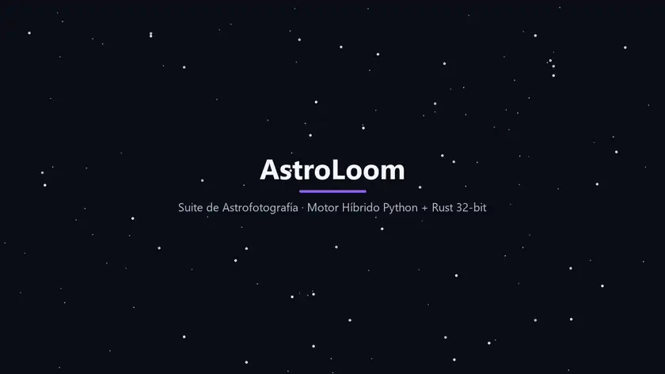
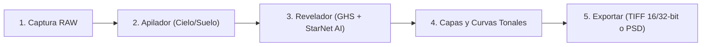

# 🌌 AstroLoom

<div align="center">

**Suite y Estación de Trabajo Integral para Astrofotografía de Paisaje, Cielo Profundo y Eventos Astronómicos**

[](https://github.com/shilmar/AstroLoom/releases)
[](https://www.python.org/)
[](https://www.rust-lang.org/)
[](LICENSE)
[]()

[**📖 Manual de Usuario**](MANUAL_DE_USUARIO.md) • [**📝 Registro de Cambios**](CHANGELOG.md) • [**🤝 Contribuir**](CONTRIBUTING.md)

</div>

<p align="center">
  
</p>

---

## 🔭 ¿Qué es AstroLoom?

**AstroLoom** es una suite de posprocesado astronómico no destructivo diseñada específicamente para fotógrafos nocturnos, astrofotógrafos de paisaje (*nightscapes*), cazadores de eclipses y amantes de las circumpolares y panorámicas de gran campo.

Impulsada por una arquitectura híbrida que combina una interfaz gráfica reactiva en **Python (`PySide6`)** con un potente motor de cómputo nativo en **Rust (`astroloom_rs`)**, AstroLoom ofrece máxima fidelidad matemática en coma flotante de 32 bits con renderizado a más de 160 FPS y un consumo mínimo de memoria RAM.

---

## ✨ Características Principales

### ⚡ Motor Híbrido Rust de Ultra-Alto Rendimiento (`astroloom_rs`)
- **Renderizado Directo a Memoria Qt:** Volcado en búfer contiguo plano `BGRA8888` a >160 FPS (~6 ms en 4K), sin copias intermedias en Python ni recolección de basura (*GC*).
- **Kernels Vectorizados SIMD & Rayon:** Apilado Kappa-Sigma ($2.77\times$ más rápido que Numba JIT), interpolación elástica TPS con `nalgebra`, y modos de fusión de capas a máxima velocidad de CPU.
- **Calibración RAW In-Place:** Calibración matemática pura pre-debayer directamente sobre la matriz de fotodiodos del RAW (0 bytes de memoria RAM adicional).
- **E/S y Códecs Nativos:** Lectores/escritores nativos en Rust para FITS (<15 ms en 60 MP), PSD multicapa de 16 bits (sin dependencias de `pytoshop`), e ingesta multihilo de cabeceras RAW.

### 🧩 Módulos Especializados Integrados

| Módulo | Descripción y Capacidades Clave |
| :--- | :--- |
| **1. Apilador (Stacker)** | Apilado dual cielo/suelo con alineación estelar subpíxel, corrección elástica TPS para gran angular, segmentación semántica de horizonte con IA (U²-Net) y rechazo Kappa-Sigma con relleno reflectivo `BORDER_REFLECT`. |
| **2. Revelador / Editor** | Procesado no destructivo de 32 bits: Estirado Hiperbólico (GHS), separación de estrellas por IA (StarNet++ v2 DirectML), curvas tonales por capa, supresión de contaminación lumínica (RBF 2D y modelo elíptico), balance fotométrico Gaia (PCC) y paletas Dual-Band OSC. |
| **3. Eclipses (HDR)** | Fusión HDR de series de bracketing solar/lunar con traspaso gradual anti-anillos. Arsenal coronal completo (Steerable G2, Larson-Sekanina, SWAP, WOW Bilateral, NAFE, NRGF, MGN) y exportación a PSD multicapa de 16 bits. |
| **4. Eclipses (Collage)** | Montaje cronológico automatizado de fases sobre paisajes con trayectorias geométricas (diagonal, arco, romboide), espaciado regular y fusión transparente. |
| **5. Startrails** | Circumpolares continuas o efecto cometa en streaming $O(1)$, supresión automática de satélites y aviones, relleno de pausas (*gap filling*), recuperación cromática de estrellas y exportación de vídeo 4K. |
| **6. Lluvias de Meteoros** | Detección algorítmica de bólidos, cribado en galería interactiva, filtros anti-aviones/satélites y reproyección al radiante celeste con flujo neto. |
| **7. Panorámicas (Mosaicos)** | Cosido 2D multifila de ultra-alta resolución, alineación por asterismos en Rust (<2 ms), fusión híbrida *Dual-Zone* (árboles nítidos sin efecto fantasma) y auto-recorte rectangular $O(H \times W)$. |

---

## 🚀 Novedades de la Versión v0.19.3

* **Instalador de Windows y Empaquetado `one-dir` (`Astroloom.spec`, `packaging/AstroLoom.iss`, `.github/workflows/release.yml`):**
  - Transición del binario PyInstaller a distribución `one-dir` (arranque más rápido sin descompresión temporal), inclusión de `gui/assets`, nuevo instalador de Windows por usuario con Inno Setup (`AstroLoom-Setup-x64.exe`) y archivo portable `.zip`.
  - Resolución de rutas en binarios empaquetados (`sys.frozen`) en `core/config_manager.py` y `run_app.py`.
* **Gestión Limpia de Configuración Local (`core/config_manager.py`, `config.default.json`, `.gitignore`):**
  - `load_config()` ya no sobrescribe automáticamente un `config.json` existente al validar rutas en memoria; actualizada la plantilla `config.default.json` con `presets_dir` y excluido `config.json` del repositorio para no ensuciar el árbol con ajustes locales.
* **Limpieza del Repositorio:**
  - Retirado `ROADMAP.md` del repositorio público y su enlace en `README.md`.

---

## 🚀 Novedades de la Versión v0.19.2

* **Deconvolución FFT 2D Nativa en Rust (`astroloom_rs/src/deconv.rs`, `core/deconvolution.py`):**
  - Nuevo motor FFT 2D real (`realfft` + `rustfft` + `Rayon`) con frontera reflectiva exacta (`PSNR > 135 dB`, 2–3,3× más rápido que OpenCV, ~0,98 s en 24 MP) y retirada completa de OpenCV `UMat`/OpenCL.
* **Eliminación de `scipy` (`-100 a -130 MB` en el binario):**
  - Reemplazados `PchipInterpolator` (curvas tonales y selectivas) y `least_squares` (ajuste de haces en Panorámicas) por implementaciones nativas en NumPy puro con precisión equivalente y hasta 10× mayor velocidad.
* **Runtime ONNX Unificado (`core/onnx_runtime.py`) y Arranque Escalonado:**
  - Gestión compartida de sesiones ONNX (DirectML `enable_mem_pattern=False` en Windows, CUDA/ROCm en Linux), precarga suave de pestañas secundarias y soporte de `.devloom` arrastrados sobre el Apilador.
* **Endurecimiento FFI Rust, Poda de Código Muerto (~4.700L) y Correcciones Críticas:**
  - Eliminados 50+ `.unwrap()` en Rust, modularizado `astroloom_rs/src/eclipse/`, corregidas costuras en Zoom 1:1 con Deconvolución + StarNet, diferenciación de paletas OSC (`Foraxx`/`Cannistra`), aviso de recorte de sombras por canal y nuevo workflow de CI en GitHub Actions.

---

## 🚀 Novedades de la Versión v0.19.1

* **Motor de Teselas 512×512 y Scrubbing 0.5× para Zoom 1:1 (`gui/developer/tile_engine.py`, `gui/developer/render_engine.py`):**
  - Rejilla fija asíncrona con caché LRU, caché de hitos por tesela (`spatial`, `stars`, `linear_u16`), prefetch concéntrico progresivo con cancelación en 0 ms, intercambio atómico del viewport sin parpadeos y scrubbing en vivo a 0.5× con refinado 1:1 al soltar.
* **Kernels Espaciales Nativos en Rust — Fases 2 y 3B (`astroloom_rs/src/spatial_filters.rs`):**
  - Aceleración Rayon multihilo para ondículas à-trous, claridad, dehaze, contraste enmascarado, filtro autoguiado, estirado MTF, reducción de ruido astronómica fusionada y difusión estelar.
* **Persistencia de Caché AI Denoise en `.devloom` (`core/project_io.py`):**
  - Guardado y recarga automática de las capas de reducción de ruido IA (`starless_ai` y `ground_ai`) dentro del proyecto.
* **Correcciones de Estabilidad en el Revelador (`gui/developer/pipeline.py`):**
  - Corregido el scrubbing de deconvolución en imágenes de ≤800 px y la coalescencia de deslizadores en Zoom 1:1.

---

## 🚀 Novedades de la Versión v0.19.0

* **Motor de Plate Solving Offline en Rust (`astroloom_rs/src/plate_solver.rs`, `core/plate_solver.py`):**
  - Resolución astrométrica offline mediante catálogos estándar y profundos (*standard/deep*) sin necesidad de conexión a internet.
* **Panorámicas con Ajuste Radial Conjunto y Nivelación SO(3) (`core/panorama.py`, `gui/tab_panorama.py`):**
  - Alineación global mediante *joint radial bundle adjustment* y nivelación automática de horizonte en SO(3).
* **Anotaciones Astronómicas de Cielo (`core/sky_annotations.py`, `gui/widgets/mask_layers_widget.py`):**
  - Generación de capas RGBA con las 88 constelaciones IAU, 325 estrellas nombradas y objetos Messier/NGC sobre imágenes y panorámicas resueltas.
* **Refinamiento de Eclipses HDR (`astroloom_rs/src/eclipse.rs`, `core/eclipse.py`, `gui/tab_eclipse.py`):**
  - Mejoras en la fusión HDR de bracketing, estirado *asinh* y detección del disco solar.

---

## 🚀 Novedades de la Versión v0.18.0

* **Nuevo Diálogo y Motor de Exportación Web y Redes Sociales (`gui/dialog_web_export.py`, `gui/widgets/export_button.py`):**
  - **Plantillas Predefinidas de Aspecto y Resolución:** Exportación optimizada en un clic para Instagram Cuadrado (1:1, 1080x1080), Instagram Retrato (4:5, 1080x1350), Stories / Reels / TikTok (9:16, 1080x1920), Twitter/X Horizontal (16:9, 1200x675), AstroBin (4K UHD) y Web General (Full HD 1920 px).
  - **Espacio de Color sRGB y Re-enfoque Adaptativo:** Conversión estricta a perfil sRGB para fidelidad cromática en pantallas móviles y máscara de enfoque adaptativa (USM) para compensar la pérdida de micro-detalle al reducir resolución.
  - **Marcas de Agua y Firmas Personalizadas:** Inserción de texto o logotipo gráfico con cuadrícula de 9 cuadrantes, escala y opacidad ajustables.
  - **Botón Unificado de Exportación (`ExportButton`):** Desplegable homogéneo presente en todos los módulos de procesado (Revelador, Eclipses HDR, Eclipses Collage, Startrails, Meteoros y Panorámicas) con acceso directo a guardado maestro (TIFF/PSD) o exportación web.

* **Modularización de Series Temporales y Salto Cualitativo en Blink Viewer (`gui/widgets/`, `gui/dialog_blink.py`):**
  - **Componentes `SeriesFilesTableWidget` y `SessionTimelineWidget`:** Gestión tabular con miniaturas en memoria y cronograma temporal interactivo por bloques de sesión integrado de forma homogénea en Blink Viewer, Startrails, Meteoros y Eclipses Collage.
  - **Visor Blink Avanzado:** Reproducción secuencial cíclica continua (*Blink Loop*) a velocidad configurable en FPS, navegación por teclado, inspección de calidad estelar en tiempo real (FWHM, excentricidad, conteo) e histograma sincronizado.

* **Arrastrar y Soltar Global (Global Drag & Drop) y Clasificación Inteligente (`gui/main_window.py`, `gui/widgets/drop_widgets.py`):**
  - **Recepción Global en Ventana Principal:** Detección automática de proyectos `.devloom` para apertura directa en el Revelador y enrutado dinámico de imágenes astronómicas hacia la pestaña activa.
  - **Clasificador Astronómico Inteligente:** Catalogación automática de colecciones de carpetas en tomas de *Darks*, *Flats*, *Bias*, *Suelo* y *Lights* por análisis de rutas y nombres.
  - **Calibración Completa en Startrails:** Pestañas de calibración unificadas (Lights, Darks, Flats, Bias, Suelo) con corrección matemática de Master Flat.

* **Diagnóstico y Resiliencia en Inteligencia Artificial y Cierre Seguro (`gui/tab_settings.py`, `core/`):**
  - **Panel de Integridad de Modelos IA:** Monitoreo del estado y peso en MB de StarNet++ v2 ONNX, NAFNet Denoise y SkySeg Horizon en Ajustes, con verificación de GPU DirectML y botón de diagnóstico.
  - **Protección Frente a Falta de Memoria (OOM):** Manejo guiado de excepciones de memoria en GPU/CPU con recolección de basura forzada y consejos prácticos de configuración.
  - **Cierre Seguro y Purga Automática:** Aviso de cambios sin guardar en el Revelador y eliminación garantizada de temporales residuales en `%TEMP%`.

---


## 🚀 Instalación y Puesta en Marcha

### Arranque Rápido
* **En Windows:** Haz **doble clic en `astroloom.bat`** en la carpeta principal del proyecto (detectará tu entorno virtual Python o la instalación del sistema y lanzará la interfaz sin consolas secundarias).
* **En Linux / macOS:** Ejecuta **`./astroloom.sh`** desde la terminal.

### Instalación Manual (Todas las Plataformas)

1. **Clonar el Repositorio:**
   ```bash
   git clone https://github.com/shilmar/AstroLoom.git
   cd AstroLoom
   ```

2. **Instalar Dependencias de Python:**
   ```bash
   pip install -r requirements.txt
   ```

3. **Compilar el Motor Nativo Rust (Recomendado para Máximo Rendimiento):**
   ```bash
   pip install maturin
   cd astroloom_rs
   maturin develop --release
   cd ..
   ```
   *(Si no se compila el módulo nativo, AstroLoom activará automáticamente su modo de reserva transparente en Python/NumPy sin interrumpir el funcionamiento).*

4. **Aceleración por GPU (Opcional - NVIDIA CUDA):**
   ```bash
   # Para CUDA 12.x:
   pip install cupy-cuda12x
   ```

5. **Iniciar la Aplicación:**
   ```bash
   python run_app.py
   ```

---

## 🗺️ Flujo de Trabajo Recomendado



> 📖 **Para una guía detallada paso a paso de cada módulo, parámetros y atajos de teclado, consulta el [Manual de Usuario Oficial](MANUAL_DE_USUARIO.md).**

---

## 🏛️ Estructura del Código

```text
AstroLoom/
├── astroloom_rs/            # Núcleo nativo de alto rendimiento en Rust (PyO3 + Rayon + SIMD)
│   ├── src/                 # Kernels de apilado, RBF, blend modes, deconv, FITS, PSD...
│   └── Cargo.toml           # Configuración del paquete nativo
├── core/                    # Lógica astronómica en Python (calibración, AI, máscaras, PCC...)
├── gui/                     # Interfaz gráfica moderna en PySide6 (Qt)
│   ├── developer/           # Pipeline de renderizado y estado del revelador
│   ├── widgets/             # Lienzo interactivo, gestor de capas, curvas, histograma...
│   └── tab_*.py             # Pestañas de Apilador, Revelador, Eclipses, Startrails, Panos...
├── locales/                 # Soporte multilingüe (español e inglés)
├── MANUAL_DE_USUARIO.md     # Guía detallada y completa para usuarios
├── CHANGELOG.md             # Historial de versiones y cambios
└── run_app.py               # Punto de entrada de la aplicación
```

---

## 🤝 Contribución y Código de Conduct

Las contribuciones son bienvenidas. Si deseas colaborar:
1. Revisa nuestra [Guía de Contribución](CONTRIBUTING.md).
2. Cumple con el [Código de Conducta](CODE_OF_CONDUCT.md).
3. Asegúrate de que las pruebas automatizadas pasen (`pytest`).

---

## 📜 Reconocimientos

AstroLoom integra ideas y algoritmos inspirados en investigaciones pioneras de la comunidad astrofotográfica y científica:
- **[Agentic-Eclipse-Library](https://github.com/PeterWar/Agentic-Eclipse-Library)** por Pere Guerra (PeterWar): Algoritmos de fusión coronal HDR, normalización y filtrado de eclipses solares.
- **[StarNet++](https://www.starnetastro.com/)** por Nikita Misiura: Red neuronal pionera para el desacoplo de estrellas.
- **Miloslav Druckmüller**: Fundamentos matemáticos de filtrado multiescala (MGN) y ecualización adaptativa difusa (NAFE).
- **Agencia Espacial Europea (ESA) — Hipparcos, Tycho-2 y Gaia DR3**: Catálogos astrométricos y fotométricos públicos que impulsan la calibración fotométrica (PCC) y el motor de *Plate Solving* offline de AstroLoom.
- **Unión Astronómica Internacional (IAU) y Catálogo HYG**: Datos oficiales de las 88 constelaciones, estrellas nombradas y objetos Messier/NGC para las anotaciones celestes.

---

## 📄 Licencia

Este proyecto está bajo la Licencia **MIT**. Consulta el archivo [LICENSE](LICENSE) para más detalles.
