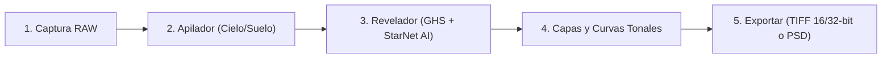

# 🌌 AstroLoom

<div align="center">

**Suite y Estación de Trabajo Integral para Astrofotografía de Paisaje, Cielo Profundo y Eventos Astronómicos**

[](https://github.com/shilmar/AstroLoom/releases)
[](https://www.python.org/)
[](https://www.rust-lang.org/)
[](LICENSE)
[]()

[**📖 Manual de Usuario**](MANUAL_DE_USUARIO.md) • [**📝 Registro de Cambios**](CHANGELOG.md) • [**🤝 Contribuir**](CONTRIBUTING.md) • [**🗺️ Hoja de Ruta**](ROADMAP.md)

</div>

---

## 🔭 ¿Qué es AstroLoom?

**AstroLoom** es una suite de posprocesado astronómico no destructivo diseñada específicamente para fotógrafos nocturnos, astrofotógrafos de paisaje (*nightscapes*), cazadores de eclipses y amantes de las circumpolares y panorámicas de gran campo.

Impulsada por una arquitectura híbrida que combina una interfaz gráfica reactiva en **Python (`PySide6`)** con un potente motor de cómputo nativo en **Rust (`astroloom_rs`)**, AstroLoom ofrece máxima fidelidad matemática en coma flotante de 32 bits con renderizado a más de 160 FPS y un consumo mínimo de memoria RAM.

---

## ✨ Características Principales

### ⚡ Motor Híbrido Rust de Ultra-Alto Rendimiento (`astroloom_rs`)
- **Renderizado Directo a Memoria Qt:** Volcado en búfer contiguo plano `BGRA8888` a >160 FPS (~6 ms en 4K), sin copias intermedias en Python ni recolección de basura (*GC*).
- **Kernels Vectorizados SIMD & Rayon:** Apilado Kappa-Sigma ($2.77\times$ más rápido que Numba JIT), interpolación elástica TPS con `nalgebra`, y modos de fusión de capas a máxima velocidad de CPU.
- **Calibración RAW In-Place:** Calibración matemática pura pre-debayer directamente sobre la matriz de fotodiodos del RAW (0 bytes de memoria RAM adicional).
- **E/S y Códecs Nativos:** Lectores/escritores nativos en Rust para FITS (<15 ms en 60 MP), PSD multicapa de 16 bits (sin dependencias de `pytoshop`), e ingesta multihilo de cabeceras RAW.

### 🧩 Módulos Especializados Integrados

| Módulo | Descripción y Capacidades Clave |
| :--- | :--- |
| **1. Apilador (Stacker)** | Apilado dual cielo/suelo con alineación estelar subpíxel, corrección elástica TPS para gran angular, segmentación semántica de horizonte con IA (U²-Net) y rechazo Kappa-Sigma con relleno reflectivo `BORDER_REFLECT`. |
| **2. Revelador / Editor** | Procesado no destructivo de 32 bits: Estirado Hiperbólico (GHS), separación de estrellas por IA (StarNet++ v2 DirectML), curvas tonales por capa, supresión de contaminación lumínica (RBF 2D y modelo elíptico), balance fotométrico Gaia (PCC) y paletas Dual-Band OSC. |
| **3. Eclipses (HDR)** | Fusión HDR de series de bracketing solar/lunar con traspaso gradual anti-anillos. Arsenal coronal completo (Steerable G2, Larson-Sekanina, SWAP, WOW Bilateral, NAFE, NRGF, MGN) y exportación a PSD multicapa de 16 bits. |
| **4. Eclipses (Collage)** | Montaje cronológico automatizado de fases sobre paisajes con trayectorias geométricas (diagonal, arco, romboide), espaciado regular y fusión transparente. |
| **5. Startrails** | Circumpolares continuas o efecto cometa en streaming $O(1)$, supresión automática de satélites y aviones, relleno de pausas (*gap filling*), recuperación cromática de estrellas y exportación de vídeo 4K. |
| **6. Lluvias de Meteoros** | Detección algorítmica de bólidos, cribado en galería interactiva, filtros anti-aviones/satélites y reproyección al radiante celeste con flujo neto. |
| **7. Panorámicas (Mosaicos)** | Cosido 2D multifila de ultra-alta resolución, alineación por asterismos en Rust (<2 ms), fusión híbrida *Dual-Zone* (árboles nítidos sin efecto fantasma) y auto-recorte rectangular $O(H \times W)$. |

---

## 🎨 Compositor Multicapa y Modos de Fusión (Novedad v0.14.3)

AstroLoom integra un sistema completo de composición no destructiva con capas de ajuste y capas ráster de imagen:
* **Transferencia Directa Eclipses $\to$ Revelador:** Exporta pilas completas de filtros coronales procesados al Revelador con un solo clic.
* **Modos de Fusión Profesionales:** *Normal*, *Trama (Screen)*, *Luminosidad (Luminosity)*, *Luz Suave (Soft Light)*, *Superponer (Overlay)* y *Multiplicar (Multiply)* acelerados en paralelo con Rust Rayon.
* **Máscaras de Pincel Espaciales:** Dibuja o borra sobre cualquier capa para aplicar filtros y ajustes de forma localizada.
* **Persistencia Completa (.devloom):** Almacenamiento seguro en ZIP con máscaras y capas ráster en PNG de 16 bits sin pérdida.

---

## 🚀 Instalación y Puesta en Marcha

### Arranque Rápido en Windows
Haz **doble clic en `astroloom.bat`** en la carpeta principal del proyecto. El script detectará tu entorno virtual Python o la instalación del sistema y lanzará la interfaz sin consolas secundarias.

### Instalación Manual (Todas las Plataformas)

1. **Clonar el Repositorio:**
   ```bash
   git clone https://github.com/shilmar/AstroLoom.git
   cd AstroLoom
   ```

2. **Instalar Dependencias de Python:**
   ```bash
   pip install -r requirements.txt
   ```

3. **Compilar el Motor Nativo Rust (Recomendado para Máximo Rendimiento):**
   ```bash
   pip install maturin
   cd astroloom_rs
   maturin develop --release
   cd ..
   ```
   *(Si no se compila el módulo nativo, AstroLoom activará automáticamente su modo de reserva transparente en Python/NumPy sin interrumpir el funcionamiento).*

4. **Aceleración por GPU (Opcional - NVIDIA CUDA):**
   ```bash
   # Para CUDA 12.x:
   pip install cupy-cuda12x
   ```

5. **Iniciar la Aplicación:**
   ```bash
   python run_app.py
   ```

---

## 🗺️ Flujo de Trabajo Recomendado



> 📖 **Para una guía detallada paso a paso de cada módulo, parámetros y atajos de teclado, consulta el [Manual de Usuario Oficial](MANUAL_DE_USUARIO.md).**

---

## 🏛️ Estructura del Código

```text
AstroLoom/
├── astroloom_rs/            # Núcleo nativo de alto rendimiento en Rust (PyO3 + Rayon + SIMD)
│   ├── src/                 # Kernels de apilado, RBF, blend modes, deconv, FITS, PSD...
│   └── Cargo.toml           # Configuración del paquete nativo
├── core/                    # Lógica astronómica en Python (calibración, AI, máscaras, PCC...)
├── gui/                     # Interfaz gráfica moderna en PySide6 (Qt)
│   ├── developer/           # Pipeline de renderizado y estado del revelador
│   ├── widgets/             # Lienzo interactivo, gestor de capas, curvas, histograma...
│   └── tab_*.py             # Pestañas de Apilador, Revelador, Eclipses, Startrails, Panos...
├── locales/                 # Soporte multilingüe (español e inglés)
├── MANUAL_DE_USUARIO.md     # Guía detallada y completa para usuarios
├── CHANGELOG.md             # Historial de versiones y cambios
└── run_app.py               # Punto de entrada de la aplicación
```

---

## 🤝 Contribución y Código de Conduct

Las contribuciones son bienvenidas. Si deseas colaborar:
1. Revisa nuestra [Guía de Contribución](CONTRIBUTING.md).
2. Cumple con el [Código de Conducta](CODE_OF_CONDUCT.md).
3. Asegúrate de que las pruebas automatizadas pasen (`pytest`).

---

## 📜 Reconocimientos

AstroLoom integra ideas y algoritmos inspirados en investigaciones pioneras de la comunidad astrofotográfica y científica:
- **[Agentic-Eclipse-Library](https://github.com/PeterWar/Agentic-Eclipse-Library)** por Pere Guerra (PeterWar): Algoritmos de fusión coronal HDR, normalización y filtrado de eclipses solares.
- **[StarNet++](https://www.starnetastro.com/)** por Nikita Misiura: Red neuronal pionera para el desacoplo de estrellas.
- **Miloslav Druckmüller**: Fundamentos matemáticos de filtrado multiescala (MGN) y ecualización adaptativa difusa (NAFE).

---

## 📄 Licencia

Este proyecto está bajo la Licencia **MIT**. Consulta el archivo [LICENSE](LICENSE) para más detalles.
