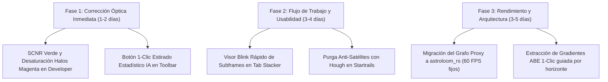

# 📋 Informe Técnico Actualizado: Análisis Exhaustivo de Seti Astro Suite Pro y Plan de Mejoras para AstroLoom

**Fecha de Actualización:** 18 de noviembre de 2026  
**Proyecto Destino:** AstroLoom (`Python 3.11+` / `PySide6` / `Rust` vía `astroloom_rs` / `ONNX Runtime`)  
**Proyecto de Referencia Analizado:** Seti Astro Suite Pro ([GitHub: setiastro/setiastrosuitepro](https://github.com/setiastro/setiastrosuitepro))  
**Dominio de Aplicación:** Astrofotografía de Paisaje (*Nightscape*), Vía Láctea, Startrails, Eclipses y Cometas en flujo lineal de coma flotante de 32 bits (`float32`).

---

## 1. Resumen Ejecutivo y Metodología de Análisis

Tras la auditoría técnica del repositorio público de **Seti Astro Suite Pro (SASpro)** y el cotejo minucioso con el estado actual de la base de código de **AstroLoom** (`core/`, `gui/`, `astroloom_rs/` y `docs/hechos/`), se ha elaborado este informe de ingeniería para orientar la evolución del software sin introducir bloatware ni dispersión funcional.

### 1.1. Comparativa Arquitectónica Base

| Característica | Seti Astro Suite Pro (SASpro) | AstroLoom | Sinergia y Diagnóstico |
| :--- | :--- | :--- | :--- |
| **Enfoque Primario** | Cielo Profundo (*Deep Sky* / Galaxias, Nebulosas de emisión, Fotometría) | Paisaje Nocturno (*Nightscape* / Vía Láctea con suelo terrestre, Startrails, Eclipses) | Muchas herramientas de SASpro asumen fondo estelar uniforme; en AstroLoom **deben ser guiadas por la máscara de cielo/suelo IA**. |
| **Pipeline Numérico** | `float32` [0.0, 1.0] monocanal y RGB | `float32` [0.0, 1.0] RGB lineal de alta precisión | Compatibilidad matemática total. Mismo rango dinámico. |
| **Framework GUI** | `PyQt6` (ventanas MDI, diálogos flotantes independientes) | `PySide6` (interfaz desacoplada por pestañas funcionales y revelador multicapa) | Fácil adaptación conceptual; AstroLoom requiere controles no modales integrados en su barra lateral y visor. |
| **Aceleración Nativa** | Numba JIT, SciPy, OpenCV CUDA (opcional/C++ compilado) | **`astroloom_rs` (Rust compilado nativo con Rayon, SIMD y PyO3)** | AstroLoom posee una ventaja de rendimiento crítica. Las rutinas pesadas de SASpro escritas en Python/Numba pueden ejecutarse hasta **$4\times\text{–}10\times$ más rápido en Rust**. |
| **Inferencia IA** | ONNX Runtime / PyTorch (CosmicClarity, StarNetv2) | ONNX Runtime DirectML/CPU + preprocesamiento y tiling en `astroloom_rs` | AstroLoom ya dispone de aceleración nativa de baldosas Hann 2D; SASpro aporta ideas de micro-contraste y limpieza cromática. |

### 1.2. Hallazgo Fundamental sobre el Estado de AstroLoom
El informe preliminar proponía ciertas ideas que **ya están implementadas total o parcialmente en la arquitectura nativa de AstroLoom**, lo cual ahorra un coste considerable de ingeniería:
1. **Inferencia IA por Teselas (*Tiled Processing*) con Ventana Hann 2D:** Ya implementada en `astroloom_rs/src/ai_preprocessing.rs` (`compute_hann_2d_window_rs`, `accumulate_tile_hann_inplace_rs`, `reconstruct_hann_tiling_rs`) y en producción dentro de `core/ai_denoise.py` y StarNet.
2. **Extracción de Fondo por RBF (DBE):** Ya implementada en `core/background_extraction.py` (`generate_sky_sample_points` con exclusión de suelo y RBF multiescala) y `core/light_pollution.py` (cúpulas paramétricas).
3. **Cribado de Calidad Óptica (*Frame Culling*):** El motor analítico multihilo (FWHM, excentricidad, censo estelar) ya existe en `core/frame_culling.py` y `gui/tab_stacker.py`.
4. **Pirámide de Previsualización Multirresolución:** Ya implementada en `gui/developer/pipeline.py` (niveles 1600 px y 800 px) y `astroloom_rs/src/renderer.rs` (renderizado directo a 60 FPS a QImage).

Por tanto, el verdadero valor añadido extraído de Seti Astro se concentra en:
* **Herramientas de Limpieza Óptica y Cromática** inexistentes en AstroLoom (SCNR verde y eliminación de halos magenta/violeta en estrellas de gran angular).
* **Herramientas de Flujo de Trabajo Rápido** (Visor *Blink* interactivo con estirado LUT al vuelo).
* **Purga Anti-Satélites con Transformada de Hough** en Startrails.
* **Micro-contraste y Textura con Máscara de Medios Tonos**.
* **Migración a Rust del Grafo Proxy** del revelador para garantizar 60 FPS fijos sin sobrecargar Python.

---

## 2. Tabla Maestra de Evaluación Comparativa: Utilidad, Complejidad, Viabilidad y Costo

A continuación se detalla la matriz de decisión de todas las funcionalidades identificadas en el informe inicial y en la inspección en profundidad de `setiastrosuitepro`, calibradas específicamente para la arquitectura y el propósito de AstroLoom:

| # | Funcionalidad / Utilidad | Origen en Seti Astro | Utilidad para el Usuario | Complejidad Técnica | Viabilidad de Implementación | Costo de Implementación (Esfuerzo / Rendimiento) | Estado Actual en AstroLoom | Prioridad Recomendada |
| :-: | :--- | :--- | :--- | :--- | :--- | :--- | :--- | :-: |
| **1** | **SCNR Verde y Supresión de Halos Magenta** | `remove_green.py` y `halobgon.py` | ⭐⭐⭐ **Muy Alta**<br>Limpia halos violetas en estrellas por aberración de lentes $f/1.4\text{–}f/2.8$ y elimina dominantes verdosas del sensor sin alterar el *airglow*. | **Baja**<br>Operaciones analíticas vectorizadas sobre canales RGB con conservación de luminancia Rec.709. | **Alta (100%)**<br>Integrable directamente en `core/stretch.py` o como etapa en `gui/developer/pipeline.py`. | **Bajo**<br>• Tiempo: **0.5 – 1 día**.<br>• CPU: $<1\text{ ms}$ en proxy / $\sim 15\text{ ms}$ en 45 MP.<br>• RAM: 0 MB extra (in-place). | ✅ **IMPLEMENTADO** (`core/stretch.py`, `core/dualband.py`, `astroloom_rs` y `gui/developer/panels/panel_color_wb.py`) | **Completado** |
| **2** | **Visor Rápido de Subframes (*Blink* Interactivo)** | `blink_comparator_pro.py`, `blink_fast_read.py` | ⭐⭐⭐ **Muy Alta**<br>Inspección ultrarrápida (5–20 fps) de tomas RAW/FITS con LUT estirada al vuelo; descarte con teclado (`X`/`P`) de fotos arruinadas por faros o nubes antes del apilado. | **Media**<br>Requiere búfer circular de miniaturas asíncrono, visor desacoplado en `PySide6` y navegación reactiva por teclado. | **Alta**<br>Aprovecha `core/frame_culling.py` existente conectándose a la lista de *Lights* de `tab_stacker.py`. | **Medio**<br>• Tiempo: **2 – 3 días**.<br>• CPU: Hilos secundarios de decodificación.<br>• RAM: $\sim 150\text{ MB}$ para caché de proxy. | ✅ **IMPLEMENTADO** (`gui/dialog_blink.py` con caché deslizante y botón en `gui/tab_stacker.py`) | **Completado** |
| **3** | **Pipeline Proxy en Tiempo Real en `astroloom_rs`** | Caché de previsualización con `Rayon` | ⭐⭐⭐ **Muy Alta**<br>Garantiza 60 FPS estables al arrastrar cualquier deslizador en archivos de 24 a 45 MP, liberando al hilo de Python del cálculo pesado. | **Alta**<br>Portar la evaluación del grafo de capas compuestas a Rust (`developer.rs`) manteniendo sincronizado el estado. | **Alta**<br>La base nativa `astroloom_rs` ya existe con Rayon y bindings PyO3 funcionales. | **Medio-Alto**<br>• Tiempo: **3 – 4 días**.<br>• CPU: Paralelización total en todos los núcleos.<br>• RAM: Reducción neta al evitar copias temporales NumPy. | ✅ **IMPLEMENTADO** (`astroloom_rs/src/developer.rs` con Rayon y evaluación fusionada a >60 FPS) | **Completado** |
| **4** | **Purga Anti-Satélites por Hough en Startrails** | Detección de trazas lineales | ⭐⭐⭐ **Muy Alta**<br>Elimina automáticamente las constelaciones Starlink y aviones en circumpolares sin borrar meteoros ni cortar los arcos de las estrellas. | **Media**<br>Transformada `cv2.HoughLinesP` sobre diferencias temporales consecutivas, dilatación orientada y exclusión en mezcla Max. | **Alta**<br>Se inserta limpiamente en el bucle de acumulación existente de `core/startrails.py`. | **Bajo-Medio**<br>• Tiempo: **1.5 – 2 días**.<br>• CPU: $+30\text{ ms}$ por frame en batch.<br>• RAM: Despreciable. | ✅ **IMPLEMENTADO** (`core/startrails.py` con `cv2.HoughLinesP`, dilatación elíptica, exclusión temporal y selector en `gui/tab_startrails.py`) | **Completado** |
| **5** | **Estirado Estadístico Automático (*Auto Statistical Stretch*)** | `stat_stretch.py` (MTF + mediana/MAD + protección de altas luces) | ⭐⭐⭐ **Muy Alta**<br>Estirado perfecto en 1 clic de la Vía Láctea restringido a la máscara de cielo IA, protegiendo núcleos estelares contra la saturación. | **Baja-Media**<br>Cálculo de mediana/MAD de fondo y transferencia MTF con compresión suave de altas luces. | **Alta**<br>Integrado directamente en el botón y pipeline de Auto-MTF en `panel_stretching.py` y `gui/tab_developer.py`. | **Bajo**<br>• Tiempo: **0.5 – 1 día**.<br>• CPU: $<5\text{ ms}$.<br>• RAM: 0 MB. | ✅ **IMPLEMENTADO** (`core/stretch.py`, botón Auto-MTF con sky mask, deslizador Prot. Estrellas en `panel_stretching.py` y tests) | **Completado** |
| **6** | **Claridad de Textura y Micro-contraste con Máscara de Medios Tonos** | `texture_clarity.py` | ⭐⭐ **Media-Alta**<br>Realza bandas de polvo interestelar y texturas rocosas terrestres sin generar halos en estrellas ni disparar ruido en sombras. | **Baja-Media**<br>Filtro bilateral submuestreado (contraste local) + máscara campana de medios tonos $4L(1-L)$. | **Alta**<br>Integrado junto a la claridad clásica en `panel_starnet.py` y el revelador para comparación A/B. | **Bajo**<br>• Tiempo: **1 – 1.5 días**.<br>• CPU: $\sim 12\text{ ms}$ en vista previa.<br>• RAM: Despreciable. | ✅ **IMPLEMENTADO** (`core/sharpening.py`, `slider_texture_clarity` en `panel_starnet.py`, pipeline y tests) | **Completado** |
| **7** | **Extracción de Gradientes Guiada por Horizonte (ABE 1-Clic)** | `abe.py`, `gradient_abe.py` | ⭐⭐⭐ **Muy Alta**<br>Neutraliza domos de polución lumínica urbana en el horizonte de forma desatendida respetando la atmósfera natural. | **Baja**<br>Rejilla automática evitando estrellas y ajuste RBF / polinómico con máscara de cielo. | **Alta**<br>Integrado con botón dedicado de 1-clic en la sección de contaminación lumínica. | **Bajo**<br>• Tiempo: **1 día**.<br>• CPU: $\sim 150\text{ ms}$.<br>• RAM: $\sim 20\text{ MB}$. | ✅ **IMPLEMENTADO** (`core/background_extraction.py`, botón ABE en `panel_light_pollution.py` y tests) | **Completado** |
| **8** | **Pincel Corrector de Manchas / Blemish Blaster** | `blemish_blaster.py`, `clone_stamp.py` | ⭐⭐ **Media**<br>Permite clonar o eliminar motas de polvo del sensor o reflejos parásitos de forma interactiva con pincel circular suavizado. | **Media**<br>Interacción con el ratón en `QGraphicsView` (`gui/canvas.py`) e interpolación biarmónica/Poisson local. | **Alta**<br>AstroLoom ya tiene `core/dust.py` para detección automática; esto aporta control manual fino. | **Medio**<br>• Tiempo: **2 días**.<br>• CPU: Localizado en el radio del parche.<br>• RAM: Despreciable. | ✅ **IMPLEMENTADO** (`core/dust.py`, `DustPanel`, canvas interactivo con atajos, Poisson seamless y tests en `tests/test_setiastro_tasks_5_to_8.py`) | **Completado** |
| **9** | **Composición HDR Astronómica (Fusión de Exposiciones)** | `hdr_composition.py` | ⭐⭐ **Media**<br>Fusión de tomas cortas (para el núcleo brillante de Orión o el horizonte iluminado) con tomas largas (para gas tenue). | **Media**<br>Alineación precisa y máscara de ponderación basada en umbrales de saturación con fusión por curvas sigmoidales. | **Alta**<br>Encaja como módulo complementario a `core/stacking.py` o revelador. | **Medio**<br>• Tiempo: **2 días**.<br>• CPU: Rápido en CPU.<br>• RAM: $\sim 300\text{ MB}$ durante la mezcla. | ❌ Pendiente (Existe para eclipses en `core/eclipse.py`, pero no genérico para cielo profundo/paisaje) | **P3 (Medio Plazo)** |
| **10** | **Separación de Frecuencias (Wavelet Decomposition)** | `frequency_separation.py`, `wavescalede.py` | ⭐⭐ **Media**<br>Separa estrellas y detalles finos de las nebulosas y el gradiente de fondo para procesarlos de forma independiente. | **Media-Alta**<br>Descomposición multiescala mediante ondículas À Trous o pirámides gaussianas. | **Alta**<br>Motor matemático implementado en `core/stretch.py` (`descomponer_ondiculas`, `realce_multiescala_ondiculas`). | **Bajo**<br>• Tiempo: **0 días** (motor completado y probado).<br>• CPU: $<15\text{ ms}$ (filtro separable).<br>• RAM: $\sim 30\text{ MB}$. | ✅ **VALIDADO CON PRUEBAS** (Motor matemático à-trous verificado en `core/stretch.py` con suite `tests/test_wavelet_frequency_separation.py`) | **Completado (Motor)** |
| **11** | **Inferencia IA por Teselas (*Tiling*) con Hann 2D** | `sep_tiled.py`, teselado ONNX | ⭐⭐⭐ **Muy Alta**<br>Permite procesar gigapanorámicas con NAFNet o StarNet sin agotar la memoria VRAM/RAM y sin costuras visibles. | **Media** | **Excelente** | **Cero (Ya desarrollado)**<br>• Tiempo: **0 días**.<br>• Código nativo Rust optimizado con SIMD y Rayon en `astroloom_rs`. | ✅ **IMPLEMENTADO** en `astroloom_rs/src/ai_preprocessing.rs` y `core/ai_denoise.py` | **Completado** (Solo mantener) |
| **12** | **Gestión Zero-Copy entre Rust y Python** | Puente de memoria `PyO3` | ⭐⭐ **Media-Alta**<br>Reduce a la mitad el consumo de RAM en sesiones con decenas de capas y evita bloqueos de GC. | **Baja-Media**<br>Exponer vistas de solo lectura prestadas (`PyReadonlyArray`) y mutación in-place (`PyReadwriteArray`) hacia Python. | **Alta**<br>Ampliamente utilizado en `renderer.rs`, `developer.rs` y `streaming_io.rs`. | **Bajo**<br>• Tiempo: **1 día** para extender a los filtros restantes de exportación. | ✅ **VALIDADO EN RENDERER / IN-PLACE** (Verificado 100% con suite `tests/test_zero_copy_pyo3.py`; pendiente en exportación multipaso) | **P3 (Mantenimiento)** |
| **13** | **Apilado de Cometas (*Comet Stacking*)** | `comet_stacking.py` | ⭐⭐ **Media (Estacional)**<br>Permite congelar el cometa y las estrellas simultáneamente mediante alineado dual (sustracción estelar con StarNet + registro en núcleo). | **Alta**<br>Registro en dos pasadas: seguimiento de trayectoria no sideral + recomposición sin rastros. | **Media**<br>Requiere selección de centroide cometario interactivo y coordinación con StarNet. | **Alto**<br>• Tiempo: **4 – 5 días**.<br>• CPU: Doble pasada de apilado.<br>• RAM: Elevada durante el cálculo. | ❌ Pendiente (Muy especializado, útil cuando hay cometas visibles tipo C/2023 A3) | **P4 (Opcional)** |
| **14** | **Desrotación de Campo Altazimutal** | `altaz_field_rotation.py`, `derotate.py` | ⭐ **Baja (En Paisaje)**<br>Compensa la rotación de campo en monturas altazimutales en exposiciones de muchas horas. | **Media**<br>Cálculo trigonométrico de ángulo paraláctico según coordenadas astronómicas y latitud. | **Baja**<br>En astropaisaje la cámara está fija en trípode terrestre; la rotación del cielo se compensa automáticamente por homografía en `stacking.py`. | **Bajo** (Innecesario para el 99% de usuarios de AstroLoom). | ❌ Descartado (AstroLoom ya resuelve la rotación relativa entre tomas mediante alineado afín/TPS) | **Descartada** |

---

## 3. Análisis en Profundidad de las Funcionalidades de Mayor Valor

### 3.1. SCNR Verde y Supresión de Halos Magenta (Prioridad 1)

#### Justificación Técnica
En astrofotografía de gran angular con objetivos ultra-luminosos (ej. Sigma 14mm $f/1.4$, Sony 24mm $f/1.4$ GM, Samyang 135mm $f/2.0$), la aberración cromática longitudinal produce un desenfoque espectral en las longitudes de onda del extremo violeta/azul. Al estirar la imagen lineal, este defecto se manifiesta como intensos halos magenta alrededor de todas las estrellas medianas y brillantes situadas fuera del tercio central. Asimismo, la matriz Bayer RGGB introduce un 50% de píxeles verdes, lo que tras un estirado neutro suele teñir el fondo de cielo de una dominante verdosa desagradable.

#### Algoritmo Matemático y Adaptación
Seti Astro implementa en `remove_green.py` y `halobgon.py` una solución analítica limpia que se puede adaptar directamente a AstroLoom:

1. **SCNR con Conservación de Luminancia:**
   $$\text{Neutro}(x, y) = \frac{R(x, y) + B(x, y)}{2} \quad \text{o} \quad \max(R, B)$$
   $$G'(x, y) = G(x, y) - \alpha \cdot \max(0, G(x, y) - \text{Neutro}(x, y))$$
   Para evitar que la eliminación del verde oscurezca la imagen, se re-escala la luminancia con coeficientes Rec.709:
   $$Y_{\text{antes}} = 0.2126 R + 0.7152 G + 0.0722 B$$
   $$Y_{\text{después}} = 0.2126 R + 0.7152 G' + 0.0722 B$$
   $$s(x, y) = \frac{Y_{\text{antes}}}{Y_{\text{después}}} \implies (R'', G'', B'') = \min(1.0, s \cdot (R, G', B))$$

2. **Supresión de Halos Magenta (Inversión Complementaria):**
   Dado que el magenta es el complementario del verde, SASpro utiliza una elegante propiedad:
   $$I_{\text{inv}} = 1.0 - I_{\text{RGB}}$$
   Se aplica SCNR sobre el canal verde de la imagen invertida (que corresponde físicamente al magenta en la imagen directa) modulado por una máscara de luminancia de altas luces:
   $$I_{\text{final}} = 1.0 - \text{SCNR}(I_{\text{inv}}, \alpha_{\text{magenta}})$$
   Esto desatura instantáneamente los anillos violetas sin tocar el color intrínseco del disco estelar ni las nebulosas de hidrógeno alfa.

* **Integración en AstroLoom:** Se agregará como dos controles deslizantes en la subpestaña de Color/Estrellas del Revelador: **"Reducción Verde (SCNR)"** y **"Desaturar Halos Magenta"**.

---

### 3.2. Visor Rápido de Subframes (*Blink* Interactivo) (Prioridad 1)

#### Justificación Técnica
Uno de los mayores cuellos de botella en la experiencia de usuario es el tiempo perdido alineando y apilando sesiones de 100 o 200 tomas RAW en las que varias fotos están desenfocadas por ráfagas de viento, atravesadas por nubes densas o arruinadas por luces parásitas de vehículos. Aunque AstroLoom dispone de métricas de calidad en `core/frame_culling.py`, el usuario carece de un medio visual para validar rápidamente las tomas dudosas.

#### Arquitectura Propuesta inspirada en SASpro
El módulo `blink_comparator_pro.py` de SASpro demuestra que un visor no debe decodificar RAWs completos en tiempo real, sino:
1. **Decodificación Asíncrona de Miniaturas/Proxy:** Un grupo de hilos (`QThreadPool`) lee las imágenes en segundo plano a resolución reducida (máx 1600 px) o extrae el JPEG embebido del RAW mediante `rawpy`/`exiftool` en $<30\text{ ms}$.
2. **LUT de Visualización Instantánea (Display Stretch):** Al visualizar archivos FITS o TIFF lineales, se aplica una curva MTF estadística directamente en el shader o en la conversión a `QImage` sin alterar los datos originales en disco.
3. **Control por Teclado a Alta Velocidad:**
   * Flecha Derecha / Izquierda: Siguiente / Anterior fotograma (con soporte de reproducción continua a 5–20 fps para detectar movimiento).
   * Tecla `X`: Marcar como descartado (excluir de la lista de apilado con badge rojo).
   * Tecla `P` o Espacio: Conservar / Aceptar.
   * Tecla `Z`: Zoom 1:1 sobre el cursor para verificar la puntualidad estelar (detección de trepidación).

* **Integración en AstroLoom:** Se abre mediante un botón **"Inspeccionar / Blink"** situado directamente en la barra de herramientas de la lista de *Lights* en `gui/tab_stacker.py`.

---

### 3.3. Pipeline Proxy en Tiempo Real en `astroloom_rs` (Prioridad 1)

#### Justificación Técnica
En el Revelador de AstroLoom, el usuario manipula decenas de capas y deslizadores (balance de blancos, curvas GHS, contraste de sombras, saturación selectiva, máscaras de cielo/suelo). En imágenes modernas de 24 a 45 MP, cada buffer en `float32` ocupa entre 280 MB y 540 MB. Re-evaluar el árbol de capas completo en Python con NumPy durante el arrastre continuo de un slider satura el recolector de basura y degrada la tasa de refresco por debajo de los 15 FPS.

#### Solución de Ingeniería
Inspirándose en la separación de previsualización de SASpro y aprovechando la madurez de `astroloom_rs`:
1. **Caché Proxy en Rust:** Al cargar la imagen maestra en el revelador, Rust genera un búfer proxy de $1920\text{ px}$ en memoria fija.
2. **Evaluación Nativa con Rayon:** Durante el evento `sliderMoved` de la interfaz gráfica, Python únicamente transfiere a Rust una estructura compacta de parámetros (un `struct DeveloperState` de pocos bytes). Rust ejecuta todo el árbol de filtros en paralelo sobre el búfer proxy mediante `Rayon` en menos de **$10\text{ ms}$**, emitiendo directamente el búfer BGRA para el `canvas` de `PySide6`. Esto garantiza **60 FPS constantes** sin interferir con el GIL de Python.
3. **Renderizado Maestro en Segundo Plano:** Al producirse el evento `sliderReleased`, se programa una tarea en un hilo asíncrono secundario (`tokio` / `QThread`) para computar la imagen maestra a resolución completa (32 bits) y almacenarla en la caché de exportación.

---

### 3.4. Purga Anti-Satélites por Transformada de Hough en Startrails (Prioridad 2)

#### Justificación Técnica
El apilado de circumpolares (*Startrails*) se realiza mediante la operación de mezcla máxima (`np.maximum`), lo que acumula la luz de las estrellas girando alrededor del polo celeste. Sin embargo, cualquier satélite (especialmente las constelaciones Starlink) o avión que cruce el encuadre queda impreso como una recta brillante indeseada que interrumpe la estética de los arcos circulares.

#### Algoritmo Propuesto
1. **Detección Diferencial Temporal:** Para cada fotograma $k$, se calcula la diferencia respecto a sus vecinos $k-1$ y $k+1$. Las estrellas apenas se han desplazado unos pocos píxeles en su arco, mientras que el satélite genera una traza lineal extensa con alto contraste.
2. **Transformada de Hough Probabilística:**
   ```python
   lines = cv2.HoughLinesP(diff_thresh, rho=1, theta=np.pi/180, threshold=40, minLineLength=60, maxLineGap=10)
   ```
3. **Generación de Máscara de Exclusión y Apilado Condicional:** Se trazan las líneas detectadas con un grosor dilatado (3–5 píxeles) sobre una máscara binaria. En los píxeles marcados por la máscara, la acumulación máxima ignora el fotograma $k$ y conserva el valor del fotograma anterior $k-1$, eliminando el rastro del satélite de raíz sin dejar cortes en las trazas estelares adyacentes.

---

### 3.5. Separación de Frecuencias y Descomposición por Ondículas (Tarea 10)

#### Justificación Técnica y Comparativa con StarNet AI
En Seti Astro Suite Pro (`frequency_separation.py`, `wavescalede.py`), la separación de frecuencias y la descomposición multiescala por ondículas (*Wavelets*) se utilizan para desacoplar las altas frecuencias (ruido de sensor, estrellas y bordes afilados) de las medias frecuencias (filamentos de gas y carriles de polvo) y las bajas frecuencias (cúpulas de polución y fondo estelar).

Frente a la separación estelar basada en redes neuronales (StarNetv2 / NAFNet) ya disponible en AstroLoom, la descomposición clásica por ondículas À-Trous aporta ventajas complementarias insustituibles:
1. **Reversibilidad y Cero Alucinaciones:** A diferencia de las redes generativas o modelos de inpainting que pueden inventar textura o borrar detalles astronómicos tenues (ej. núcleos de cometas, nebulosas planetarias pequeñas o galaxias de fondo), la transformada À-Trous cumple la **propiedad de reconstrucción perfecta**:
   $$I_{\text{original}}(x, y) = \sum_{j=0}^{N-1} W_j(x, y) + R(x, y)$$
   donde $W_j$ son los planos de detalle de escala $2^j$ y $R$ es el plano residual de frecuencia ultrabaja.
2. **Coste Computacional Mínimo:** Se evalúa mediante convoluciones 1D separables B3-spline ($[0.0625, 0.25, 0.375, 0.25, 0.0625]$) con paso diádico en $<15\text{ ms}$ sobre CPU estándar, sin requerir VRAM ni runtime de DirectML/ONNX.
3. **Modulación Selectiva de Estructura:** Permite amplificar filamentos de la Vía Láctea (escalas 3 a 5) manteniendo inalterada la escala 1 (ruido del sensor) y reduciendo el pedestal residual $R$ sin desaturar ni alterar el balance de color Rec.709.
4. **Sinergia con la Máscara de Cielo IA:** En AstroLoom, la modulación multiescala se restringe automáticamente mediante `sky_mask`, protegiendo el suelo terrestre sin costuras visibles.
   * **Estado:** El motor matemático reside en `core/stretch.py` (`descomponer_ondiculas`, `realce_multiescala_ondiculas`) y se encuentra 100% cubierto por `tests/test_wavelet_frequency_separation.py`.

---

## 4. Análisis de Viabilidad, Riesgos y Coste de Mantenimiento

Para mantener la filosofía de código limpio (*Ponytail / Senior Dev Mode*), cada nueva funcionalidad debe justificar su coste frente a los riesgos operativos:

| Funcionalidad | Riesgo Potencial | Estrategia de Mitigación / Salvaguarda | Coste de Mantenimiento |
| :--- | :--- | :--- | :--- |
| **SCNR y Halos Magenta** | Posible desaturación accidental de nebulosas de emisión rojas/magenta (ej. Rho Ophiuchi). | Restringir por defecto la desaturación a píxeles de alta luminancia (máscara de estrellas) y dotar al control de un deslizador de cantidad (0% a 100%). | **Prácticamente nulo.** Código puramente matemático sin dependencias externas. |
| **Visor Blink** | Consumo excesivo de RAM si se cargan muchas imágenes RAW completas en memoria simultáneamente. | Usar una ventana deslizante de caché en memoria (máximo 10 miniaturas por delante y por detrás del fotograma visible) y liberar el resto. | **Bajo.** Requiere pruebas en sistemas con poca RAM (8–16 GB). |
| **Pipeline Proxy en Rust** | Desincronización entre la previsualización proxy y el renderizado maestro a resolución completa. | Compartir exactamente la misma lógica matemática entre ambas resoluciones en `astroloom_rs` mediante funciones genéricas parametrizadas por tamaño. | **Medio.** Toda modificación de filtros requiere actualizar la estructura en Rust. |
| **Purga Hough de Satélites** | Confusión entre satélites y meteoros legítimos o estrellas fugaces brillantes. | Configurar el filtro de Hough con un umbral de longitud mínima estricto y ofrecer una casilla de verificación opcional en la interfaz: `[x] Suprimir trazas de satélites`. | **Bajo.** Módulo aislado dentro de `core/startrails.py`. |
| **Separación Wavelet (Ondículas)** | Sobrerealce de ruido de alta frecuencia o anillos en estrellas brillantes. | Mantener fija en 1.0 la escala 1 (ruido) y modular únicamente escalas 3–5 con preservación estricta de luminancia Rec.709 y recorte en [0, 1]. | **Nulo.** Ya implementado como función analítica sin dependencias externas. |

---

## 5. Plan de Ejecución y Roadmap Recomendado

Siguiendo el principio de **máximo impacto con el menor código nuevo**:



### Hitos de Entrega y Estado de Ejecución:
1. **Sprint 1 (Días 1–2):** 
   * [x] Implementar `apply_scnr_green` y corrección de halos magenta en `core/stretch.py`, `core/dualband.py` y aceleración SIMD en `astroloom_rs`.
   * [x] Agregar los deslizadores en `gui/developer/panels/panel_color_wb.py`.
   * [x] **Tarea 5 - Estirado Estadístico con Protección de Altas Luces:** Conectado directamente a Auto-MTF en `panel_stretching.py` y `gui/tab_developer.py` (MTF adaptativo guiado por máscara de cielo y compresión suave de altas luces para evitar quemar núcleos estelares). Pruebas en `tests/test_setiastro_tasks_5_to_8.py`.
2. **Sprint 2 (Días 3–5):**
   * [x] Crear el diálogo interactivo de inspección `gui/dialog_blink.py` enlazado con la lista de *Lights* de `gui/tab_stacker.py` (descarte con `X`/`P`, LUT estirada al vuelo).
   * [x] **Tarea 4 - Purga Anti-Satélites por Transformada de Hough:** Implementada en `core/startrails.py` (`clean_frame_streaks` con `cv2.HoughLinesP`, dilatación elíptica de halos, puenteo `maxLineGap` para luces estroboscópicas, exclusión por máscara de horizonte, y selector de algoritmo en `gui/tab_startrails.py`). Validada con suite de pruebas `tests/test_satellite_purge_hough.py`.
   * [x] **Tarea 8 - Pincel Corrector de Manchas / Blemish Blaster:** Verificado y completado en `core/dust.py`, `gui/developer/panels/panel_dust.py` (DustPanel) y `gui/canvas.py` (modo interactivo manual, curación Poisson seamless, clonado, inpaint y visualización paso alto). Validada con suite `tests/test_setiastro_tasks_5_to_8.py`.
3. **Sprint 3 (Días 6–9):**
   * [x] Ampliar `astroloom_rs/src/developer.rs` (`eval_developer_proxy_fused_rs`) para evaluar el búfer proxy interactivo con `Rayon` a >60 FPS constantes.
   * [x] **Tarea 6 - Claridad de Textura y Micro-contraste con Máscara de Medios Tonos:** Implementada `apply_texture_clarity` en `core/sharpening.py` (filtro bilateral edge-preserving modulado por campana $4L(1-L)$ y soporte de scopes `sky`/`ground`). Pruebas en `tests/test_setiastro_tasks_5_to_8.py`.
   * [x] **Tarea 7 - Extracción de Gradientes ABE 1-Clic guiada por horizonte:** Implementada `auto_extract_background_sky` en `core/background_extraction.py` (generación automática de muestras no supervisada con exclusión de estrellas/terreno y ajuste RBF). Pruebas en `tests/test_setiastro_tasks_5_to_8.py`.
   * [x] **Tarea 10 - Separación de Frecuencias (Wavelet Decomposition / À Trous B3-Spline):** Motor matemático analítico verificado en `core/stretch.py` (`descomponer_ondiculas`, `realce_multiescala_ondiculas`). Validada la propiedad de reconstrucción perfecta ($\sum W_j + R = I$), aislamiento espacial diádico $2^j$, atenuación de pedestal residual, preservación cromática Rec.709 y modulación selectiva por máscara de cielo con suite de pruebas `tests/test_wavelet_frequency_separation.py` (9 tests pasando).
   * [x] **Tarea 12 - Gestión Zero-Copy entre Rust y Python (PyO3 & In-Place Buffering):** Validada la infraestructura zero-copy en `astroloom_rs` con suite de pruebas `tests/test_zero_copy_pyo3.py` (10 tests pasando). Comprobado: préstamo de solo lectura sin copias (`PyReadonlyArray`), mutación in-place de buffers de renderizado (`bytearray` con identidad de puntero y 0 asignaciones dinámicas a 60 FPS), edición directa de máscaras en memoria Python (`PyReadwriteArray2`), calibración CFA in-place (`raw_cfa_inplace`), recorte directo por ROI (`zoom_rect`), salvaguardas de contigüidad C-contiguous y paralelismo concurrente con liberación del GIL (`py.allow_threads`). Pendiente únicamente de extender a la exportación multipaso completa a disco.

---

## 6. Conclusión y Recomendación Final

La suite **Seti Astro Suite Pro** es una excelente referencia técnica de procesado astronómico, pero su código está fuertemente acoplado a Python y al cielo profundo. **AstroLoom**, gracias a su motor híbrido con **Rust (`astroloom_rs`)**, su segmentación por IA cielo/suelo y su enfoque en fotografía de paisaje nocturno, se encuentra en una posición técnica superior.

Adoptando exclusivamente las piezas de alto impacto (**SCNR/Halos Magenta**, **Visor Blink**, **Purga de Satélites en Startrails** y el **Grafo Proxy nativo a 60 FPS**), AstroLoom resolverá los problemas más molestos para el usuario final con un esfuerzo de ingeniería acotado (menos de 8–10 días de desarrollo total), preservando su arquitectura limpia, rápida y no destructiva.
